# ALKANA COATING — CS & CC SYSTEM USER MANUAL
*HƯỚNG DẪN SỬ DỤNG HỆ THỐNG QUI TRÌNH SƠN (CS) & TÍNH GIÁ THÀNH SƠN (CC)*

**Complete Step-by-Step Visual Guide for Technical (TA), Sales, Project Leader & System Administrator**
*Tài liệu hướng dẫn trực quan từng bước dành cho Kỹ thuật viên (TA), Kinh doanh (Sales), Trưởng nhóm Dự án (Project Leader) & Quản trị viên (Admin)*

- **Version / *Phiên bản*:** `v2.0 — Production Release`  
- **Last Updated / *Cập nhật lần cuối*:** `2026-11-09`  
- **Production URL / *Địa chỉ hệ thống*:** http://alkanacscc.com

---

## TABLE OF CONTENTS
*MỤC LỤC HƯỚNG DẪN SỬ DỤNG*

- **CHAPTER 1: SYSTEM SIGN IN, WORKSPACE & ROLE-BASED ACCESS (RBAC)**  
  *CHƯƠNG 1: ĐĂNG NHẬP HỆ THỐNG, KHÔNG GIAN LÀM VIỆC & PHÂN QUYỀN (RBAC)*
  - **1.1. System Sign In & Authentication** — *Đăng nhập & Xác thực Tài khoản Hệ thống*
  - **1.2. Main Workspace Layout & Navigation Architecture** — *Bố cục Không gian Làm việc Chính & Thanh Điều hướng*
  - **1.3. Account Profile & Self-Service Password Update** — *Thông tin Tài khoản & Đổi Mật khẩu Cá nhân*
- **CHAPTER 2: PROJECT EXPLORER & REVISION LIFECYCLE MANAGEMENT**  
  *CHƯƠNG 2: QUẢN LÝ HỒ SƠ DỰ ÁN & VÒNG ĐỜI PHIÊN BẢN (REVISION)*
  - **2.1. Searching & Filtering Projects in Project Explorer** — *Tra cứu & Lọc Hồ sơ trong Quản lý Dự án (Projects Explorer)*
  - **2.2. Creating a New Coating Project (Initializing Rev 00)** — *Khởi tạo Hồ sơ Dự án Sơn Mới (Tạo Phiên bản Gốc Rev 00)*
  - **2.3. Approving Revisions, Auto-Supersede & Mandatory Audit Reason** — *Phê duyệt Phiên bản (APPROVED), Tự động Thay thế & Lý do Bắt buộc*
  - **2.4. Inspecting the Revision Status Audit History Timeline** — *Tra cứu Dòng thời gian Lịch sử Thay đổi Trạng thái (Audit History)*
- **CHAPTER 3: COATING SCHEDULE (CS) DYNAMIC EDITOR & SMART AUTO-SAVE**  
  *CHƯƠNG 3: LẬP QUI TRÌNH SƠN (CS) ĐỘNG & CƠ CHẾ TỰ ĐỘNG LƯU*
  - **3.1. Editing Project Header, Environmental Conditions & Signatories** — *Nhập Thông tin Chung, Điều kiện Môi trường & Chữ ký Phê duyệt*
  - **3.2. Building the Dynamic Process Table (Chemical Steps & Sanding Rows)** — *Xây dựng Bảng Quy trình Sơn Động (Bước Hóa chất & Bước Chà nhám)*
  - **3.3. Smart Auto-Save, Viewport Pinning, Revision Cloning & Price Sync** — *Tự động Lưu Thông minh (Auto-Save), Ghim Khung Bảng, Nhân bản & Đồng bộ Giá*
- **CHAPTER 4: REAL-TIME COATING COST (CC), RBAC REDACTION & BOM SUMMARY**  
  *CHƯƠNG 4: BẢNG TÍNH CHI PHÍ SƠN (CC), ẨN GIÁ KỸ THUẬT & DỰ TOÁN VẬT TƯ (BOM)*
  - **4.1. Reading the Automated Coating Cost (CC) Table** — *Cách đọc Bảng Tính Toán Chi Phí Sơn Tự động (Coating Cost - CC)*
  - **4.2. Technical Role (TECHNICAL) Automatic Price Redaction** — *Chế độ Bảo mật Tự động Ẩn Đơn giá đối với Kỹ thuật viên (TECHNICAL)*
  - **4.3. Estimating Material Quantities & Packaging in BOM Summary** — *Dự toán Khối lượng Sơn & Số Thùng Đặt hàng tại BOM Summary*
- **CHAPTER 5: LIVE-FORMULA EXCEL EXPORT & A4 LANDSCAPE PRINTING**  
  *CHƯƠNG 5: XUẤT FILE EXCEL CÔNG THỨC SỐNG & IN BIỂU MẪU CHUẨN A4 NGANG*
  - **5.1. A4 Landscape Print Preview, PDF Save & Excel Formula Export** — *Xem trước Bản in Chuẩn A4 Ngang, Lưu PDF & Xuất Excel Công thức Sống*
- **CHAPTER 6: 7-TAB ANALYTICS & EXECUTIVE REPORTING CENTER**  
  *CHƯƠNG 6: TRUNG TÂM 7 BÁO CÁO PHÂN TÍCH & THỐNG KÊ CHUYÊN SÂU*
  - **6.1. Report 1: Product Usage — On-Demand Selection & Step Breakdown** — *Báo cáo 1: Phân tích Theo Sản phẩm Sơn — Gộp theo Revision & Sổ xuống Từng Step*
  - **6.2. Report 2: Customer Portfolio & Project Cost Range Analysis** — *Báo cáo 2: Phân tích Danh mục Khách hàng & Biên độ Giá thành Dự án*
  - **6.3. Report 3: Revision Cost Variance (Base vs. Target Revision Diff)** — *Báo cáo 3: Phân tích Biến động Chi phí Giữa các Phiên bản (Revision Variance)*
  - **6.4. Report 4: Price & Quotation Drift Alert** — *Báo cáo 4: Cảnh báo Chênh lệch Đơn giá Snapshot so với Báo giá Gốc Hiện hành*
  - **6.5. Report 5: Application Step & Finishing System Benchmark** — *Báo cáo 5: Đối chuẩn Cơ cấu Công đoạn Thi công & Hệ Sơn (Benchmark)*
  - **6.6. Report 6: Multi-Project BOM Demand Forecast** — *Báo cáo 6: Dự báo Tổng Nhu cầu Vật tư Gộp Đa Dự án (Multi-BOM Forecast)*
  - **6.7. Report 7: Project & Revision Activity Funnel (Sales & Technical KPI)** — *Báo cáo 7: Phễu Hoạt động Dự án & Hiệu suất Nhân sự (Sales & Technical)*
- **CHAPTER 7: MASTER DATA CRUD, BULK EXCEL IMPORT & USER ADMINISTRATION**  
  *CHƯƠNG 7: QUẢN TRỊ DỮ LIỆU NGUỒN (MASTER DATA), NHẬP EXCEL & TÀI KHOẢN USER*
  - **7.1. Managing Customers & Assigning Responsible Salesmen** — *Quản lý Danh mục Khách hàng & Gán Nhân viên Sales Phụ trách*
  - **7.2. Managing Material Quotations & Bulk Price Uploads** — *Quản lý Bảng Báo giá Vật tư (Quotations) & Tải lên Đơn giá Excel*
  - **7.3. Configuring Application Steps, Transfer Efficiency Methods & Packings** — *Cấu hình Bước Thi công Chuẩn, Phương pháp (Hiệu suất %) & Quy cách Đóng gói*
  - **7.4. Administering User Accounts, Roles & Salesman RBAC Scopes** — *Quản trị Tài khoản Người dùng, Phân quyền Role & Gán Phạm vi Salesman*

---

## CHAPTER 1: SYSTEM SIGN IN, WORKSPACE & ROLE-BASED ACCESS (RBAC)
*CHƯƠNG 1: ĐĂNG NHẬP HỆ THỐNG, KHÔNG GIAN LÀM VIỆC & PHÂN QUYỀN (RBAC)*

Understand how to sign in, navigate the 4 main modules, manage your password, and verify permissions across the 4 user roles.  
*Nắm vững cách đăng nhập, điều hướng qua 4 phân hệ chính, đổi mật khẩu cá nhân và cơ chế phân quyền bảo mật theo 4 vai trò người dùng.*

### 1.1. System Sign In & Authentication
*1.1. Đăng nhập & Xác thực Tài khoản Hệ thống*

> **Applicable Roles / *Vai trò áp dụng*:** `ALL ROLES` | `ADMIN` | `PROJECT_LEADER` | `SALES` | `TECHNICAL`  
> **Objective:** Sign in with your corporate email and password to load your role permissions and assigned customer scope.  
> *Mục tiêu: Đăng nhập bằng email và mật khẩu được cấp để hệ thống tải đúng quyền hạn (Role) và phạm vi khách hàng phụ trách.*

**Figure 1.1 — ALKANA Coating System Sign In Screen**  
*Hình 1.1 — Màn hình Đăng nhập Hệ thống ALKANA Coating CS & CC*

#### Step-by-Step Instructions / *Hướng dẫn Thao tác Từng bước*

- **① Enter Account Email (Email Address):** Type your registered email address (e.g., leader@alkana.vn, sales@alkana.vn, tech@alkana.vn) in the Email field.  
  *① Nhập Email Tài khoản (Email Address): Nhập địa chỉ email đã được cấp (ví dụ: leader@alkana.vn, sales@alkana.vn, tech@alkana.vn) vào ô Email tài khoản.*
- **② Enter Password (Password):** Enter your password. Click the eye icon on the right if you need to verify typed characters.  
  *② Nhập Mật khẩu (Password): Nhập mật khẩu của bạn. Nhấn biểu tượng con mắt bên phải nếu cần kiểm tra ký tự vừa nhập.*
- **③ Click Sign In (Đăng nhập hệ thống):** Click the Sign In button (or press Enter). Your session token is stored securely so you stay signed in across page refreshes.  
  *③ Nhấn nút Đăng nhập Hệ thống (Sign In): Nhấn nút Đăng nhập (hoặc phím Enter). Phiên đăng nhập được lưu tự động giúp bạn không bị mất phiên khi tải lại trang.*

| **Role Code** *Mã Vai trò* | **Target User Group** *Nhóm Người dùng* | **Coating Schedule (CS) & BOM** *Qui Trình Sơn (CS) & BOM* | **Coating Cost (CC) & Unit Prices** *Bảng Giá (CC) & Đơn giá VND* | **Status Approval & Master Data** *Phê duyệt Trạng thái & Master Data* |
| :--- | :--- | :--- | :--- | :--- |
| TECHNICAL *Kỹ thuật viên (TA)* | Field Technical Application (TA) *Kỹ thuật viên hiện trường / Pha màu* | Full Edit (Technical specs & quantities only) *Toàn quyền lập CS & xem lượng Kg/Lít BOM* | HIDDEN (100% price & cost redaction) *ẨN HOÀN TOÀN (Tự động ẩn tab CC & mọi cột giá)* | View status only; scoped to assigned Salesman *Chỉ xem trạng thái; giới hạn theo Sales phụ trách* |
| SALES *Kinh doanh* | Sales & Quotation Executive *Nhân viên Kinh doanh & Báo giá* | Full Edit within assigned Salesman scope *Xem & chỉnh sửa trong phạm vi Sales phụ trách* | VISIBLE (View CC, BOM Cost & Reports) *HIỂN THỊ ĐẦY ĐỦ (Xem bảng CC, chi phí BOM & Báo cáo)* | View status; manage scoped Customers/Quotations *Xem trạng thái; cập nhật KH & Báo giá thuộc phạm vi* |
| PROJECT_LEADER *Trưởng nhóm Dự án* | Project Leader / Technical Manager *Trưởng nhóm Dự án / Quản lý Kỹ thuật* | Full Edit across all customers & projects *Toàn quyền lập & chỉnh sửa mọi hồ sơ dự án* | VISIBLE (Full cost & analytical access) *HIỂN THỊ ĐẦY ĐỦ (Toàn bộ chi phí & 7 báo cáo)* | Approve / Set Inactive / Reopen Draft + Master Data *Phê duyệt APPROVED / INACTIVE / Mở lại Draft* |
| ADMIN *Quản trị Hệ thống* | System Administrator / IT / Director *Quản trị viên Hệ thống / Ban Giám đốc* | Full Unrestricted Access *Toàn quyền không giới hạn* | VISIBLE (Full unrestricted access) *HIỂN THỊ ĐẦY ĐỦ (Toàn quyền truy cập)* | Full Approval + User Accounts & RBAC Management *Toàn quyền Phê duyệt + Quản lý Tài khoản User* |

---

### 1.2. Main Workspace Layout & Navigation Architecture
*1.2. Bố cục Không gian Làm việc Chính & Thanh Điều hướng*

> **Applicable Roles / *Vai trò áp dụng*:** `ALL ROLES`  
> **Objective:** Switch seamlessly between the 4 core functional modules, search projects from the left sidebar, and monitor real-time coating cost.  
> *Mục tiêu: Chuyển đổi nhanh giữa 4 phân hệ chức năng chính, tra cứu cây dự án ngay trên thanh menu trái và theo dõi tổng chi phí sơn theo thời gian thực.*

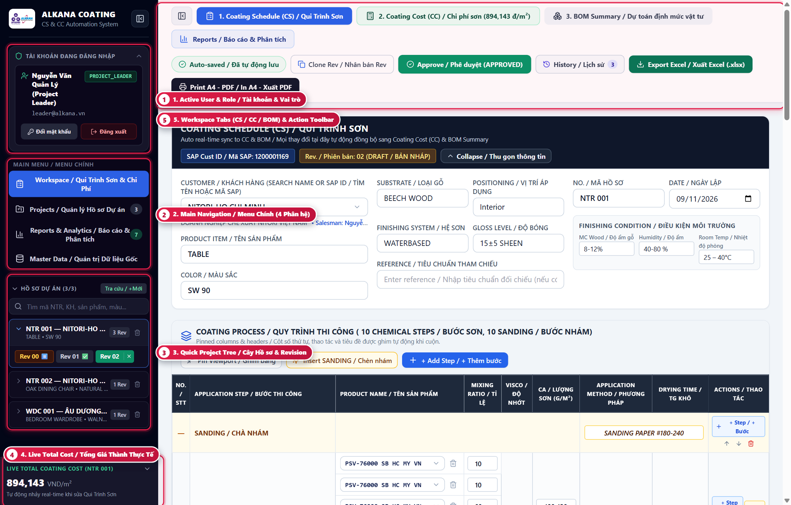
**Figure 1.2 — Main Workspace Overview & Collapsible Left Sidebar**  
*Hình 1.2 — Tổng quan Không gian Làm việc Chính & Thanh Menu Trái Thu gọn được*

#### Step-by-Step Instructions / *Hướng dẫn Thao tác Từng bước*

- **① Active Account & RBAC Card:** Displays your Full Name, Role Badge (e.g., PROJECT_LEADER), Assigned Salesman scope (if applicable), Change Password button, and Sign Out button.  
  *① Thẻ Tài khoản & Vai trò Đang đăng nhập: Hiển thị Họ tên, Nhãn vai trò (Role), Tên Sales phụ trách (nếu có), nút Đổi mật khẩu và nút Đăng xuất.*
- **② Main Navigation Menu (4 Core Modules):** Switch between: (1) Workspace (CS/CC/BOM), (2) Projects Explorer, (3) Reports & Analytics (7 Tabs), and (4) Master Data.  
  *② Menu Điều hướng Chính (4 Phân hệ Cốt lõi): Chuyển đổi giữa 4 phân hệ: (1) Workspace (Qui Trình Sơn & Chi Phí), (2) Projects (Quản lý Hồ sơ Dự án), (3) Reports & Analytics (7 Báo cáo), và (4) Master Data (Dữ liệu Gốc).*
- **③ Quick Project & Revision Accordion Tree:** Type a project code (e.g., NTR 001), customer name, or color to filter immediately. Click any Rev pill (Rev 00, Rev 01, Rev 02) to load it into the Workspace.  
  *③ Cây Tra cứu Nhanh Hồ sơ Dự án & Phiên bản (Revision): Nhập mã dự án (VD: NTR 001), tên khách hàng hoặc màu sơn để lọc tức thì. Nhấn vào thẻ phiên bản (Rev 00, Rev 01, Rev 02) để mở ngay trên màn hình làm việc.*
- **④ Live Total Coating Cost Footer (VND/m²):** Continuously recalculates and displays the exact Total Coating Cost (VND/m²) as you edit steps in the Coating Schedule.  
  *④ Khung Tổng Chi phí Sơn Thời gian Thực (VND/m²): Tự động tính toán và nhảy số Tổng chi phí sơn (VND/m²) ngay lập tức mỗi khi bạn thay đổi thông số bên bảng Qui Trình Sơn.*
- **⑤ Top Workspace Sub-Tabs & Global Action Bar:** Switch between Tab 1 (CS), Tab 2 (CC), and Tab 3 (BOM), or execute actions: Auto-Save Flush, Clone Revision, Approve/Status Change, Status History, Export Excel (.xlsx), and Print A4/PDF.  
  *⑤ Thanh Tab Làm việc (CS / CC / BOM) & Công cụ Tác vụ Hồ sơ: Chuyển giữa 3 Tab (1. CS, 2. CC, 3. BOM) và thực hiện các lệnh: Lưu đồng bộ, Nhân bản Revision, Phê duyệt trạng thái, Xem lịch sử, Xuất Excel (.xlsx) và In A4/PDF.*

---

### 1.3. Account Profile & Self-Service Password Update
*1.3. Thông tin Tài khoản & Đổi Mật khẩu Cá nhân*

> **Applicable Roles / *Vai trò áp dụng*:** `ALL ROLES`  
> **Objective:** Inspect your active session permissions and update your personal password at any time.  
> *Mục tiêu: Kiểm tra chi tiết quyền hạn tài khoản hiện tại và chủ động đổi mật khẩu bảo mật cá nhân.*

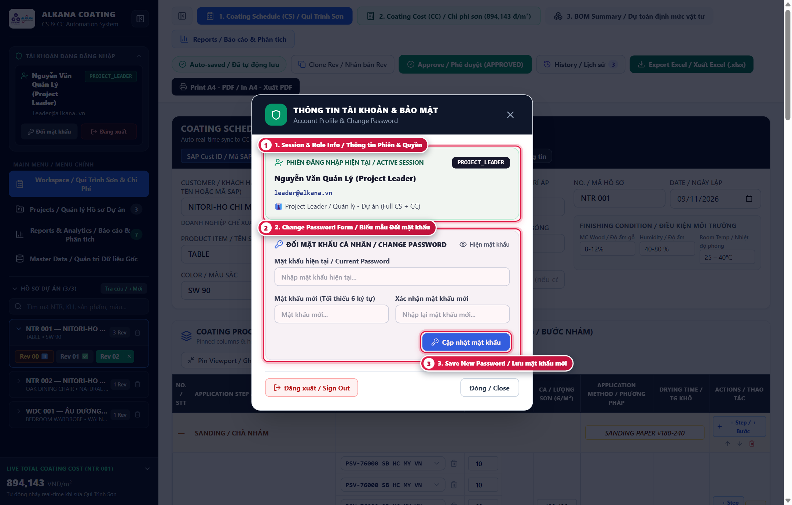
**Figure 1.3 — Account Profile & Change Password Dialog**  
*Hình 1.3 — Hộp thoại Thông tin Tài khoản & Đổi Mật khẩu Cá nhân*

#### Step-by-Step Instructions / *Hướng dẫn Thao tác Từng bước*

- **① Review Active Session & Role Scope:** Click "Đổi mật khẩu" on the left sidebar to open the profile dialog and verify your assigned Role and Salesman scope.  
  *① Kiểm tra Thông tin Phiên & Phạm vi Phân quyền: Nhấn nút "Đổi mật khẩu" ở thanh menu trái để mở hộp thoại kiểm tra Vai trò (Role) và Salesman phụ trách.*
- **② Fill Current & New Password (minimum 6 characters):** Enter your Current Password, New Password, and Confirm New Password.  
  *② Nhập Mật khẩu Hiện tại & Mật khẩu Mới (tối thiểu 6 ký tự): Nhập đầy đủ Mật khẩu hiện tại, Mật khẩu mới (tối thiểu 6 ký tự) và Nhập lại mật khẩu mới.*
- **③ Click Update Password (Cập nhật mật khẩu):** Click "Cập nhật mật khẩu" to save immediately without losing your current work in the Workspace.  
  *③ Nhấn nút Cập nhật Mật khẩu: Nhấn "Cập nhật mật khẩu" để lưu thay đổi ngay lập tức mà không làm gián đoạn công việc đang mở.*

---

## CHAPTER 2: PROJECT EXPLORER & REVISION LIFECYCLE MANAGEMENT
*CHƯƠNG 2: QUẢN LÝ HỒ SƠ DỰ ÁN & VÒNG ĐỜI PHIÊN BẢN (REVISION)*

Search existing coating projects, initialize new customer projects (Rev 00), clone revisions, and govern status transitions (DRAFT, APPROVED, INACTIVE) with full audit trails.  
*Tra cứu danh mục dự án sơn, khởi tạo dự án mới (Rev 00), nhân bản phiên bản và kiểm soát chặt chẽ vòng đời trạng thái (DRAFT, APPROVED, INACTIVE) kèm lịch sử kiểm toán.*

### 2.1. Searching & Filtering Projects in Project Explorer
*2.1. Tra cứu & Lọc Hồ sơ trong Quản lý Dự án (Projects Explorer)*

> **Applicable Roles / *Vai trò áp dụng*:** `ALL ROLES`  
> **Objective:** Locate any project or revision across customers and filter by approval status.  
> *Mục tiêu: Tìm kiếm nhanh hồ sơ dự án theo khách hàng, mã dự án, sản phẩm, màu sắc hoặc lọc theo trạng thái phê duyệt.*

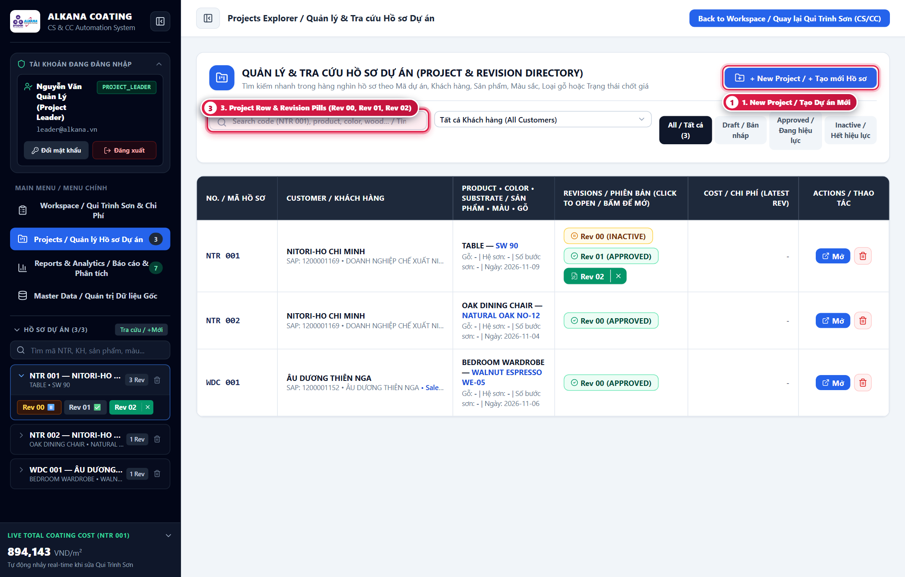
**Figure 2.1 — Projects Explorer & Multi-Revision Cards**  
*Hình 2.1 — Màn hình Quản lý Hồ sơ Dự án & Danh sách Phiên bản*

#### Step-by-Step Instructions / *Hướng dẫn Thao tác Từng bước*

- **① Click Create New Project (+ Tạo Hồ Sơ Dự Án Mới):** Click the top-right button whenever you need to start a brand-new project code (initializes Rev 00).  
  *① Nhấn nút + Tạo Hồ Sơ Dự Án Mới: Nhấn nút "+ Tạo Hồ Sơ Dự Án Mới" ở góc phải trên cùng khi cần tạo một mã dự án hoàn toàn mới (khởi tạo từ Rev 00).*
- **② Filter by Keyword, Customer & Revision Status:** Use the search box, Customer searchable dropdown, or Status pills (ALL / DRAFT / APPROVED / INACTIVE) to narrow down projects.  
  *② Lọc theo Từ khóa, Khách hàng & Trạng thái Phiên bản: Sử dụng ô tìm kiếm từ khóa, hộp chọn Khách hàng hoặc các nút lọc trạng thái (ALL / DRAFT / APPROVED / INACTIVE) để thu hẹp danh sách.*
- **③ Select Any Revision Pill to Open in Workspace:** Each project card lists all its revisions (Rev 00, Rev 01, Rev 02...) with status badges (✅ APPROVED, ⏸️ INACTIVE, 📝 DRAFT). Click any revision to open its Coating Schedule.  
  *③ Nhấn vào Thẻ Revision để Mở trong Không gian Làm việc: Mỗi thẻ dự án hiển thị đầy đủ lịch sử phiên bản (Rev 00, Rev 01, Rev 02...) kèm biểu tượng trạng thái. Nhấn vào phiên bản bất kỳ để mở ngay bảng Qui Trình Sơn.*

---

### 2.2. Creating a New Coating Project (Initializing Rev 00)
*2.2. Khởi tạo Hồ sơ Dự án Sơn Mới (Tạo Phiên bản Gốc Rev 00)*

> **Applicable Roles / *Vai trò áp dụng*:** `TECHNICAL` | `SALES` | `PROJECT_LEADER` | `ADMIN`  
> **Objective:** Register a new project with core customer and substrate metadata to generate an initial empty Draft schedule (Rev 00).  
> *Mục tiêu: Đăng ký mã dự án mới cùng thông tin khách hàng và chất liệu nền để hệ thống khởi tạo bảng Qui Trình Sơn bản nháp đầu tiên (Rev 00).*

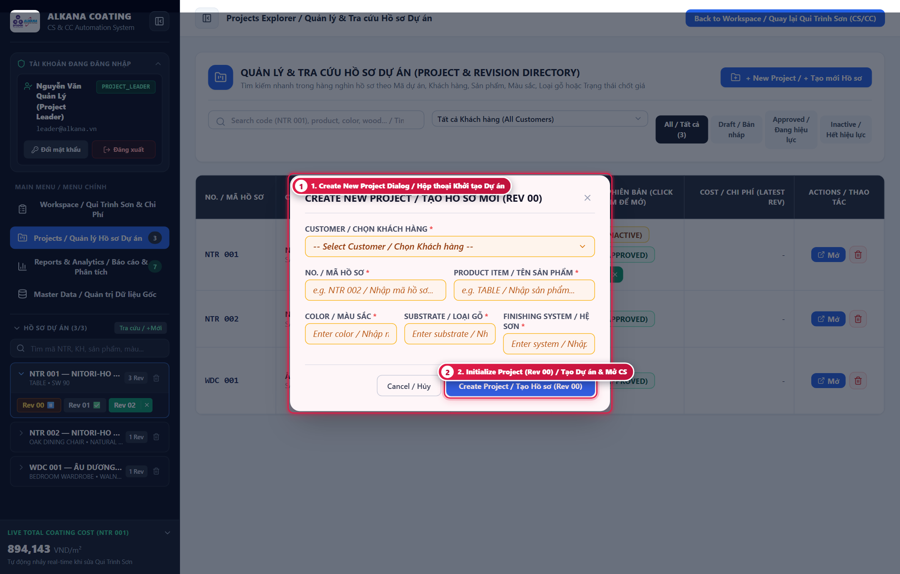
**Figure 2.2 — Create New Project Modal Dialog**  
*Hình 2.2 — Hộp thoại Khởi tạo Hồ sơ Dự án Mới*

#### Step-by-Step Instructions / *Hướng dẫn Thao tác Từng bước*

- **① Complete Required Project Identification Fields:** Enter the Project Code (e.g., NTR 002), select the Customer from the searchable dropdown, and fill in Product Name, Color Name, Substrate, and Finishing System.  
  *① Điền Đầy đủ Thông tin Định danh Dự án Bắt buộc: Nhập Mã dự án (VD: NTR 002), chọn Khách hàng từ danh sách tìm kiếm, và nhập Tên sản phẩm, Tên màu, Loại gỗ/Chất liệu nền, Hệ sơn.*
- **② Click Initialize Project (Tạo Dự Án & Mở Qui Trình Sơn):** Click submit. The system creates the project with Rev 00 (DRAFT) and opens the Coating Schedule editor immediately.  
  *② Nhấn nút Tạo Dự Án & Mở Qui Trình Sơn: Nhấn nút xác nhận. Hệ thống lập tức tạo hồ sơ Rev 00 ở trạng thái Bản nháp (DRAFT) và chuyển thẳng vào màn hình lập Qui Trình Sơn.*

---

### 2.3. Approving Revisions, Auto-Supersede & Mandatory Audit Reason
*2.3. Phê duyệt Phiên bản (APPROVED), Tự động Thay thế & Lý do Bắt buộc*

> **Applicable Roles / *Vai trò áp dụng*:** `PROJECT_LEADER` | `ADMIN`  
> **Objective:** Lock a verified schedule as APPROVED for production, or transition between APPROVED, INACTIVE, and DRAFT with mandatory audit notes.  
> *Mục tiêu: Chốt khóa hồ sơ đã duyệt sang trạng thái APPROVED để đưa vào sản xuất, hoặc chuyển đổi giữa APPROVED, INACTIVE và DRAFT kèm lý do kiểm toán bắt buộc.*

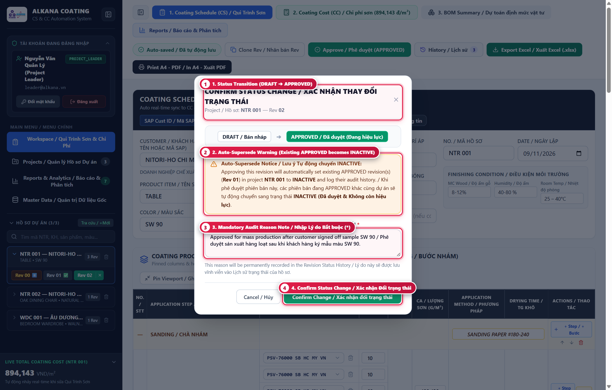
**Figure 2.3 — Confirm Status Change & Auto-Supersede Notice**  
*Hình 2.3 — Hộp thoại Xác nhận Đổi Trạng thái & Cảnh báo Tự động Chuyển INACTIVE*

#### Step-by-Step Instructions / *Hướng dẫn Thao tác Từng bước*

- **① Verify Target Status Transition Banner:** Click "Approve / Phê duyệt (APPROVED)" (or "Set Inactive" / "Reopen Draft") on the top bar. Verify the transition path (e.g., DRAFT ➔ APPROVED).  
  *① Kiểm tra Biểu ngữ Chuyển đổi Trạng thái: Nhấn nút "Approve / Phê duyệt (APPROVED)" (hoặc "Set Inactive" / "Reopen Draft") trên thanh công cụ. Kiểm tra chiều chuyển trạng thái (VD: DRAFT ➔ APPROVED).*
- **② Review Auto-Supersede Warning (Single Active Approved Rule):** When approving a new revision (e.g., Rev 02), any previously APPROVED revision in the same project (e.g., Rev 01) is automatically set to INACTIVE so only one active approved schedule exists per project.  
  *② Lưu ý Cơ chế Tự động Chuyển INACTIVE (Quy tắc 1 Phiên bản Hiệu lực): Khi phê duyệt phiên bản mới (VD: Rev 02), phiên bản đang APPROVED trước đó của cùng dự án (VD: Rev 01) sẽ tự động chuyển sang INACTIVE để đảm bảo mỗi dự án chỉ có 1 bản hiệu lực duy nhất.*
- **③ Enter Mandatory Reason for Status Change (*):** Type a clear business or technical reason (required). The Confirm button remains disabled until a reason is provided.  
  *③ Nhập Lý do Thay đổi Trạng thái Bắt buộc (*): Nhập rõ lý do phê duyệt, ngưng hiệu lực hoặc mở lại bản nháp (bắt buộc). Nút Xác nhận chỉ bật lên khi đã nhập lý do.*
- **④ Click Confirm Change (Xác nhận đổi trạng thái):** Click Confirm. Approved and Inactive revisions are locked against accidental edits.  
  *④ Nhấn nút Xác nhận Đổi trạng thái: Nhấn xác nhận. Các phiên bản ở trạng thái APPROVED và INACTIVE sẽ tự động khóa (Read-only) để bảo vệ dữ liệu lịch sử.*

---

### 2.4. Inspecting the Revision Status Audit History Timeline
*2.4. Tra cứu Dòng thời gian Lịch sử Thay đổi Trạng thái (Audit History)*

> **Applicable Roles / *Vai trò áp dụng*:** `ALL ROLES`  
> **Objective:** Track who approved, reopened, or superseded a revision, when it happened, and the exact reason recorded.  
> *Mục tiêu: Theo dõi minh bạch ai đã phê duyệt, mở lại bản nháp hoặc thay thế phiên bản vào thời điểm nào cùng lý do chi tiết.*

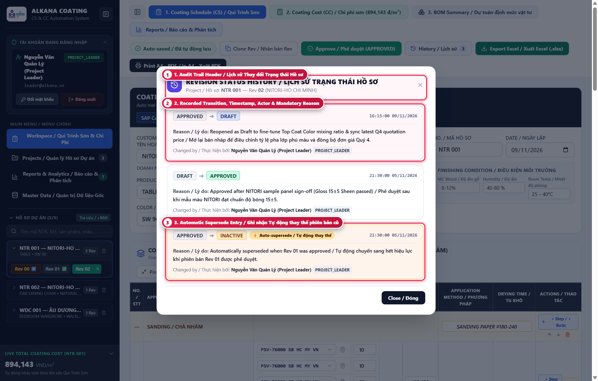
**Figure 2.4 — Revision Status History Timeline Modal**  
*Hình 2.4 — Hộp thoại Lịch sử Thay đổi Trạng thái Hồ sơ*

#### Step-by-Step Instructions / *Hướng dẫn Thao tác Từng bước*

- **① Click History / Lịch sử on the Top Action Bar:** Click the "History / Lịch sử" button (shows a badge count of recorded transitions) from any open revision.  
  *① Nhấn nút History / Lịch sử trên Thanh Công cụ Trên cùng: Nhấn nút "History / Lịch sử" (hiển thị số lượng bản ghi lịch sử) trên thanh công cụ của phiên bản đang mở.*
- **② Read Chronological Transition Cards & Audit Reasons:** Each card displays From Status ➔ To Status, exact timestamp, mandatory reason note, and the full name + role of the user who performed the action.  
  *② Xem Chi tiết Từng Bản ghi Chuyển Trạng thái & Lý do: Mỗi thẻ ghi rõ Trạng thái cũ ➔ Trạng thái mới, thời gian chính xác tới từng giây, lý do bắt buộc và họ tên + vai trò người thực hiện.*
- **③ Identify Auto-Supersede Events (⚡ Auto-supersede):** Entries marked with the amber "⚡ Auto-supersede" badge indicate revisions that were automatically retired when a newer revision was approved.  
  *③ Nhận diện Sự kiện Tự động Thay thế (⚡ Auto-supersede): Các bản ghi gắn nhãn màu vàng "⚡ Auto-supersede" cho biết phiên bản này đã tự động chuyển sang hết hiệu lực khi có phiên bản mới hơn được phê duyệt.*

---

## CHAPTER 3: COATING SCHEDULE (CS) DYNAMIC EDITOR & SMART AUTO-SAVE
*CHƯƠNG 3: LẬP QUI TRÌNH SƠN (CS) ĐỘNG & CƠ CHẾ TỰ ĐỘNG LƯU*

Enter project header specifications, build multi-step coating processes with interleaved sanding rows, configure mixing ratios and CA (g/m²) ranges, and use smart viewport and price-sync tools.  
*Nhập thông tin chung của hồ sơ, xây dựng bảng quy trình sơn đa công đoạn xen kẽ bước chà nhám, thiết lập tỷ lệ pha và khoảng định mức CA (g/m²), cùng công cụ ghim bảng và đồng bộ đơn giá.*

### 3.1. Editing Project Header, Environmental Conditions & Signatories
*3.1. Nhập Thông tin Chung, Điều kiện Môi trường & Chữ ký Phê duyệt*

> **Applicable Roles / *Vai trò áp dụng*:** `TECHNICAL` | `SALES` | `PROJECT_LEADER` | `ADMIN`  
> **Objective:** Define customer, furniture item, substrate, environmental parameters, and the 4 signatory names that appear on official Excel and A4 printouts.  
> *Mục tiêu: Khai báo khách hàng, tên sản phẩm, loại gỗ, thông số môi trường xưởng và 4 đại diện ký duyệt sẽ xuất hiện trên bản in A4 và file Excel.*

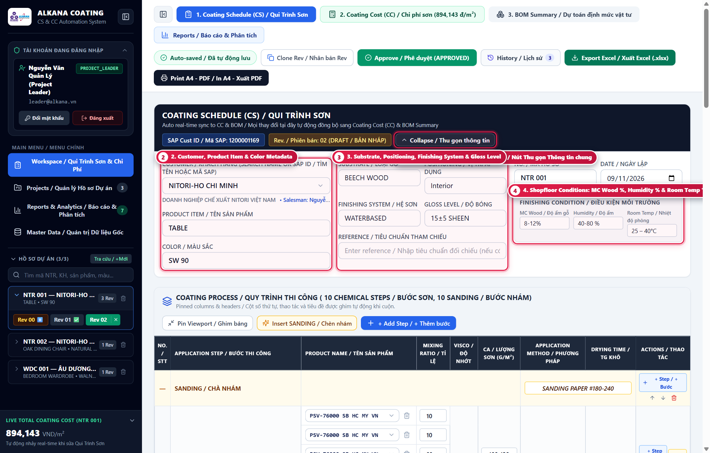
**Figure 3.1 — Coating Schedule (CS) Header & Technical Metadata**  
*Hình 3.1 — Khu vực Thông tin Chung & Điều kiện Kỹ thuật của Qui Trình Sơn (CS)*

#### Step-by-Step Instructions / *Hướng dẫn Thao tác Từng bước*

- **① Coating Schedule Banner & Header Collapse Control:** Shows the active Project Code, Revision Number, and Status. Click "Thu gọn Thông tin chung" anytime to maximize vertical space for the process table.  
  *① Thanh Tiêu đề CS & Nút Thu gọn Thông tin Chung: Hiển thị Mã dự án, Số Revision và Trạng thái. Nhấn "Thu gọn Thông tin chung" khi muốn mở rộng tối đa diện tích làm việc cho bảng quy trình bên dưới.*
- **② Select Customer & Core Product Specifications:** Select the Customer (filters available Quotation material codes automatically), then enter Project Code, Date, Product Name, Color Name, Substrate, Positioning, Finishing System, and Gloss Level.  
  *② Chọn Khách hàng & Thông số Kỹ thuật Sản phẩm: Chọn Khách hàng (hệ thống sẽ tự động lọc danh mục Mã vật tư báo giá của đúng khách hàng đó), sau đó điền Mã dự án, Ngày lập, Sản phẩm, Màu sắc, Chất liệu gỗ, Vị trí sử dụng, Hệ sơn và Độ bóng.*
- **③ Specify Shopfloor & Drying Conditions:** Enter Moisture Content of Wood (MC 8-12%), Room Humidity (40-80%), Room Temperature (25-40°C), Line Speed, Drying Condition, and Technical Remarks.  
  *③ Thiết lập Điều kiện Môi trường Xưởng & Chế độ Sấy: Nhập Độ ẩm gỗ (MC of Wood), Độ ẩm phòng, Nhiệt độ phòng, Tốc độ chuyền (Line Speed), Điều kiện sấy và Ghi chú kỹ thuật (Remark).*
- **④ Fill 4 Approval Signatory Names:** Enter names for Prepared by TA, Checked by Project Leader, Approved by PD/PM, and Customer Confirmation.  
  *④ Điền Tên 4 Đại diện Ký duyệt Hồ sơ: Nhập tên người lập (Prepared by TA), người kiểm tra (Project Leader), người duyệt (PD/PM) và xác nhận của Khách hàng (Customer).*

---

### 3.2. Building the Dynamic Process Table (Chemical Steps & Sanding Rows)
*3.2. Xây dựng Bảng Quy trình Sơn Động (Bước Hóa chất & Bước Chà nhám)*

> **Applicable Roles / *Vai trò áp dụng*:** `TECHNICAL` | `SALES` | `PROJECT_LEADER` | `ADMIN`  
> **Objective:** Add coating steps, interleave sanding specifications, combine multiple chemical components per step, and enter viscosity, CA (g/m²), and application methods.  
> *Mục tiêu: Thêm các bước thi công sơn, chèn xen kẽ hàng phụ chà nhám (SANDING), phối trộn nhiều mã hóa chất trong cùng 1 bước và nhập độ nhớt, định mức CA (g/m²), phương pháp thi công.*

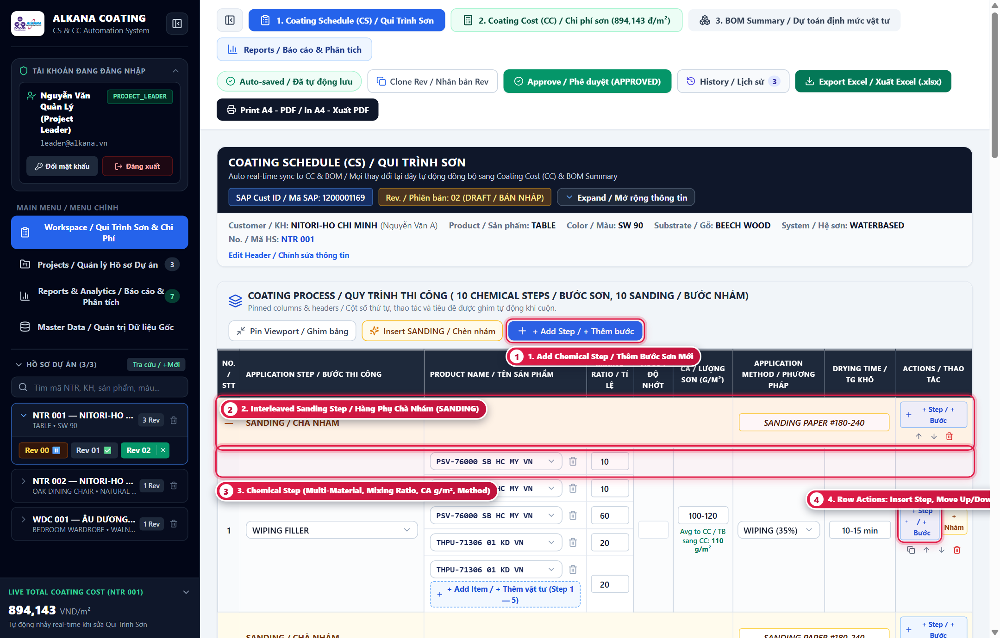
**Figure 3.2 — Coating Schedule Dynamic Process Table**  
*Hình 3.2 — Bảng Quy trình Thi công Sơn Động (Gộp dòng tự động theo Bước)*

#### Step-by-Step Instructions / *Hướng dẫn Thao tác Từng bước*

- **① Add Chemical Step (+ Thêm Bước Sơn) or Sanding Row (+ Chèn Bước Chà Nhám):** Use the action buttons to append a numbered Coating Step (#1, #2...) or insert an unnumbered Sanding row (e.g., SANDING PAPER #180-240) between steps.  
  *① Thêm Bước Sơn Mới hoặc Chèn Bước Chà Nhám (SANDING): Sử dụng thanh nút bấm để thêm bước sơn có đánh số thứ tự (#1, #2...) hoặc chèn hàng phụ Chà nhám (VD: SANDING PAPER #180-240) xen kẽ giữa các bước.*
- **② Configure Interleaved Sanding Row (SANDING):** Enter the abrasive grit specification (e.g., SANDING PAPER #180-240 or #320) and optional step remarks. Sanding rows do not consume chemical cost.  
  *② Cấu hình Hàng phụ Chà nhám (SANDING): Nhập thông số giấy nhám (VD: SANDING PAPER #180-240 hoặc #320) và ghi chú nếu có. Hàng chà nhám không tính vào chi phí hóa chất.*
- **③ Select Application Step, Product Codes, Mixing Ratio, CA (g/m²) & Method:** Choose the Step Name (e.g., WIPING FILLER, SANDING SEALER, TOP COAT COLOR), select each Product Code from the customer quotation list, enter Mixing Ratio (e.g., 10 : 10 : 60 : 20 : 20), Viscosity, CA range (e.g., "100-120" automatically averages to 110 g/m²), Application Method (WIPING 35% or SPRAY 60%), and Drying Time.  
  *③ Chọn Tên Công đoạn, Mã Vật tư, Tỷ lệ pha, Định mức CA (g/m²) & Phương pháp: Chọn Tên bước thi công, chọn từng Mã vật tư (Product Code) từ báo giá khách hàng, nhập Tỷ lệ pha (Mixing Ratio), Độ nhớt (Visco), Định mức CA (nhập khoảng "100-120" hệ thống tự động lấy trung bình 110 g/m²), Phương pháp thi công (tự động ánh xạ hiệu suất 35% hoặc 60%) và Thời gian khô.*
- **④ Add Multiple Chemical Items Within a Step (+ Thêm mã vật tư):** Click "+ Thêm mã vật tư" inside any step to add hardeners, thinners, or colorants. Shared step columns (Step #, Step Name, Visco, CA, Method, Drying Time) merge automatically via dynamic rowSpan.  
  *④ Chèn Thêm Nhiều Mã Hóa chất vào Cùng Một Bước (+ Thêm mã vật tư): Nhấn "+ Thêm mã vật tư" ngay trong bước đó để thêm chất đóng rắn, dung môi hoặc tinh màu. Các cột chung của bước sẽ tự động gộp ô (rowSpan) chuẩn xác.*

---

### 3.3. Smart Auto-Save, Viewport Pinning, Revision Cloning & Price Sync
*3.3. Tự động Lưu Thông minh (Auto-Save), Ghim Khung Bảng, Nhân bản & Đồng bộ Giá*

> **Applicable Roles / *Vai trò áp dụng*:** `TECHNICAL` | `SALES` | `PROJECT_LEADER` | `ADMIN`  
> **Objective:** Ensure zero data loss with real-time hybrid auto-save, lock the table scroll area on large schedules, clone revisions, and refresh material prices from Master Quotations.  
> *Mục tiêu: Đảm bảo không bao giờ mất dữ liệu nhờ cơ chế tự động lưu lai ghép, ghim cố định khung cuộn bảng khi quy trình dài, nhân bản Revision và cập nhật đơn giá mới nhất từ Master Data.*

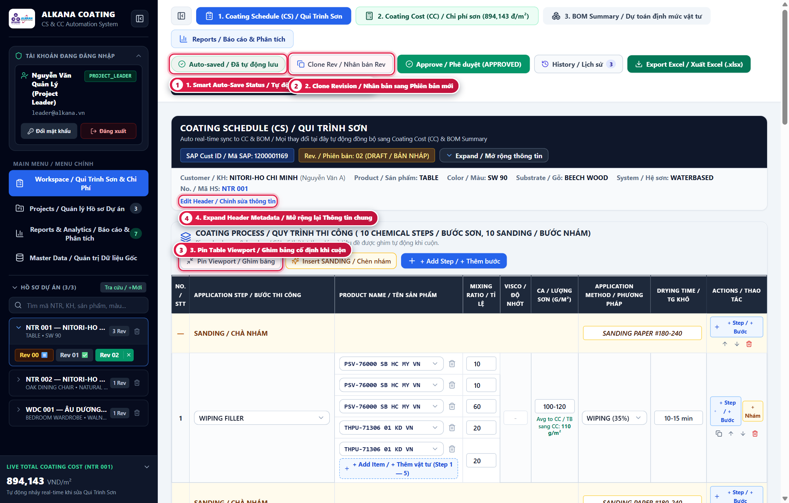
**Figure 3.3 — Smart Auto-Save Status, Clone Revision & Price Sync Controls**  
*Hình 3.3 — Trạng thái Tự động Lưu, Nhân bản Revision & Đồng bộ Đơn giá Mới nhất*

#### Step-by-Step Instructions / *Hướng dẫn Thao tác Từng bước*

- **① Monitor Smart Auto-Save Indicator (Auto-saved / Ctrl+S):** Discrete actions (adding/deleting steps or selecting dropdowns) save in ~250ms; typing saves after ~900ms idle. Press Ctrl+S or click the pill to flush immediately.  
  *① Theo dõi Trạng thái Tự động Lưu Thông minh (Auto-saved / Ctrl+S): Các thao tác chọn/thêm/xóa bước được lưu tự động sau ~250ms; thao tác gõ phím lưu sau ~900ms nghỉ tay. Có thể nhấn Ctrl+S hoặc bấm trực tiếp vào nút trạng thái để lưu tức thì.*
- **② Clone Revision (Clone Rev / Nhân bản Rev):** Click "Clone Rev / Nhân bản Rev" to duplicate all steps of the current schedule into a new Draft revision (e.g., Rev 02 ➔ Rev 03) with refreshed quotation prices.  
  *② Nhân bản Phiên bản Mới (Clone Rev / Nhân bản Rev): Nhấn "Clone Rev / Nhân bản Rev" để sao chép toàn bộ quy trình hiện tại sang một phiên bản nháp mới (VD: Rev 02 ➔ Rev 03) đồng thời cập nhật đơn giá mới nhất.*
- **③ Toggle Header Collapse & Pin Table Viewport:** Use "Mở rộng/Thu gọn Thông tin chung" and "Ghim khung cuộn bảng" together with the synchronized top/bottom horizontal scrollbars to navigate wide schedules effortlessly.  
  *③ Bật/Tắt Thu gọn Header & Ghim Khung Cuộn Bảng: Kết hợp nút "Mở rộng/Thu gọn Thông tin chung", "Ghim khung cuộn bảng" và thanh cuộn ngang đồng bộ trên/dưới để thao tác mượt mà với các quy trình nhiều bước.*
- **④ Sync Latest Quotation Prices (Đồng bộ Đơn giá mới nhất):** On any DRAFT revision, click "Đồng bộ Đơn giá" to pull the latest VND/kg prices from the Master Quotation table into all steps of the active revision.  
  *④ Đồng bộ Đơn giá Báo giá Mới nhất (Sync Latest Prices): Khi hồ sơ đang ở trạng thái DRAFT, nhấn nút "Đồng bộ Đơn giá" để cập nhật toàn bộ đơn giá vật tư trong quy trình theo bảng Master Quotation mới nhất.*

---

## CHAPTER 4: REAL-TIME COATING COST (CC), RBAC REDACTION & BOM SUMMARY
*CHƯƠNG 4: BẢNG TÍNH CHI PHÍ SƠN (CC), ẨN GIÁ KỸ THUẬT & DỰ TOÁN VẬT TƯ (BOM)*

Review the 100% automated read-only Coating Cost calculation, understand IEEE-754 full-precision formulas, verify Technical RBAC price redaction, and estimate material drums in BOM Summary.  
*Kiểm tra bảng tính Chi phí Sơn (CC) tự động hóa 100% ở chế độ chỉ xem, nắm rõ công thức tính chính xác tuyệt đối, cơ chế ẩn giá đối với Kỹ thuật viên và dự toán số lượng thùng sơn cần đặt tại BOM Summary.*

### 4.1. Reading the Automated Coating Cost (CC) Table
*4.1. Cách đọc Bảng Tính Toán Chi Phí Sơn Tự động (Coating Cost - CC)*

> **Applicable Roles / *Vai trò áp dụng*:** `SALES` | `PROJECT_LEADER` | `ADMIN`  
> **Objective:** Inspect step-by-step and item-by-item cost calculations without manual formula entry.  
> *Mục tiêu: Xem chi tiết đơn giá, độ phủ và giá thành sơn (VND/m²) của từng hóa chất và từng công đoạn được tính tự động hoàn toàn từ bảng CS.*

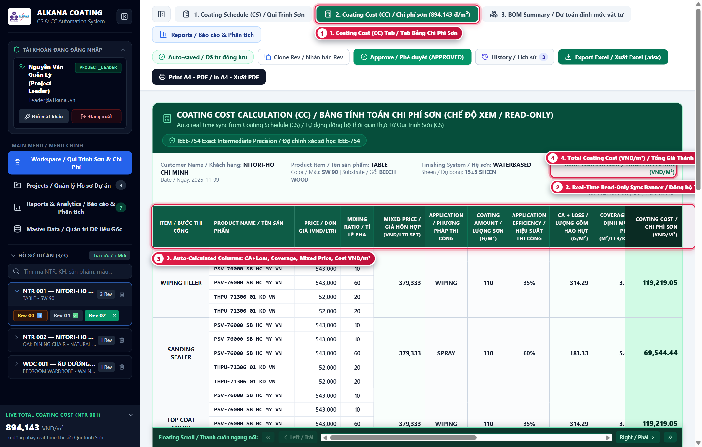
**Figure 4.1 — Coating Cost (CC) Read-Only Real-Time Calculation Table**  
*Hình 4.1 — Màn hình Bảng Tính Toán Chi Phí Sơn (CC) Tự động Thời gian Thực*

#### Step-by-Step Instructions / *Hướng dẫn Thao tác Từng bước*

- **① Switch to Tab 2: Coating Cost (CC):** Click Tab "2. Coating Cost (CC)" on the top bar. The tab badge displays the live Total Coating Cost (e.g., 891,825 đ/m²).  
  *① Chuyển sang Tab 2: Coating Cost (CC) / Chi phí sơn: Nhấn vào Tab "2. Coating Cost (CC)" trên thanh công cụ. Nhãn tab luôn hiển thị sẵn Tổng chi phí sơn hiện tại (VD: 891,825 đ/m²).*
- **② Verify Read-Only Real-Time Synchronization:** The CC table is strictly Read-Only to prevent manual formula tampering. Every edit in CS updates CC instantaneously.  
  *② Cơ chế Đồng bộ Tự động Chế độ Chỉ xem (Read-Only): Bảng CC được khóa ở chế độ Chỉ xem (Read-Only) nhằm ngăn chặn sai lệch công thức thủ công. Mọi thay đổi bên tab CS đều tự động cập nhật sang CC tức thì.*
- **③ Inspect Consumption, Coverage & Mixed Price Columns:** Review Price (VND/kg), Mixing Ratio, Mixed Price, CA (g/m²), Application Efficiency (%), CA + Loss (g/m²), Coverage (m²/kg), and Coating Cost (VND/m²).  
  *③ Kiểm tra Các Cột Định mức Tiêu hao, Độ phủ (Coverage) & Giá Hỗn hợp (Mixed Price): Đối chiếu các cột: Đơn giá gốc (Price), Tỷ lệ pha, Giá hỗn hợp (Mixed Price), Định mức CA, Hiệu suất thu hồi (%), Lượng tiêu hao gồm hao hụt (CA + Loss), Độ phủ (Coverage m²/kg) và Chi phí công đoạn (Coating Cost VND/m²).*
- **④ Check Grand Total Coating Cost (VND/m²):** The bottom footer sums all chemical steps using full 64-bit IEEE-754 intermediate precision before final display rounding.  
  *④ Kiểm tra Dòng Tổng Chi Phí Sơn Toàn Quy trình (Total Coating Cost VND/m²): Dòng tổng cộng cuối bảng cộng dồn toàn bộ các bước hóa chất với độ chính xác số thực 64-bit tuyệt đối trước khi làm tròn hiển thị.*

| **Metric / Column** *Chỉ số / Cột tính toán* | **Exact Mathematical Formula** *Công thức Toán học Chính xác* | **Business Meaning** *Ý nghĩa Nghiệp vụ* |
| :--- | :--- | :--- |
| CA Average (g/m²) *Định mức CA trung bình (g/m²)* | (CA_min + CA_max) / 2 * Trung bình cộng khoảng định mức (VD: "100-120" ➔ 110 g/m²)* | Target wet film application weight per m² *Lượng sơn tiêu chuẩn phủ trên 1 m² bề mặt* |
| Item CA + Loss (g/m²) *Lượng sơn từng mã gồm hao hụt (g/m²)* | [CA_step × (Ratio_i / ΣRatio)] / Efficiency *[CA bước × (Tỷ lệ mã i / Tổng tỷ lệ bước)] / Hiệu suất (%)* | Actual paint required after spray/wiping loss *Lượng sơn thực tế cần xuất kho sau khi tính hao hụt* |
| Step Coverage (m²/kg) *Độ phủ công đoạn (m²/kg)* | 1000 / Step_CA_Plus_Loss *1000 / Tổng (CA + Loss) của bước* | Square meters coated per 1 kg of mixed paint *Số m² bề mặt sơn được với 1 kg hỗn hợp pha* |
| Mixed Price (VND/kg) *Đơn giá hỗn hợp pha (VND/kg)* | Σ(Price_i × Ratio_i) / ΣRatio *Tổng tích (Đơn giá × Tỷ lệ pha) / Tổng tỷ lệ pha* | Weighted average price of 1 kg of mixed paint *Đơn giá bình quân gia quyền của 1 kg hỗn hợp sơn* |
| Step Coating Cost (VND/m²) *Chi phí sơn công đoạn (VND/m²)* | Mixed_Price / Step_Coverage *Đơn giá hỗn hợp / Độ phủ công đoạn* | Exact coating cost per m² for that step *Chi phí sơn trên 1 m² của công đoạn đó* |

---

### 4.2. Technical Role (TECHNICAL) Automatic Price Redaction
*4.2. Chế độ Bảo mật Tự động Ẩn Đơn giá đối với Kỹ thuật viên (TECHNICAL)*

> **Applicable Roles / *Vai trò áp dụng*:** `TECHNICAL`  
> **Objective:** Protect commercial pricing confidentiality while allowing Technical Application (TA) staff full access to technical specifications and material quantities.  
> *Mục tiêu: Bảo mật tuyệt đối đơn giá thương mại nhưng vẫn đảm bảo Kỹ thuật viên (TA) thao tác đầy đủ thông số kỹ thuật và định mức khối lượng.*

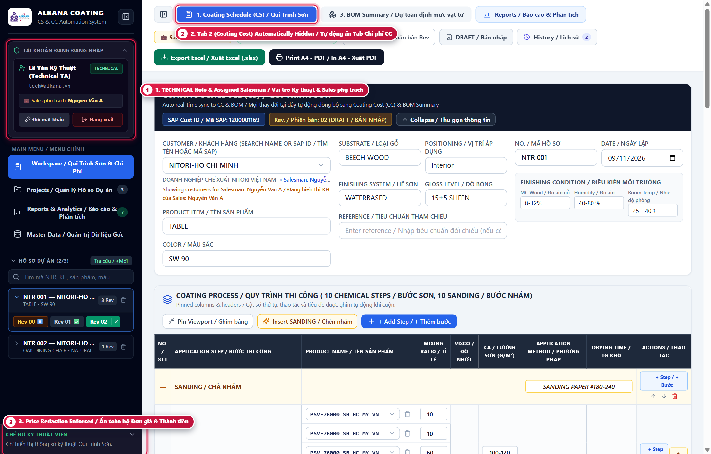
**Figure 4.2 — Workspace View under TECHNICAL Role (Prices & CC Tab Redacted)**  
*Hình 4.2 — Giao diện Làm việc của Vai trò TECHNICAL (Tự động Ẩn Tab CC & Đơn giá)*

#### Step-by-Step Instructions / *Hướng dẫn Thao tác Từng bước*

- **① Verify TECHNICAL Role Badge & Assigned Salesman Scope:** When signed in as TECHNICAL (e.g., tech@alkana.vn), the sidebar displays the TECHNICAL badge and restricts visible projects to the assigned Salesman.  
  *① Nhận diện Nhãn Vai trò TECHNICAL & Phạm vi Sales Phụ trách: Khi đăng nhập bằng tài khoản TECHNICAL (VD: tech@alkana.vn), thanh bên trái hiển thị nhãn TECHNICAL và chỉ hiển thị các khách hàng/dự án thuộc Salesman được phân công.*
- **② Coating Cost (CC) Tab is Automatically Hidden:** Only Tab 1 (Coating Schedule) and Tab 3 (BOM Summary quantities without prices) are accessible.  
  *② Tab 2 (Coating Cost - CC) Tự động Ẩn khỏi Thanh Công cụ: Thanh công cụ phía trên chỉ hiển thị Tab 1 (Coating Schedule) và Tab 3 (BOM Summary chỉ hiện số Kg/Thùng, ẩn cột giá).*
- **③ Backend API Redacts All Price Fields to Zero/Null:** Both the UI footer and backend API responses strip out unit prices and total VND figures so commercial data cannot be inspected even via browser developer tools.  
  *③ Tầng Backend Tự động Xóa Ẩn Toàn bộ Trường Đơn giá: Cả giao diện lẫn dữ liệu trả về từ API Backend đều tự động lọc bỏ đơn giá và thành tiền, đảm bảo an toàn bảo mật tuyệt đối.*

---

### 4.3. Estimating Material Quantities & Packaging in BOM Summary
*4.3. Dự toán Khối lượng Sơn & Số Thùng Đặt hàng tại BOM Summary*

> **Applicable Roles / *Vai trò áp dụng*:** `ALL ROLES`  
> **Objective:** Aggregate identical material codes across all coating steps and calculate exact Kg/Ltr and drum/packing counts for any production area (m²).  
> *Mục tiêu: Tự động gom nhóm các mã hóa chất trùng nhau xuất hiện ở nhiều bước thi công và tính tổng số Kg/Lít cùng số thùng (Packing) cần đặt hàng theo diện tích dự án (m²).*

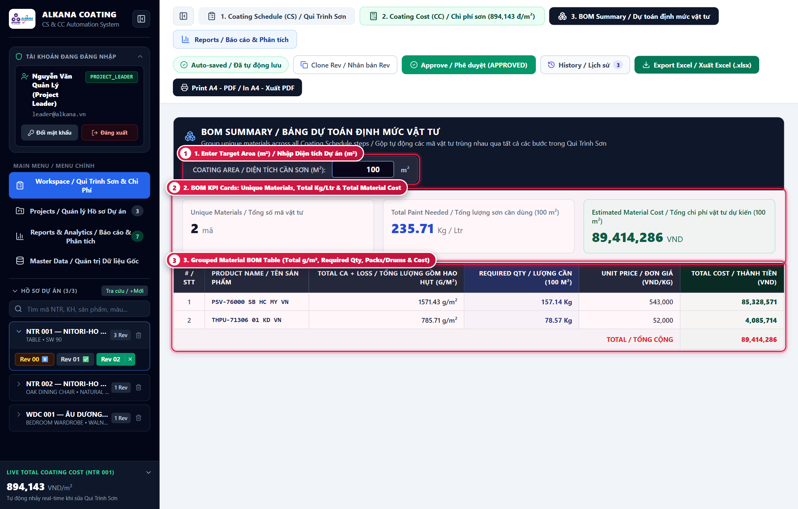
**Figure 4.3 — BOM Summary & Packaging Estimator View**  
*Hình 4.3 — Màn hình Dự toán Định mức Vật tư & Quy đổi Số Thùng (BOM Summary)*

#### Step-by-Step Instructions / *Hướng dẫn Thao tác Từng bước*

- **① Enter Target Coating Area (m²):** Click Tab "3. BOM Summary" and type the required production area in m² (e.g., 100 m² or 500 m²) in the top-right input box.  
  *① Nhập Diện tích Cần Sơn của Dự án (Coating Area m²): Chuyển sang Tab "3. BOM Summary" và nhập tổng diện tích cần sơn (m²) vào ô "Coating Area / Diện tích cần sơn (m²)" ở góc phải trên.*
- **② Review Executive BOM KPI Cards:** Instantly view Total Unique Material Codes, Total Paint Required (Kg/Ltr), and Total Estimated Material Cost (VND — visible to Sales/Leader/Admin).  
  *② Xem 3 Thẻ Chỉ số Tổng hợp BOM: Theo dõi tức thì: Tổng số mã vật tư duy nhất, Tổng lượng sơn cần dùng (Kg/Ltr) và Tổng chi phí vật tư dự kiến (VND).*
- **③ Inspect Consolidated Material & Packing Table:** Each unique product code shows its summed Total CA + Loss (g/m²), Required Quantity (Kg/Ltr), Packing Specification, Nett Weight, and exact Full Packs Needed (rounded up) to place warehouse or purchasing orders.  
  *③ Kiểm tra Bảng Tổng hợp Định mức & Số Thùng Nguyên (Packs Required): Mỗi mã sơn hiển thị Tổng định mức thực tế g/m² (cộng gộp từ mọi bước sử dụng), Lượng cần dùng (Kg/Ltr), Quy cách đóng gói (Nett) và Số thùng nguyên cần đặt (làm tròn lên).*

---

## CHAPTER 5: LIVE-FORMULA EXCEL EXPORT & A4 LANDSCAPE PRINTING
*CHƯƠNG 5: XUẤT FILE EXCEL CÔNG THỨC SỐNG & IN BIỂU MẪU CHUẨN A4 NGANG*

Export native Excel workbooks (.xlsx) with embedded live formulas and dynamic merged cells, or print standardized A4 Landscape sheets with 4 signature blocks.  
*Xuất file Excel (.xlsx) giữ nguyên công thức tính toán sống và gộp ô tự động, hoặc in biểu mẫu chuẩn A4 ngang công nghiệp với 4 ô chữ ký xác nhận.*

### 5.1. A4 Landscape Print Preview, PDF Save & Excel Formula Export
*5.1. Xem trước Bản in Chuẩn A4 Ngang, Lưu PDF & Xuất Excel Công thức Sống*

> **Applicable Roles / *Vai trò áp dụng*:** `ALL ROLES`  
> **Objective:** Generate customer-ready A4 PDF documents or editable Excel files containing live SUMPRODUCT and coverage formulas.  
> *Mục tiêu: Tạo bản in A4/PDF chuẩn công nghiệp để trình ký khách hàng hoặc xuất file Excel (.xlsx) nhúng sẵn công thức sống.*

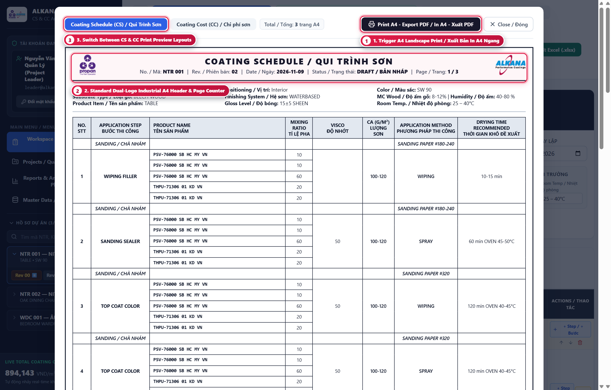
**Figure 5.1 — A4 Landscape Print & PDF Preview Dialog**  
*Hình 5.1 — Giao diện Xem trước Bản in Chuẩn A4 Ngang & Xuất PDF*

#### Step-by-Step Instructions / *Hướng dẫn Thao tác Từng bước*

- **① Switch Between CS and CC Print Modes & Click Print / Save PDF:** Click "Print A4 - PDF" on the top workspace toolbar. Inside the preview bar, toggle between "In Qui Trình Sơn (CS)" and "In Bảng Chi Phí (CC)", then click "In ngay / Lưu PDF (A4 Ngang)".  
  *① Chuyển Đổi Chế độ In (CS / CC) & Nhấn Nút In A4 / Lưu PDF: Nhấn nút "Print A4 - PDF" trên thanh công cụ. Tại thanh điều khiển phía trên, chọn chế độ "In Qui Trình Sơn (CS)" hoặc "In Bảng Chi Phí (CC)", sau đó nhấn "In ngay / Lưu PDF (A4 Ngang)".*
- **② Verify Dual-Brand Industrial Header & Multi-Page Pagination:** Long schedules automatically paginate across multiple A4 Landscape sheets without splitting multi-item steps mid-row, repeating the header on every page.  
  *② Kiểm tra Tiêu đề Logo Đôi (PROPAN & ALKANA) & Phân trang Tự động: Các quy trình dài được tự động ngắt trang A4 ngang thông minh (không cắt đứt ngang bước sơn) và lặp lại tiêu đề chuẩn trên từng trang (Page 1/2, 2/2).*
- **③ 4-Party Industrial Signatory Block & Live Excel Export:** The footer renders 4 signature boxes (CUSTOMER, PD/PM, TA, PROJECT LEADER). To export an editable spreadsheet with live formulas (SUMPRODUCT, Coverage, BOM), click "Export Excel / Xuất Excel (.xlsx)" on the Workspace top bar.  
  *③ Khung 4 Ô Chữ ký Phê duyệt & Nút Xuất Excel (.xlsx): Cuối biểu mẫu hiển thị chuẩn 4 ô chữ ký (CUSTOMER, PD/PM, TA, PROJECT LEADER). Để tải file bảng tính nhúng sẵn công thức Excel sống (SUMPRODUCT, Coverage, BOM), nhấn nút "Export Excel / Xuất Excel (.xlsx)" ngoài thanh công cụ chính.*

---

## CHAPTER 6: 7-TAB ANALYTICS & EXECUTIVE REPORTING CENTER
*CHƯƠNG 6: TRUNG TÂM 7 BÁO CÁO PHÂN TÍCH & THỐNG KÊ CHUYÊN SÂU*

Analyze product usage across revisions and steps, evaluate customer portfolios, compare revision cost variances, detect outdated quotation prices, benchmark steps, forecast multi-project BOM demand, and track team activity.  
*Phân tích tần suất sử dụng sản phẩm theo từng Revision & Step, đánh giá danh mục khách hàng, so sánh biến động chi phí giữa các Revision, phát hiện chênh lệch đơn giá báo giá, đối chuẩn công đoạn, dự báo tổng nhu cầu BOM đa dự án và theo dõi hiệu suất nhân sự.*

### 6.1. Report 1: Product Usage — On-Demand Selection & Step Breakdown
*6.1. Báo cáo 1: Phân tích Theo Sản phẩm Sơn — Gộp theo Revision & Sổ xuống Từng Step*

> **Applicable Roles / *Vai trò áp dụng*:** `ALL ROLES`  
> **Objective:** Select any paint product code on demand to see every project revision where it is used, its share of total revision cost, and expand down to individual coating steps.  
> *Mục tiêu: Chọn nhanh một mã sơn theo yêu cầu (On-Demand) để xem toàn bộ các Revision có sử dụng mã sơn đó, tỷ trọng chi phí của mã sơn trong Revision và bấm sổ xuống (Breakdown) chi tiết từng bước thi công.*

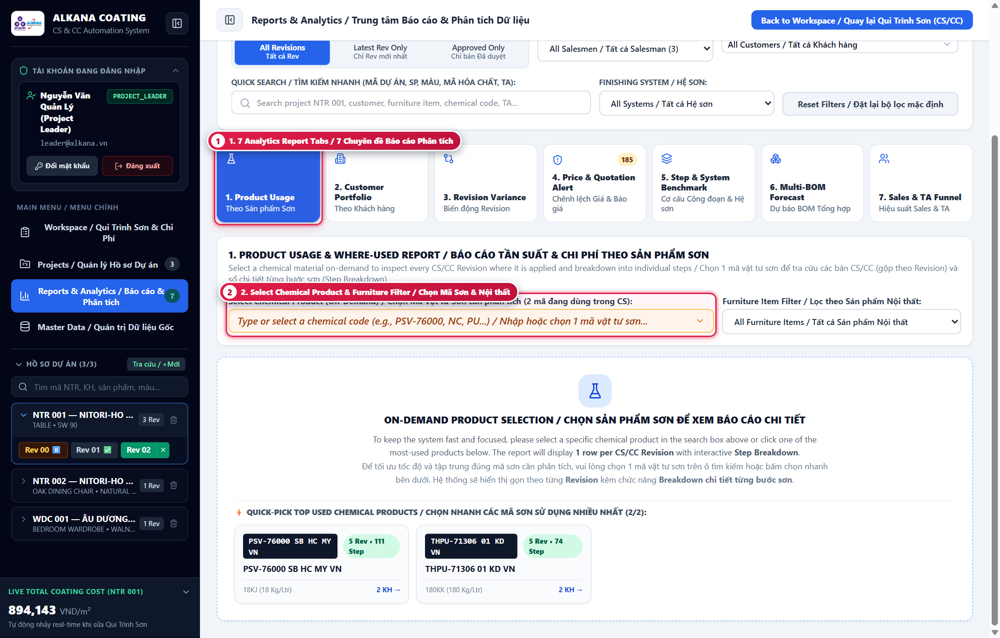
**Figure 6.1 — Report 1: Product Usage with Revision Rollup & Step Breakdown**  
*Hình 6.1 — Báo cáo 1: Thống kê Sử dụng Sản phẩm Sơn (Tổng hợp theo Revision & Breakdown xuống Step)*

#### Step-by-Step Instructions / *Hướng dẫn Thao tác Từng bước*

- **① Navigate the 7 Analytics Tabs & Global Filters:** Open "Reports & Analytics" from the left sidebar, select Tab "1. Product Usage", and filter by Revision Scope (ALL / LATEST / APPROVED), Salesman, Customer, or Finishing System.  
  *① Chọn Chuyên đề Báo cáo & Thiết lập Bộ lọc Toàn cục: Mở mục "Reports & Analytics" trên menu trái, chọn Tab "1. Product Usage" và tùy chỉnh bộ lọc Phạm vi Phiên bản (ALL / LATEST / APPROVED), Salesman, Khách hàng hoặc Hệ sơn.*
- **② Select a Material Code On-Demand & Export PivotTable-Ready Excel:** Pick a paint code from the searchable combobox or click a Quick-Pick Top Product chip. Click "Export Active Tab (.xlsx)" anytime to export the flat step-level Excel sheet for PivotTable analysis.  
  *② Chọn Mã Sơn Cần Phân tích & Xuất Excel Bảng Phẳng Phục vụ PivotTable: Chọn mã sơn từ hộp tìm kiếm hoặc bấm 1 chạm vào thẻ gợi ý mã sơn phổ biến (Quick-Pick). Nhấn "Export Active Tab (.xlsx)" để xuất bảng phẳng cấp Step phục vụ chạy PivotTable trên Excel.*
- **③ Read the Revision-Level Rollup Row (1 Row per Revision):** Each revision displays the count & numbers of steps using that product (e.g., "10 bước: #1..#10"), Total Item Consumption (Σ g/m²), Price Snapshot, Total Item Cost (Σ VND/m²), and % Share of Total Revision Cost.  
  *③ Xem Dòng Tổng hợp theo Từng Revision (1 Dòng / 1 Revision): Mỗi Revision hiển thị trên 1 dòng gọn gàng gồm: Số bước & vị trí bước sử dụng, Tổng định mức tiêu hao của mã sơn trong Revision (Σ g/m²), Đơn giá Snapshot, Tổng chi phí mã sơn (Σ VND/m²) và Tỷ trọng % trên Tổng giá thành Revision.*
- **④ Click Any Revision Row (or Expand All) for Step-Level Breakdown:** Clicking a revision row expands the nested Breakdown sub-table showing every step (#Step, Step Name, Application Method & Efficiency %, Mixing Ratio & Share %, Step g/m², and Step Cost VND/m²).  
  *④ Nhấn vào Dòng Revision (hoặc Mở rộng tất cả) để Xem Chi tiết Từng Step: Nhấn trực tiếp vào dòng Revision (hoặc nút "Mở rộng tất cả / Expand All") để sổ xuống bảng con liệt kê chi tiết từng bước thi công có dùng mã sơn đó (#Step, Tên bước, Phương pháp & Hiệu suất %, Tỷ lệ pha, Định mức g/m² và Chi phí VND/m²).*

---

### 6.2. Report 2: Customer Portfolio & Project Cost Range Analysis
*6.2. Báo cáo 2: Phân tích Danh mục Khách hàng & Biên độ Giá thành Dự án*

> **Applicable Roles / *Vai trò áp dụng*:** `ALL ROLES`  
> **Objective:** Summarize project volume, revision counts, finishing systems, and Min/Avg/Max coating cost per m² for each customer.  
> *Mục tiêu: Tổng hợp số lượng dự án, số phiên bản, các hệ sơn đang áp dụng và biên độ chi phí sơn (Thấp nhất / Trung bình / Cao nhất VND/m²) của từng khách hàng.*

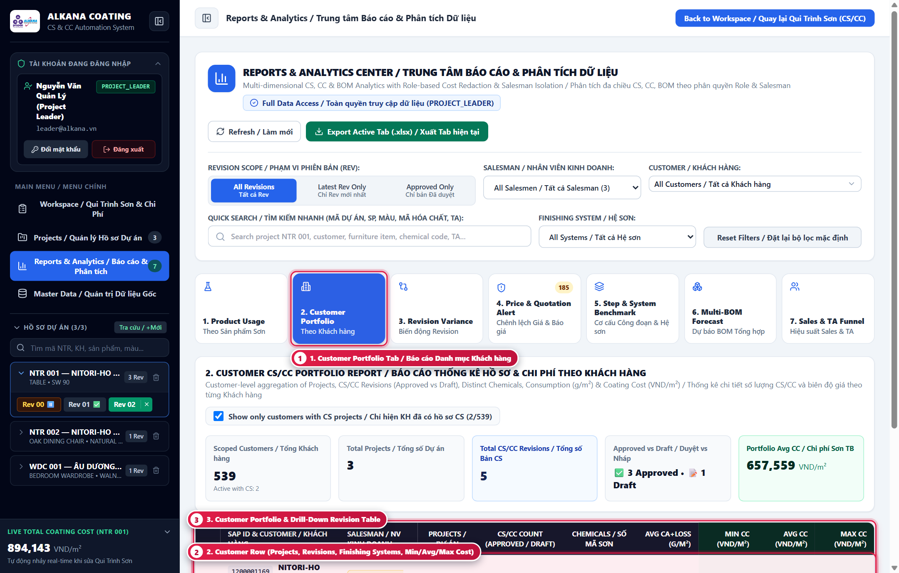
**Figure 6.2 — Report 2: Customer Portfolio & Drill-Down Revisions**  
*Hình 6.2 — Báo cáo 2: Danh mục Khách hàng & Bảng Chi tiết Hồ sơ Con*

#### Step-by-Step Instructions / *Hướng dẫn Thao tác Từng bước*

- **① Select Tab 2: Customer Portfolio (Theo Khách hàng):** Click Tab "2. Customer Portfolio" to view portfolio-wide KPIs and customer rankings.  
  *① Chọn Tab 2: Customer Portfolio (Theo Khách hàng): Nhấn vào Tab "2. Customer Portfolio" để xem các chỉ số tổng quan và bảng xếp hạng danh mục khách hàng.*
- **② Inspect Customer Summary Row (Projects, Systems & Cost Range):** Review total projects, approved/draft counts, finishing systems used, average consumption (g/m²), and Min / Avg / Max Cost (VND/m²).  
  *② Xem Dòng Tổng hợp Khách hàng (Số Dự án, Hệ sơn & Khoảng Giá thành): Đối chiếu tổng số dự án, số bản đã duyệt/bản nháp, các hệ sơn sử dụng, định mức tiêu hao bình quân (g/m²) và Chi phí Thấp nhất / Trung bình / Cao nhất (VND/m²).*
- **③ Expand Customer Row & Jump Directly to Workspace (Mở CS/CC):** Click a customer row to list all underlying project revisions, or click "Mở CS/CC" on any revision row to open it immediately in the Workspace.  
  *③ Mở rộng Dòng Khách hàng & Nhảy Trực tiếp sang Màn hình Làm việc (Mở CS/CC): Nhấn vào dòng khách hàng để sổ xuống danh sách tất cả các Revision của khách hàng đó, hoặc nhấn nút "Mở CS/CC" để mở thẳng hồ sơ trong Workspace.*

---

### 6.3. Report 3: Revision Cost Variance (Base vs. Target Revision Diff)
*6.3. Báo cáo 3: Phân tích Biến động Chi phí Giữa các Phiên bản (Revision Variance)*

> **Applicable Roles / *Vai trò áp dụng*:** `ALL ROLES`  
> **Objective:** Compare two revisions of the same project (e.g., Rev 00 vs. Rev 02) to pinpoint why coating cost or consumption increased or decreased.  
> *Mục tiêu: So sánh đối chiếu giữa 2 phiên bản của cùng dự án (VD: Rev 00 so với Rev 02) để chỉ rõ nguyên nhân làm tăng hoặc giảm giá thành sơn và định mức tiêu hao.*

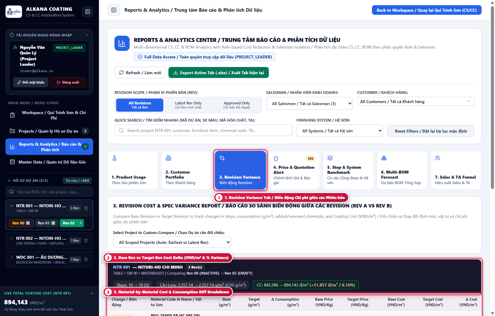
**Figure 6.3 — Report 3: Revision Cost & Consumption Variance Breakdown**  
*Hình 6.3 — Báo cáo 3: So sánh Biến động Chi phí & Định mức Giữa các Revision*

#### Step-by-Step Instructions / *Hướng dẫn Thao tác Từng bước*

- **① Select Tab 3: Revision Variance (Biến động Revision):** Open Tab "3. Revision Variance" and optionally select a specific Project, Base Revision, and Target Revision to compare.  
  *① Chọn Tab 3: Revision Variance (Biến động Revision): Mở Tab "3. Revision Variance" và chọn Dự án cùng Phiên bản gốc (Base Rev) và Phiên bản đích (Target Rev) cần so sánh.*
- **② Review Project-Level Cost & Consumption Delta (±VND/m² & ±%):** Compare Base Cost vs. Target Cost, Net Cost Delta (VND/m² and %), and Step Count changes.  
  *② Xem Mức Chênh lệch Tổng Chi phí & Định mức (±VND/m² & ±%): Xem ngay mức tăng/giảm tuyệt đối (VND/m², g/m²) và tỷ lệ phần trăm biến động (%) giữa hai phiên bản.*
- **③ Inspect Material-Level Diff Table (Added, Removed, Price/Usage Changed):** Expand the project row to inspect exact per-material changes in price snapshot, g/m² consumption, and VND/m² cost impact.  
  *③ Kiểm tra Bảng Chi tiết Chênh lệch Từng Mã Vật tư: Sổ xuống bảng chi tiết vật tư để xem từng mã hóa chất đã thay đổi đơn giá, định mức g/m² hay được thêm mới/loại bỏ.*

---

### 6.4. Report 4: Price & Quotation Drift Alert
*6.4. Báo cáo 4: Cảnh báo Chênh lệch Đơn giá Snapshot so với Báo giá Gốc Hiện hành*

> **Applicable Roles / *Vai trò áp dụng*:** `SALES` | `PROJECT_LEADER` | `ADMIN`  
> **Objective:** Detect revisions whose frozen material prices (Price Snapshot) differ from the latest Master Quotation prices or are missing quotation records.  
> *Mục tiêu: Phát hiện tự động các hồ sơ Revision đang lưu đơn giá cũ (Price Snapshot) lệch so với bảng Báo giá Master hiện hành hoặc chưa có báo giá.*

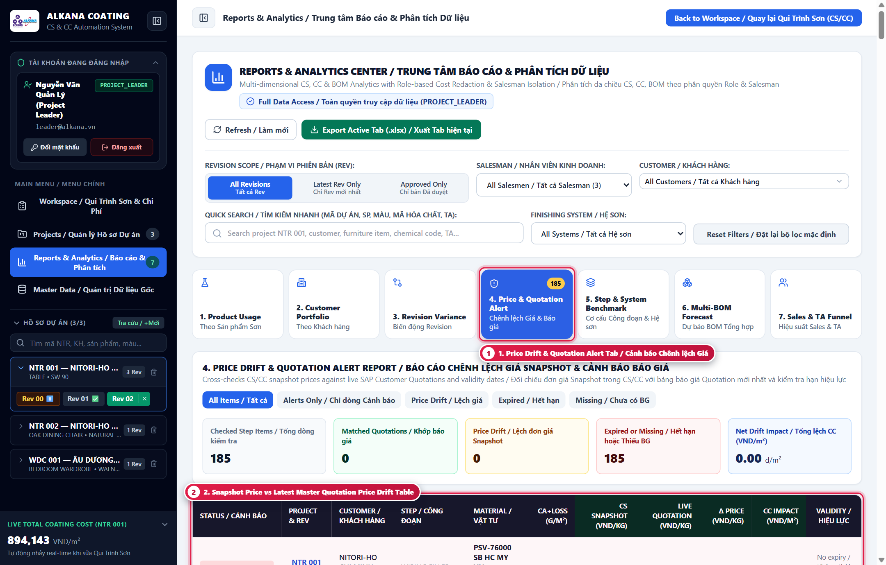
**Figure 6.4 — Report 4: Price Drift & Missing Quotation Alert**  
*Hình 6.4 — Báo cáo 4: Cảnh báo Chênh lệch Đơn giá & Thiếu Báo giá Vật tư*

#### Step-by-Step Instructions / *Hướng dẫn Thao tác Từng bước*

- **① Select Tab 4: Price & Quotation Alert (Chênh lệch Giá & Báo giá):** Open Tab "4. Price & Quotation Alert" to audit pricing accuracy across active schedules.  
  *① Chọn Tab 4: Price & Quotation Alert (Chênh lệch Giá & Báo giá): Mở Tab "4. Price & Quotation Alert" để rà soát tính cập nhật của đơn giá trên toàn bộ các hồ sơ quy trình sơn.*
- **② Identify Outdated Snapshot Prices & Cost Impact per m²:** Review rows flagged as PRICE_INCREASED, PRICE_DECREASED, or MISSING_QUOTATION, comparing Snapshot Price vs. Current Master Quotation Price.  
  *② Nhận diện Các Mã Sơn Lệch Giá & Mức Ảnh hưởng lên Giá thành (VND/m²): Kiểm tra các dòng cảnh báo Tăng giá, Giảm giá hoặc Thiếu báo giá, đối chiếu giữa Đơn giá lưu trong Revision và Đơn giá Master mới nhất, sau đó nhấn "Mở CS/CC" để đồng bộ lại giá.*

---

### 6.5. Report 5: Application Step & Finishing System Benchmark
*6.5. Báo cáo 5: Đối chuẩn Cơ cấu Công đoạn Thi công & Hệ Sơn (Benchmark)*

> **Applicable Roles / *Vai trò áp dụng*:** `ALL ROLES`  
> **Objective:** Analyze which coating steps (e.g., TOP COAT COLOR, WIPING FILLER, SEALER) and finishing systems (WATERBASED, PU, NC) drive the highest cost and consumption.  
> *Mục tiêu: Phân tích tỷ trọng chi phí và định mức tiêu hao bình quân của từng loại công đoạn (Stain, Sealer, Top Coat...) và từng hệ sơn (Waterbased, PU, NC).*

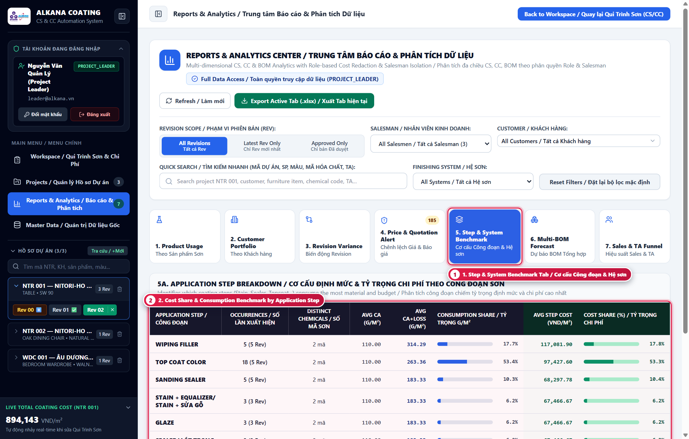
**Figure 6.5 — Report 5: Application Step & Finishing System Benchmark**  
*Hình 6.5 — Báo cáo 5: Phân tích Cơ cấu Chi phí theo Công đoạn & Hệ Sơn*

#### Step-by-Step Instructions / *Hướng dẫn Thao tác Từng bước*

- **① Select Tab 5: Step & System Benchmark:** Click Tab "5. Step & System Benchmark" to view aggregated engineering benchmarks.  
  *① Chọn Tab 5: Step & System Benchmark (Cơ cấu Công đoạn & Hệ sơn): Nhấn vào Tab "5. Step & System Benchmark" để xem bảng đối chuẩn kỹ thuật và chi phí.*
- **② Compare Application Step Cost Share & Spray/Wiping Split:** Inspect each step name’s occurrence count, Spray vs. Wiping breakdown, average CA + Loss (g/m²), average Cost (VND/m²), and % Share of total schedule cost.  
  *② So sánh Tỷ trọng Chi phí Từng Công đoạn & Tỷ lệ Phun (Spray) / Lau (Wiping): Xem tần suất xuất hiện, tỷ lệ dùng phương pháp Phun (Spray) so với Lau (Wiping), định mức g/m² bình quân, chi phí VND/m² bình quân và % tỷ trọng chi phí của từng công đoạn.*
- **③ Benchmark Finishing Systems (WATERBASED vs. PU vs. NC):** The bottom table compares average step count, g/m² consumption, and Min/Avg/Max VND/m² across finishing systems.  
  *③ Đối sánh Hiệu quả Giữa các Hệ Sơn (WATERBASED, PU, NC): Bảng phía dưới đối sánh số bước trung bình, tổng lượng sơn g/m² và biên độ giá thành VND/m² giữa các hệ sơn.*

---

### 6.6. Report 6: Multi-Project BOM Demand Forecast
*6.6. Báo cáo 6: Dự báo Tổng Nhu cầu Vật tư Gộp Đa Dự án (Multi-BOM Forecast)*

> **Applicable Roles / *Vai trò áp dụng*:** `ALL ROLES`  
> **Objective:** Combine multiple project revisions with custom production areas (m²) to calculate a consolidated warehouse purchasing plan (total Kg/Ltr, drums, and budget).  
> *Mục tiêu: Gộp nhiều hồ sơ dự án với diện tích sản xuất (m²) tùy chỉnh cho từng dự án để tính tổng nhu cầu vật tư toàn xưởng (tổng Kg/Lít, tổng số thùng cần mua và tổng ngân sách).*

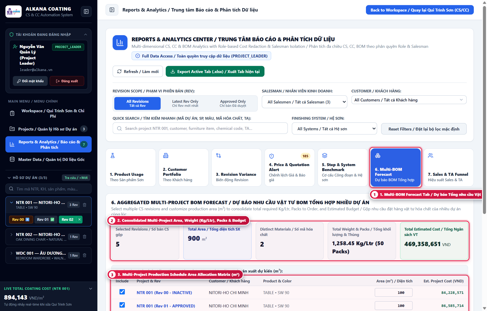
**Figure 6.6 — Report 6: Multi-Project BOM Demand Forecast**  
*Hình 6.6 — Báo cáo 6: Dự báo Tổng Nhu cầu Vật tư (Multi-BOM Forecast)*

#### Step-by-Step Instructions / *Hướng dẫn Thao tác Từng bước*

- **① Select Tab 6: Multi-BOM Forecast (Dự báo BOM Tổng hợp):** Click Tab "6. Multi-BOM Forecast" to open the multi-project material planner.  
  *① Chọn Tab 6: Multi-BOM Forecast (Dự báo BOM Tổng hợp): Nhấn vào Tab "6. Multi-BOM Forecast" để mở công cụ lập kế hoạch vật tư tổng hợp đa dự án.*
- **② Toggle Included Revisions & Enter Planned Production Area (m²):** Check/uncheck project revisions in the allocation matrix and enter the planned m² for each project, then click Recalculate.  
  *② Tích chọn Các Dự án Tham gia & Nhập Diện tích Sản xuất Dự kiến (m²): Tích chọn các Revision cần đưa vào kế hoạch sản xuất, nhập diện tích m² dự kiến cho từng dự án và nhấn nút Tính toán lại.*
- **③ Review Consolidated Material Procurement Table:** The bottom table merges identical chemical codes across all selected projects, displaying total required Kg/Ltr, full packs/drums to order, and total material cost.  
  *③ Xem Bảng Tổng hợp Vật tư Cần Đặt hàng Toàn Xưởng: Bảng kết quả phía dưới tự động cộng gộp các mã sơn trùng nhau từ tất cả các dự án đã chọn, xuất ra tổng số Kg/Lít, tổng số thùng nguyên cần đặt mua và tổng chi phí.*

---

### 6.7. Report 7: Project & Revision Activity Funnel (Sales & Technical KPI)
*6.7. Báo cáo 7: Phễu Hoạt động Dự án & Hiệu suất Nhân sự (Sales & Technical)*

> **Applicable Roles / *Vai trò áp dụng*:** `ALL ROLES`  
> **Objective:** Monitor revision approval conversion rates (DRAFT vs. APPROVED vs. INACTIVE) and evaluate workload across Salesmen and Technical (TA) staff.  
> *Mục tiêu: Theo dõi tỷ lệ chuyển đổi phê duyệt hồ sơ (DRAFT / APPROVED / INACTIVE) và thống kê khối lượng công việc theo từng nhân viên Sales và Kỹ thuật viên (TA).*

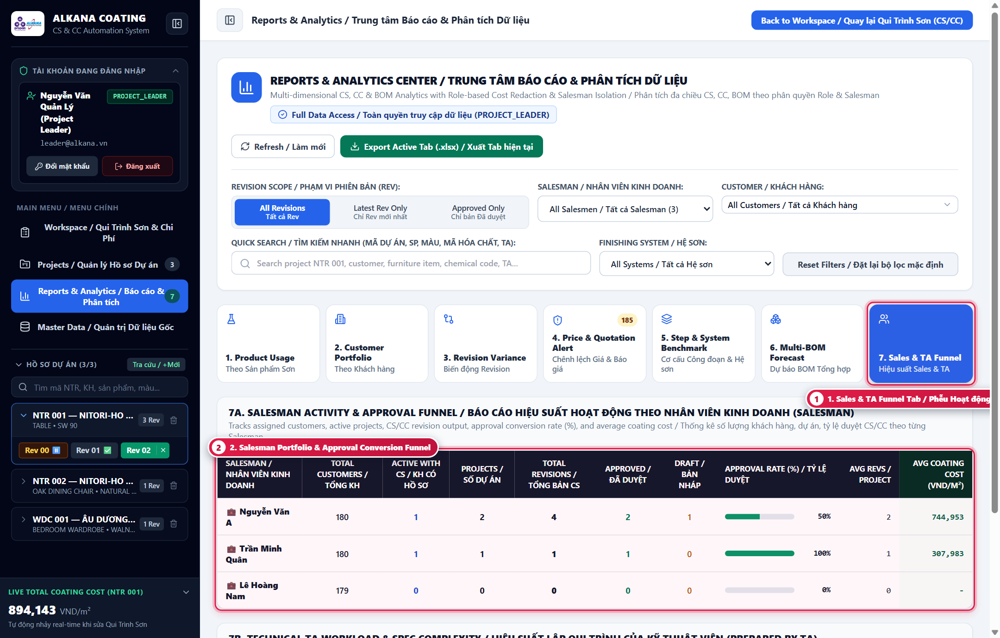
**Figure 6.7 — Report 7: Project & Revision Activity Funnel**  
*Hình 6.7 — Báo cáo 7: Phễu Hoạt động Hồ sơ & Thống kê Hiệu suất Nhân sự*

#### Step-by-Step Instructions / *Hướng dẫn Thao tác Từng bước*

- **① Select Tab 7: Activity Funnel (Tiến độ & Phễu Hồ sơ):** Click Tab "7. Activity Funnel" to view overall approval conversion metrics.  
  *① Chọn Tab 7: Activity Funnel (Tiến độ & Phễu Hồ sơ): Nhấn vào Tab "7. Activity Funnel" để xem các chỉ số phễu trạng thái hồ sơ trên toàn hệ thống.*
- **② Analyze Salesman Portfolio & Conversion Rate Table:** Review each Salesman’s assigned customers, active projects, Approved/Draft/Inactive revision counts, approval rate (%), and average coating cost.  
  *② Phân tích Bảng Kết quả Phụ trách theo Nhân viên Kinh doanh (Salesman): Xem số lượng khách hàng, số dự án, số phiên bản Đã duyệt / Bản nháp / Hết hiệu lực, tỷ lệ duyệt (%) và giá thành bình quân của từng Salesman.*
- **③ Analyze Technical TA Authoring Productivity Table:** Track how many revisions and projects each Technical TA has prepared and their approval status breakdown.  
  *③ Phân tích Bảng Năng suất Lập Hồ sơ theo Kỹ thuật viên (Technical TA): Theo dõi số lượng dự án và phiên bản quy trình sơn do từng Kỹ thuật viên (TA) thiết lập cùng tỷ lệ hồ sơ đã được phê duyệt.*

---

## CHAPTER 7: MASTER DATA CRUD, BULK EXCEL IMPORT & USER ADMINISTRATION
*CHƯƠNG 7: QUẢN TRỊ DỮ LIỆU NGUỒN (MASTER DATA), NHẬP EXCEL & TÀI KHOẢN USER*

Maintain the 5 foundational Master Data tables (Customers, Quotations, Application Steps, App-Methods, Packing Mappings) with server-side pagination and Excel templates, and administer User Accounts & RBAC scopes.  
*Quản trị 5 bảng Dữ liệu Nguồn cốt lõi (Khách hàng, Báo giá Vật tư, Bước Thi công, Phương pháp & Hiệu suất, Quy cách Đóng gói) hỗ trợ phân trang máy chủ và nhập/xuất file mẫu Excel, cùng phân mục Quản lý Tài khoản & Phân quyền User.*

### 7.1. Managing Customers & Assigning Responsible Salesmen
*7.1. Quản lý Danh mục Khách hàng & Gán Nhân viên Sales Phụ trách*

> **Applicable Roles / *Vai trò áp dụng*:** `ADMIN` | `PROJECT_LEADER` | `SALES`  
> **Objective:** Create, edit, search, or bulk-import Customer records and link each customer to a responsible Salesman for row-level RBAC filtering.  
> *Mục tiêu: Thêm mới, chỉnh sửa, tìm kiếm hoặc nhập hàng loạt danh sách Khách hàng từ Excel, đồng thời gán tên Salesman phụ trách để phân quyền dữ liệu tự động.*

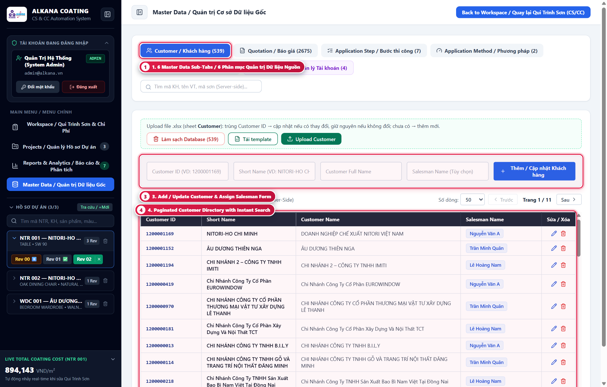
**Figure 7.1 — Master Data Sub-Tab 1: Customers Directory & Excel Import**  
*Hình 7.1 — Quản trị Master Data 1: Danh mục Khách hàng & Công cụ Nhập Excel*

#### Step-by-Step Instructions / *Hướng dẫn Thao tác Từng bước*

- **① Select Master Data from Left Sidebar & Choose Sub-Tab 1: Customers:** Click "Master Data / Quản trị Dữ liệu Gốc" on the sidebar to access the 6 master management sub-tabs.  
  *① Mở Mục Master Data trên Menu Trái & Chọn Tab 1: Customers: Nhấn vào "Master Data / Quản trị Dữ liệu Gốc" ở thanh menu trái để mở giao diện 6 phân mục dữ liệu nguồn.*
- **② Download Standard Template or Bulk Import Customers (.xlsx):** Use "Tải File Mẫu" to download the standard Excel template, or click "Import Excel" to bulk-create/update customer records.  
  *② Tải File Mẫu Chuẩn hoặc Nhập Hàng loạt Khách hàng từ Excel (.xlsx): Nhấn "Tải File Mẫu" để lấy biểu mẫu Excel chuẩn, hoặc nhấn "Import Excel" để tải lên danh sách khách hàng hàng loạt.*
- **③ Add or Update Individual Customer & Salesman Assignment:** Fill in Customer ID (SAP Code), Short Name, Full Name, and Salesman Name, then click Save. Click the Edit (pencil) icon on any table row to modify an existing record.  
  *③ Thêm Mới hoặc Cập nhật Khách hàng & Gán Salesman Phụ trách: Điền Mã khách hàng (Customer ID), Tên viết tắt (Short Name), Tên đầy đủ và Tên Salesman phụ trách rồi nhấn Lưu. Nhấn biểu tượng cây bút trên dòng bất kỳ để sửa.*
- **④ Search & Navigate Server-Side Paginated Customer Table:** Use the search bar and pagination controls at the bottom to browse hundreds of customers smoothly.  
  *④ Tìm kiếm Tức thì & Duyệt Bảng Phân trang Khách hàng: Sử dụng ô tìm kiếm nhanh và thanh chuyển trang ở cuối bảng để tra cứu hàng trăm khách hàng mượt mà.*

---

### 7.2. Managing Material Quotations & Bulk Price Uploads
*7.2. Quản lý Bảng Báo giá Vật tư (Quotations) & Tải lên Đơn giá Excel*

> **Applicable Roles / *Vai trò áp dụng*:** `ADMIN` | `PROJECT_LEADER` | `SALES`  
> **Objective:** Maintain customer-specific material codes, packing sizes, and unit prices (VND/kg) that drive automated Coating Cost lookups.  
> *Mục tiêu: Quản lý danh mục mã vật tư sơn, quy cách đóng gói (Nett) và đơn giá (VND/kg) theo từng khách hàng làm nguồn dữ liệu tra cứu tự động cho bảng Coating Cost.*

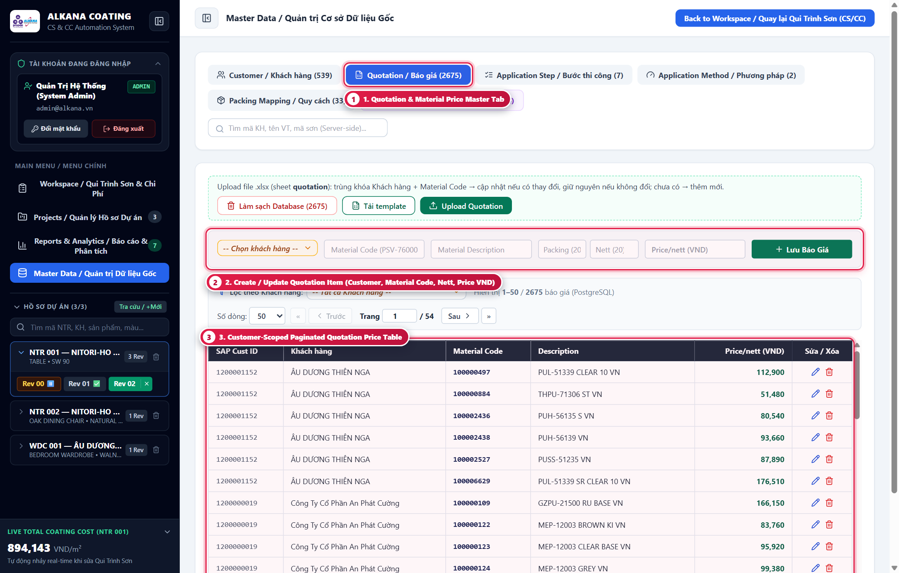
**Figure 7.2 — Master Data Sub-Tab 2: Material Quotations Management**  
*Hình 7.2 — Quản trị Master Data 2: Bảng Báo giá Vật tư Sơn theo Khách hàng*

#### Step-by-Step Instructions / *Hướng dẫn Thao tác Từng bước*

- **① Select Sub-Tab 2: Quotation (Bảng giá vật tư):** Click "2. Quotation" to manage customer material pricing.  
  *① Chọn Phân mục 2: Quotation (Bảng giá vật tư): Nhấn vào tab "2. Quotation" để quản lý bảng giá hóa chất sơn.*
- **② Create or Edit Quotation Item (Customer, Material Code, Nett, Price VND):** Select the Customer Code, enter Material Code, Material Name, Packing Description, Nett Weight (Kg/Ltr), and Unit Price (VND), or upload via the Quotation Excel Template.  
  *② Thêm Mới hoặc Sửa Dòng Báo giá (Mã KH, Mã Vật tư, Quy cách, Đơn giá VND): Chọn Mã khách hàng, nhập Mã vật tư, Tên mô tả, Quy cách đóng gói, Trọng lượng tịnh (Nett) và Đơn giá (VND), hoặc tải lên hàng loạt bằng File mẫu Báo giá Excel.*
- **③ Filter by Customer Combobox & Search Material Codes:** Filter the paginated table by specific customer or type any material code substring in the search box.  
  *③ Lọc theo Khách hàng & Tìm kiếm Nhanh Mã Hóa chất: Lọc bảng báo giá theo từng khách hàng cụ thể hoặc gõ mã vật tư vào ô tìm kiếm để kiểm tra đơn giá.*

---

### 7.3. Configuring Application Steps, Transfer Efficiency Methods & Packings
*7.3. Cấu hình Bước Thi công Chuẩn, Phương pháp (Hiệu suất %) & Quy cách Đóng gói*

> **Applicable Roles / *Vai trò áp dụng*:** `ADMIN` | `PROJECT_LEADER` | `TECHNICAL`  
> **Objective:** Standardize coating step names, application transfer efficiencies (e.g., SPRAY 60%, WIPING 35%), and container nett weights.  
> *Mục tiêu: Chuẩn hóa danh mục tên bước thi công, tỷ lệ hiệu suất thu hồi theo phương pháp sơn (VD: SPRAY 60%, WIPING 35%) và trọng lượng thùng đóng gói.*

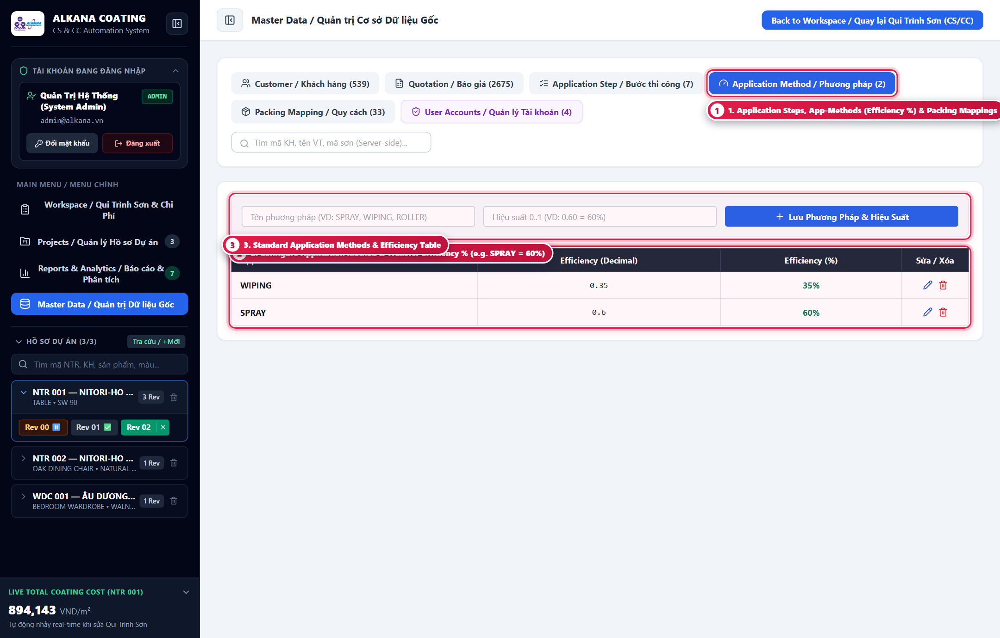
**Figure 7.3 — Master Data Sub-Tabs 3–5: Steps, App-Methods & Packing Mappings**  
*Hình 7.3 — Quản trị Master Data 3–5: Bước Thi công, Phương pháp & Quy cách Đóng gói*

#### Step-by-Step Instructions / *Hướng dẫn Thao tác Từng bước*

- **① Switch Across Sub-Tabs 3 (Steps), 4 (App-Methods), and 5 (Packings):** Use Sub-Tab 3 for standard step names, Sub-Tab 4 for application methods, and Sub-Tab 5 for container size mappings.  
  *① Chuyển đổi Giữa các Tab 3 (Application Step), 4 (App-Method) & 5 (Packing Mapping): Chọn Tab 3 để cấu hình tên bước chuẩn, Tab 4 để cấu hình phương pháp thi công và Tab 5 để cấu hình quy cách thùng sơn.*
- **② Define Method Name & Transfer Efficiency % (or Packing Nett Weight):** In App-Method, enter the Method Name (e.g., SPRAY, WIPING, ROLLER) and Efficiency % (e.g., 60% or 35%). This percentage directly governs the CA + Loss formula in Coating Cost.  
  *② Thiết lập Tên Phương pháp & Tỷ lệ Hiệu suất % (hoặc Trọng lượng Thùng): Tại tab App-Method, nhập Tên phương pháp (VD: SPRAY, WIPING, ROLLER) và Hiệu suất thu hồi % (VD: 60% hoặc 35%). Chỉ số này quyết định trực tiếp công thức tính lượng hao hụt CA + Loss.*
- **③ Edit or Remove Standard Master Entries:** Click the Edit (pencil) or Delete (trash) icon on any row to maintain clean master standards.  
  *③ Chỉnh sửa hoặc Xóa Bản ghi Danh mục Chuẩn: Nhấn biểu tượng Sửa (cây bút) hoặc Xóa (thùng rác) trên từng dòng để cập nhật danh mục chuẩn.*

---

### 7.4. Administering User Accounts, Roles & Salesman RBAC Scopes
*7.4. Quản trị Tài khoản Người dùng, Phân quyền Role & Gán Phạm vi Salesman*

> **Applicable Roles / *Vai trò áp dụng*:** `ADMIN`  
> **Objective:** Provision new user accounts, reset passwords, assign roles (ADMIN, PROJECT_LEADER, SALES, TECHNICAL), and bind Sales/Technical users to their Salesman data scope.  
> *Mục tiêu: Tạo tài khoản người dùng mới, cấp lại mật khẩu, gán vai trò (ADMIN, PROJECT_LEADER, SALES, TECHNICAL) và liên kết nhân viên Sales/Kỹ thuật với phạm vi Salesman phụ trách.*

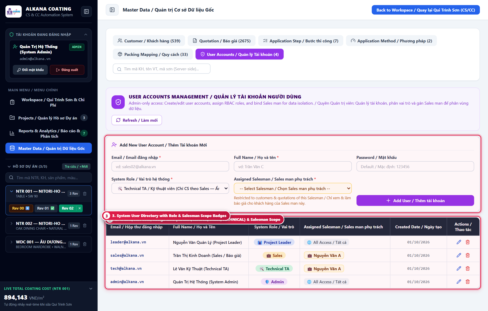
**Figure 7.4 — Master Data Sub-Tab 6: User Accounts & RBAC Administration**  
*Hình 7.4 — Quản trị Master Data 6: Quản lý Tài khoản Người dùng & Phân quyền RBAC (Chỉ ADMIN)*

#### Step-by-Step Instructions / *Hướng dẫn Thao tác Từng bước*

- **① Open Sub-Tab 6: Users (Visible Exclusively to ADMIN):** Sign in with an ADMIN account (e.g., admin@alkana.vn) and click Sub-Tab "6. Users" under Master Data.  
  *① Mở Phân mục 6: Users / Tài khoản & Phân quyền (Chỉ hiển thị với ADMIN): Đăng nhập bằng tài khoản ADMIN (VD: admin@alkana.vn) và chọn phân mục "6. Users" trong Master Data.*
- **② Create or Edit User Account, Role & Assigned Salesman Scope:** Enter Email, Full Name, Password, and Role. For SALES and TECHNICAL roles, select the "Salesman phụ trách" so the user only views and edits customers/projects belonging to that Salesman.  
  *② Tạo Mới hoặc Sửa Tài khoản, Chọn Role & Gán Phạm vi Salesman Phụ trách: Nhập Email, Họ tên, Mật khẩu và chọn Vai trò (Role). Đối với vai trò SALES và TECHNICAL, chọn thêm "Salesman phụ trách" để hệ thống tự động giới hạn phạm vi khách hàng và hồ sơ dự án đúng theo Salesman đó.*
- **③ Manage Active User Directory & Reset Credentials:** Click "Sửa" on any user row to change their role, update their assigned Salesman, or reset their password.  
  *③ Quản lý Danh sách Tài khoản Hệ thống & Đặt lại Mật khẩu: Nhấn nút "Sửa" trên dòng tài khoản bất kỳ khi cần thay đổi vai trò, đổi Salesman phụ trách hoặc cấp lại mật khẩu mới.*

---
