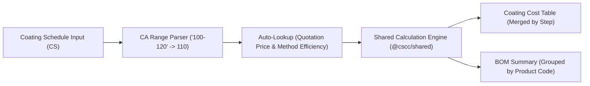

# Phase 2: Shared Calculation Engine, Backend API & RBAC

## Context Links

- Đặc tả công thức & RBAC: `c:\dev\cscc\docs\coating_system_specification.md` (Mục 3, 4, 5)
- Ảnh đối chiếu kết quả tính toán: `c:\dev\cscc\pic\cs.png`, `c:\dev\cscc\pic\cc.png`, `c:\dev\cscc\pic\cc1.png`

## Overview

Xây dựng bộ công thức tính toán dùng chung (`@cscc/shared`) cho cả Frontend và Backend, đảm bảo tự động ánh xạ 100% từ **Coating Schedule (CS)** sang **Coating Cost (CC)** và **BOM Summary**, đồng thời triển khai REST API kèm phân quyền RBAC bảo mật tuyệt đối dữ liệu đơn giá.

## Key Insights

- **Parser cột `CA (g/m²)`:** Kỹ thuật viên nhập chuỗi khoảng như `"100-120"` (hoặc số đơn `"110"`). Hàm `parseCaInput("100-120")` tự động tách `min = 100, max = 120` và trả về trung bình cộng `110` cho cột `Coating Amount (g/m²)` bên bảng CC.
- **Lọc bỏ dòng `SANDING` khi sang CC:** Các dòng bước chà nhám (`SANDING PAPER #180-240`, `#320`) chỉ hiển thị ở CS, không đưa sang bảng tính tiền CC.
- **Công thức chuẩn từng Bước (Step) bên CC:**
  - $\text{Total Mixing Ratio} = \sum \text{MixingRatio}_i$
  - $\text{Mixed Price (VND/Ltr set)} = \frac{\sum (\text{Price}_i \times \text{MixingRatio}_i)}{\text{Total Mixing Ratio}}$
  - $\text{CA + Loss (g/m}^2\text{)} = \frac{\text{Coating Amount}}{\text{Efficiency}}$
  - $\text{Coverage (m}^2\text{/Ltr/kg)} = \frac{1000}{\text{CA + Loss}}$
  - $\text{Coating Cost (VND/m}^2\text{)} = \frac{\text{Mixed Price}}{\text{Coverage}}$
- **Công thức BOM Summary:**
  - Tách định mức thực tế của từng vật tư thành phần trong mỗi bước:
    $$\text{Component CA + Loss}_i = \text{Step (CA + Loss)} \times \frac{\text{MixingRatio}_i}{\text{Total Mixing Ratio}}$$
  - Gom nhóm (`GROUP BY productCode`) trên toàn bộ các bước của Schedule:
    - $\text{Total g/m}^2 = \sum \text{Component CA + Loss}_i$
    - $\text{Total Kg/Ltr Required} = \frac{\text{Total g/m}^2 \times \text{Project Area (m}^2\text{)}}{1000}$
    - $\text{Packs Required} = \lceil \frac{\text{Total Kg/Ltr Required}}{\text{Nett}} \rceil$ (và số thực tế chưa làm tròn).

## Requirements

- [ ] Hiện thực hóa module `@cscc/shared/src/calculator.ts` bao gồm: `parseCaInput`, `calculateStepCost`, `calculateCoatingCostTable`, `calculateBomSummary`.
- [ ] Viết Unit Tests kiểm chứng bộ số liệu `NITORI-HO CHI MINH (NTR 001)` khớp 100% đến từng chữ số thập phân với `pic/cc.png` (`379,333`, `314.29`, `3.18`, `119,219.05`, `183.33`, `5.45`, `69,544.44`, tổng `894,143`).
- [ ] Xây dựng API CRUD + Search + Excel Import cho 5 bảng Master Data.
- [ ] Xây dựng API quản lý Project & Coating Schedule (`GET/POST/PUT /api/projects`, `/api/revisions/:id`).
- [ ] Xây dựng Middleware RBAC: Khi user có role `TECHNICAL`, serializer ở Backend tự động loại bỏ các trường `unitPrice`, `mixedPrice`, `coatingCost`, `totalCoatingCost` và chặn endpoint `/api/revisions/:id/cost`.

## Architecture

## Related Code Files

- Create: `c:\dev\cscc\packages\shared\src\calculator.ts`
- Create: `c:\dev\cscc\packages\shared\src\calculator.test.ts`
- Create: `c:\dev\cscc\apps\backend\src\middleware\auth-rbac.middleware.ts`
- Create: `c:\dev\cscc\apps\backend\src\routes\master-data.routes.ts`
- Create: `c:\dev\cscc\apps\backend\src\routes\project-revision.routes.ts`

## Implementation Steps

1. Viết `packages/shared/src/calculator.ts` và bộ test `calculator.test.ts` với dữ liệu mẫu `NTR 001`.
2. Xây dựng JWT Auth + RBAC middleware (`TECHNICAL` vs `SALES` / `PROJECT_LEADER` / `ADMIN`).
3. Xây dựng các API Master Data (`/api/master/customers`, `/api/master/quotations`, `/api/master/packing-mappings`, `/api/master/steps`, `/api/master/methods`, `/api/master/import-excel`).
4. Xây dựng các API Project & Revision (`/api/projects`, `/api/revisions/:id/schedule`, `/api/revisions/:id/cost`, `/api/revisions/:id/bom`).

## Todo

- [ ] Xây dựng `parseCaInput` xử lý chuỗi khoảng `100-120` -> `110`
- [ ] Xây dựng `calculateCoatingCostTable` và `calculateBomSummary` trong `@cscc/shared`
- [ ] Viết unit test xác thực kết quả tính toán khớp 100% ảnh `cc.png` (`894,143 VND/m²`)
- [ ] Triển khai REST API cho Master Data và Project/Revision
- [ ] Triển khai RBAC middleware ẩn đơn giá ở tầng API đối với role `TECHNICAL`

## Success Criteria

- Toàn bộ unit tests của `@cscc/shared` pass 100%.
- Role `TECHNICAL` gọi API `/api/revisions/:id/cost` nhận HTTP `403 Forbidden`, và gọi `/api/revisions/:id/schedule` không chứa bất kỳ trường giá nào trong JSON trả về.

## Risk Assessment

- **Sai số làm tròn số thực (Floating-point rounding):** Trong Excel, các cột `Mixed Price`, `CA + Loss`, `Coverage` hiển thị số làm tròn (`379,333`, `314.29`, `3.18`), nhưng công thức tính `Coating Cost` lấy giá trị chính xác trước khi làm tròn ($\frac{379333.3333}{1000 / 314.285714} = 119,219.0476 \rightarrow 119,219.05$). Engine tính toán phải giữ độ chính xác floating-point ở bước trung gian giống hệt Excel và chỉ làm tròn khi hiển thị!

## Security Considerations

- Mọi kiểm tra quyền xem giá (`SALES`, `PROJECT_LEADER`, `ADMIN`) đều thực hiện tại Backend middleware và DTO serializer, tuyệt đối không gửi dữ liệu giá xuống client của `TECHNICAL`.

## Next Steps

- Chuyển sang Phase 3 để xây dựng giao diện Workspace UI (CS Editor, CC Read-only Merged Table, BOM Summary).