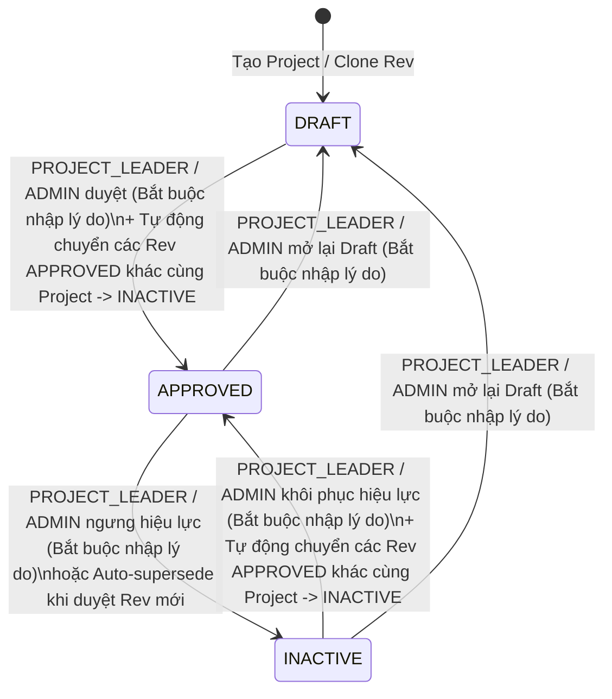

# Revision INACTIVE Status, Auto-Supersede & Audit History System

## Overview & Brainstorm Contract

### 1. Outcome (Kết quả đầu ra)
- **3 trạng thái vòng đời của Coating Schedule & Coating Cost (`RevisionStatus`)**:
  - `DRAFT`: Bản nháp — cho phép chỉnh sửa, làm mới đơn giá, hoặc xóa (khi dự án có > 1 revision).
  - `APPROVED`: Đã duyệt và **đang có hiệu lực** — khóa chỉnh sửa, khóa xóa, khóa làm mới đơn giá.
  - `INACTIVE`: Đã duyệt và **không còn hiệu lực** — khóa chỉnh sửa, khóa xóa, khóa làm mới đơn giá (vẫn cho phép xem, xuất Excel, in A4 và `Clone Rev`).
- **Quy tắc chuyển đổi trạng thái (State Machine)**:
  - **Chỉ được chuyển sang `INACTIVE` từ một hồ sơ đang là `APPROVED`** (`APPROVED` ➔ `INACTIVE`). Mọi yêu cầu chuyển trực tiếp từ `DRAFT` ➔ `INACTIVE` đều bị chặn (`400 Bad Request`).
  - Cho phép chuyển `DRAFT` ➔ `APPROVED` (duyệt hồ sơ), `APPROVED` ➔ `DRAFT` (mở lại bản nháp), và `INACTIVE` ➔ `APPROVED` hoặc `INACTIVE` ➔ `DRAFT` (khôi phục hoặc mở lại khi cần thiết bởi `PROJECT_LEADER` / `ADMIN`).
- **Tự động chuyển `INACTIVE` khi duyệt Revision mới (Auto-supersede)**:
  - Trong cùng 1 `Project`, khi `PROJECT_LEADER` hoặc `ADMIN` duyệt (`APPROVED`) một phiên bản (ví dụ `Rev 01`), hệ thống **tự động chuyển toàn bộ các phiên bản `APPROVED` khác của Project đó (ví dụ `Rev 00`) sang `INACTIVE`**, đồng thời **ghi nhận lịch sử tự động** cho các phiên bản bị thay thế ngay trong cùng một Database Transaction.
- **Bắt buộc nhập lý do (`note` / `reason`)**:
  - Mọi thao tác thay đổi trạng thái đều **bắt buộc phải nhập lý do** (`note.trim().length > 0`).
- **Phân quyền RBAC**:
  - Chỉ **`PROJECT_LEADER`** và **`ADMIN`** mới có quyền thay đổi trạng thái.
  - **`TECHNICAL` (TA)** và **`SALES`** không thể thay đổi trạng thái (Backend trả `403 Forbidden`, Frontend chỉ hiển thị Badge trạng thái và nút xem Lịch sử).
- **Lưu trữ & Hiển thị Lịch sử (`RevisionStatusHistory`)**:
  - Lưu vào bảng quan hệ chuyên biệt `RevisionStatusHistory` trong PostgreSQL và hiển thị Timeline lịch sử đầy đủ trên giao diện.

### 2. Constraints (Ràng buộc kỹ thuật & Nghiệp vụ)
- **Tính bất biến (Immutability)**: Hồ sơ ở trạng thái `INACTIVE` được bảo vệ nghiêm ngặt như `APPROVED` tại [`data-store.ts`](../../apps/backend/src/store/data-store.ts) (chặn `updateRevision`, `deleteRevision`, `refreshRevisionPrices`) và [`CoatingScheduleEditor.tsx`](../../apps/frontend/src/components/schedule/CoatingScheduleEditor.tsx) (`isLocked = true`).
- **Tính nguyên tử (Atomicity)**: Việc cập nhật trạng thái Revision đích, tự động chuyển `INACTIVE` các Revision `APPROVED` cũ cùng Project, và thêm các dòng `RevisionStatusHistory` phải nằm trong cùng một `prisma.$transaction`.
- **Tương thích báo cáo**: Trong [`report.service.ts`](../../apps/backend/src/services/report.service.ts), bộ lọc `revisionScope === 'APPROVED'` chỉ lấy các bản đang `APPROVED` (có hiệu lực), không gộp các bản đã `INACTIVE`.

### 3. Non-goals (Không nằm trong phạm vi)
- Không xây dựng hệ thống phê duyệt đa cấp (multi-step approval queue) hay gửi email thông báo.
- Không lưu audit log cho từng thao tác sửa ô dữ liệu trong bản `DRAFT`.

### 4. Trade-offs & Better Approaches
- **Trade-offs**: Sử dụng bảng quan hệ `RevisionStatusHistory` (Phương án A) đòi hỏi thêm 1 bảng trong Prisma Schema và 1 truy vấn kèm (`include: { statusHistory: ... }`), nhưng đảm bảo toàn vẹn khóa ngoại (`onDelete: Cascade`), tránh race condition của mảng JSON và hỗ trợ truy vấn lịch sử chuẩn xác.
- **Better approaches**: `none — recommended direction is Relational RevisionStatusHistory Table + Atomic Auto-Supersede Transaction + Role Guard Middleware`.

---

## Architecture & State Machine

---

## Phases Roadmap

| # | Phase | Effort | Status | Description |
|---|-------|--------|--------|-------------|
| 1 | [Database Schema & Shared Types](./phase-01-database-schema-and-shared-types.md) | 1h | Completed | Bổ sung `INACTIVE` vào `RevisionStatus`, tạo bảng `RevisionStatusHistory` trong Prisma & PostgreSQL DDL, cập nhật kiểu dữ liệu `@cscc/shared`. |
| 2 | [Backend Status Service, RBAC & Auto-Supersede](./phase-02-backend-status-service-rbac-and-auto-supersede.md) | 2h | Completed | Xây dựng middleware chặn `TECHNICAL`/`SALES`, kiểm tra state machine (`DRAFT -x-> INACTIVE`) & lý do bắt buộc, xử lý auto-supersede trong transaction và khóa sửa/xóa với `INACTIVE`. |
| 3 | [Frontend Status Workflow, Reason Modal & History Timeline UI](./phase-03-frontend-status-workflow-and-history-ui.md) | 2h | Completed | Cập nhật giao diện đổi trạng thái (chỉ mở cho `PROJECT_LEADER`/`ADMIN`), Modal nhập lý do bắt buộc, Timeline lịch sử thay đổi và đồng bộ nhãn `INACTIVE` trên toàn bộ UI/Print/Filter. |
| 4 | [Automated Testing & End-to-End Verification](./phase-04-automated-testing-and-verification.md) | 1h | Completed | Viết bộ kiểm thử tự động kiểm tra phân quyền RBAC (`403`), bắt buộc lý do (`400`), chặn `DRAFT -> INACTIVE`, auto-supersede kèm lịch sử và bảo vệ bất biến cho `INACTIVE`. |

## Dependencies

- Shared Package: `packages/shared/src/types.ts`
- Prisma & DB Store: `apps/backend/prisma/schema.prisma`, `apps/backend/src/store/data-store.ts`
- Backend Services & Routes: `apps/backend/src/middleware/auth-rbac.middleware.ts`, `apps/backend/src/services/revision.service.ts`, `apps/backend/src/services/report.service.ts`, `apps/backend/src/app.ts`
- Frontend UI: `apps/frontend/src/api/client.ts`, `apps/frontend/src/App.tsx`, `apps/frontend/src/components/schedule/CoatingScheduleEditor.tsx`, `apps/frontend/src/components/projects/ProjectExplorerView.tsx`, `apps/frontend/src/components/print/PrintableSheetA4.tsx`

## Acceptance Criteria

- [x] `RevisionStatus` hỗ trợ đầy đủ `DRAFT`, `APPROVED`, `INACTIVE` trên cả Shared, Backend, Database và Frontend.
- [x] Tài khoản `TECHNICAL` và `SALES` bị chặn `403 Forbidden` khi gọi `PATCH /api/revisions/:id/status` và không thấy nút đổi trạng thái trên giao diện.
- [x] Tài khoản `PROJECT_LEADER` và `ADMIN` khi đổi trạng thái bắt buộc phải nhập `note` (lý do); nếu để trống hệ thống báo lỗi `400`.
- [x] Chỉ cho phép chuyển sang `INACTIVE` từ hồ sơ đang `APPROVED`; chặn chuyển trực tiếp từ `DRAFT` sang `INACTIVE` (`400`).
- [x] Khi duyệt (`APPROVED`) một Revision mới trong Project, tất cả các Revision đang `APPROVED` khác của cùng Project tự động chuyển sang `INACTIVE` và được ghi lịch sử tự động trong bảng `RevisionStatusHistory`.
- [x] Hồ sơ `INACTIVE` bị khóa chỉnh sửa, khóa xóa, khóa làm mới đơn giá, nhưng vẫn cho phép `Clone Rev`, xuất Excel, in A4 và xem Timeline lịch sử trạng thái.

<!-- slug: revision-status-inactive-and-audit-history -->

