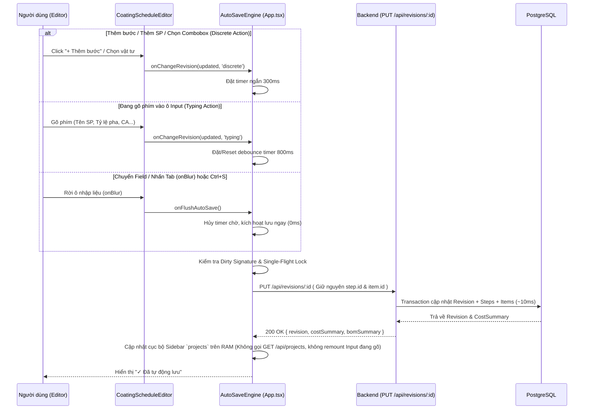

# Coating Schedule Smart Auto-Save & Performance Optimization

## Overview & Brainstorm Contract

### 1. Outcome (Kết quả đầu ra)
- **Tự động lưu (Auto-Save) toàn diện trên Coating Schedule (`DRAFT`)**:
  - **Thao tác cấu trúc & chọn danh mục (`discrete` actions)**: Thêm bước sơn (`+ Add Step`), chèn bước nhám (`Insert SANDING`), nhân bản bước, di chuyển bước lên/xuống, xóa bước, thêm/xóa dòng vật tư (`+ Add Item`), chọn Khách hàng, chọn Bước thi công, chọn Vật tư, chọn Phương pháp thi công, đổi Ngày lập — tự động gom nhóm ngắn (**300ms**) và lưu ngầm xuống PostgreSQL.
  - **Nhập liệu văn bản & con số (`typing` actions)**: Nhập Tên sản phẩm, Màu sắc, Loại gỗ, Hệ sơn, Độ bóng, Mã hồ sơ, Tỷ lệ pha (`Mixing Ratio`), Độ nhớt (`Visco`), Định mức `CA`, Thời gian khô, Thông số nhám, Chữ ký — tự động lưu sau khi ngừng gõ (**800ms**) **HOẶC lưu ngay lập tức (0ms flush) khi chuyển sang ô khác (`onBlur` / nhấn phím `Tab`)**.
- **Loại bỏ nút `Save / Lưu hồ sơ` thủ công, thay bằng `Auto-Save Status Pill`**:
  - Hiển thị trạng thái trực quan trên thanh công cụ Workspace:
    - `⏳ Đang tự động lưu...` (khi đang chờ debounce hoặc đang gửi request).
    - `✓ Đã tự động lưu` (kèm thời gian lưu gần nhất khi đồng bộ hoàn tất).
    - `⚠️ Lỗi tự động lưu — Bấm để thử lại` (nếu mất mạng hoặc lỗi máy chủ, cho phép bấm để thử lại ngay).
  - Hỗ trợ phím tắt `Ctrl + S` / `Cmd + S` để lưu tức thì (flush 0ms) và chặn hộp thoại lưu trang web mặc định của trình duyệt.
- **Tối ưu hóa hiệu năng & Trải nghiệm nhập liệu**:
  - Không gọi lại `GET /api/projects` sau mỗi lần auto-save (cập nhật trực tiếp state `projects` trên RAM của Frontend, giảm >90% tải truy vấn Database).
  - Giữ nguyên `step.id` và `item.id` ổn định từ Client và không ghi đè ngược `activeRevision` đang gõ dở bằng response trễ từ mạng, đảm bảo **không bao giờ mất focus con trỏ (`input focus`)** khi nhấn `Tab` hoặc gõ nhanh.
  - Tách bạch lưu nháp (`DRAFT`) với kiểm tra phê duyệt (`validateRevisionBeforeSave`): cho phép auto-save ngay cả khi bước/vật tư mới thêm còn trống trường thông tin; chỉ bắt buộc kiểm tra đầy đủ khi bấm **`Approve / Phê duyệt (APPROVED)`**.

### 2. Constraints (Ràng buộc kỹ thuật & Nghiệp vụ)
- Chỉ kích hoạt Auto-Save khi hồ sơ ở trạng thái `DRAFT` và người dùng có quyền chỉnh sửa (`!isLocked`). Các hồ sơ `APPROVED`, `INACTIVE`, `LOCKED` hoặc khách hàng ngoài phạm vi phân quyền của Sales/Technical được khóa hoàn toàn.
- Đảm bảo **Single-Flight Request Queue**: tại mọi thời điểm chỉ có tối đa 1 request `PUT /api/revisions/:id` chạy trên mạng; nếu có thay đổi mới phát sinh trong lúc đang lưu, hệ thống gom vào 1 bản chờ duy nhất và gửi tiếp ngay khi request trước hoàn tất.
- Tự động flush (lưu hết thay đổi còn chờ) trước khi người dùng chuyển sang xem Revision khác, trước khi Clone Rev, hoặc trước khi mở hộp thoại Phê duyệt (`Approve`).

### 3. Non-goals (Không nằm trong phạm vi)
- Không thay đổi công thức tính toán Coating Cost (`CC`) và `BOM Summary`.
- Không thay đổi quy trình phân quyền phê duyệt trạng thái (`DRAFT` / `APPROVED` / `INACTIVE`).

### 4. Trade-offs & Better Approaches
- **Trade-offs**: So với Pure Debounce (dễ mất dữ liệu khi đóng tab nhanh) hoặc Pure Blur (không lưu nếu người dùng gõ xong nhưng để nguyên con trỏ trong ô), cơ chế **Hybrid Auto-Save (300ms Discrete + 800ms Typing Debounce + Blur Flush + Single-Flight Queue)** phức tạp hơn đôi chút ở tầng điều phối state nhưng triệt tiêu hoàn toàn nguy cơ mất dữ liệu lẫn hiện tượng nghẽn mạng.
- **Better approaches**: Kết hợp **Preserving Deterministic Step/Item IDs** ở Backend (`data-store.ts`) + **Local Sidebar State Patching** ở Frontend (`App.tsx`) giúp loại bỏ hoàn toàn hiện tượng React remount thẻ `<input>` và cắt bỏ truy vấn `GET /api/projects` nặng nề sau mỗi lần lưu.

---

## Architecture & Auto-Save Flow

---

## Phases Roadmap

| # | Phase | Effort | Status | Description |
|---|-------|--------|--------|-------------|
| 1 | [Backend Stable IDs & Lightweight Draft Save](./phase-01-backend-stable-ids-and-lightweight-update.md) | 1h | Completed | Giữ nguyên `step.id` và `item.id` ổn định trong `dataStore.updateRevision`, hỗ trợ lưu nháp mượt mà cho các bước/vật tư mới thêm. |
| 2 | [Frontend Hybrid Auto-Save Engine & Local State Sync](./phase-02-frontend-hybrid-auto-save-engine-and-local-sync.md) | 1.5h | Completed | Xây dựng bộ điều phối Auto-Save (300ms discrete, 800ms typing, flush khi chuyển field/chuyển revision, single-flight queue) và cập nhật Sidebar trên RAM. |
| 3 | [Toolbar Auto-Save Status Pill & Editor Event Wiring](./phase-03-toolbar-auto-save-status-pill-and-ux.md) | 1h | Completed | Thay nút Save thủ công bằng `Auto-Save Status Pill`, gắn sự kiện chuyển field (`onBlurCapture`) và phím tắt `Ctrl+S`. |
| 4 | [Automated Testing & Performance Verification](./phase-04-automated-testing-and-verification.md) | 0.5h | Completed | Viết kiểm thử tự động xác nhận bảo toàn ID bước/vật tư, lưu nháp nhiều bước liên tiếp và kiểm tra typecheck/build toàn hệ thống. |

## Dependencies

- Backend Store: `apps/backend/src/store/data-store.ts`
- Frontend Workspace & State: `apps/frontend/src/App.tsx`
- Coating Schedule Editor: `apps/frontend/src/components/schedule/CoatingScheduleEditor.tsx`
- Automated Tests: `apps/backend/test/auto-save-revision.test.ts`

## Acceptance Criteria

- [x] Thêm bước sơn, chèn bước nhám, thêm vật tư, chọn khách hàng/vật tư/phương pháp: tự động lưu sau ~300ms.
- [x] Gõ thông số vào ô input và nhấn `Tab` (chuyển field) hoặc click sang ô khác: lưu ngay lập tức khi rời ô mà không làm mất focus con trỏ ở ô mới.
- [x] Gõ thông số và dừng tay tại chỗ: tự động lưu sau ~800ms mà con trỏ chuột vẫn nằm nguyên vị trí trong ô đang nhập.
- [x] Nút `Save / Lưu hồ sơ` cũ được thay bằng `Auto-Save Status Pill` (`Đang tự động lưu...` / `✓ Đã tự động lưu` / `⚠️ Lỗi tự động lưu — Thử lại`).
- [x] Không còn gọi `GET /api/projects` sau mỗi lần lưu; danh sách dự án ở Sidebar vẫn tự động cập nhật chi phí (`VND/m²`) và tên SP theo thời gian thực.
- [x] Các bước/vật tư mới thêm (đang để trống trường thông tin) vẫn được auto-save bình thường ở trạng thái `DRAFT`; khi bấm `Approve / Phê duyệt` hệ thống vẫn chặn và báo các mục bắt buộc còn thiếu.

<!-- slug: coating-schedule-auto-save -->

