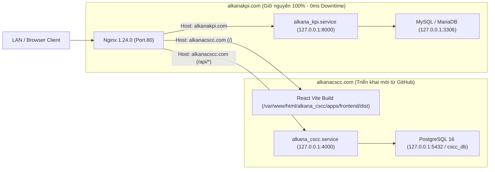

# Ubuntu 24.04 Co-Tenancy Production Deployment (`alkanacscc.com`)

## Overview & Brainstorm Contract

### 1. Outcome (Kết quả đầu ra)
- Triển khai hoàn chỉnh hệ thống **ALKANA Coating Schedule & Coating Cost (`alkanacscc.com`)** từ GitHub (`https://github.com/hotriluan/cscc.git`) lên máy chủ Ubuntu 24.04 (`192.168.18.33`) tại thư mục `/var/www/html/alkana_cscc`.
- Sao lưu (`pg_dump`) toàn bộ dữ liệu đã kiểm thử trên máy local (`users`, `customers`, `quotations`, `packingMappings`, `applicationSteps`, `applicationMethods`, `projects`, `revisions`, `revisionStatusHistory`) và khôi phục (`psql`) nguyên vẹn lên PostgreSQL 16 trên server `192.168.18.33`.
- Cấu hình dịch vụ nền `alkana_cscc.service` (`systemd`) tự động khởi chạy tại `127.0.0.1:4000` và Nginx Virtual Host `/etc/nginx/sites-available/alkana_cscc` phục vụ tên miền `alkanacscc.com` (port `80`).
- **Đảm bảo an toàn tuyệt đối (0ms downtime)** cho ứng dụng Django hiện hữu `alkanakpi.com`.

### 2. Constraints (Ràng buộc kỹ thuật & An toàn hệ thống)
- **Không chạm vào tài nguyên của `alkanakpi.com`**:
  - Không sửa `/var/www/html/alkana_kpi`, `/etc/systemd/system/alkana_kpi.service`, `/etc/nginx/sites-available/alkana_kpi`.
  - Không đụng tới MySQL/MariaDB (port `3306`) hay Gunicorn (port `8000`).
- **Graceful Nginx Reload**: Chỉ nạp cấu hình mới sau khi `sudo nginx -t` báo `syntax is ok` và `test is successful`, dùng `sudo systemctl reload nginx` (không dùng `restart`).
- **Cô lập CSDL & Tiến trình**:
  - PostgreSQL 16 lắng nghe nội bộ tại `127.0.0.1:5432` với database `cscc_db` và user `cscc`.
  - Backend Node.js lắng nghe nội bộ tại `127.0.0.1:4000` dưới quyền user `it`, group `www-data`.

### 3. Non-goals (Không nằm trong phạm vi)
- Không thay đổi cấu hình hay mã nguồn của `alkanakpi.com`.
- Không cài đặt Docker daemon để tránh làm thay đổi cấu hình bridge network / `iptables` trên production server.

### 4. Trade-offs & Better Approaches
- **Trade-offs**: Phương án **Native Systemd + Nginx Virtual Host + PostgreSQL 16** yêu cầu cài đặt `nodejs` và `postgresql` trực tiếp qua `apt`, nhưng đổi lại đạt độ tương thích 100% với mô hình vận hành hiện tại của `alkanakpi.com`, tiêu tốn cực ít RAM (~250 MB trên tổng 6.7 GiB RAM trống) và không ảnh hưởng tới network stack của máy chủ.
- **Better approaches**: `none — recommended direction is the requested one (Phương án 1: Native Systemd + Nginx Virtual Host + PostgreSQL 16 kèm script deploy.sh tự động cập nhật từ GitHub)`.

---

## Co-Tenancy Architecture Diagram

---

## Phases Roadmap

| Phase | Name | Effort | Status | Description |
|-------|------|--------|--------|-------------|
| 1 | [Local DB Backup & Server Runtime Preparation](./phase-01-local-db-backup-and-server-runtime-prep.md) | 0.5h | Completed | Kiểm tra baseline `alkanakpi.com`, dump dữ liệu PostgreSQL từ máy local, truyền lên server và cài đặt PostgreSQL 16 + Node.js 22 LTS. |
| 2 | [PostgreSQL Setup, GitHub Clone & Data Restore](./phase-02-postgresql-setup-and-local-data-restore.md) | 0.75h | Completed | Khởi tạo DB `cscc_db`, clone repo từ GitHub vào `/var/www/html/alkana_cscc`, nạp bản backup từ máy local và đối chiếu số lượng bản ghi. |
| 3 | [Production Build, Systemd Service & Nginx Virtual Host](./phase-03-build-systemd-service-and-nginx-vhost.md) | 0.75h | Completed | Build Frontend/Backend, tạo `alkana_cscc.service` (port 4000) và cấu hình Nginx Virtual Host `alkanacscc.com` với `systemctl reload nginx`. |
| 4 | [End-to-End Verification & GitHub Update Script](./phase-04-smoke-verification-and-update-script.md) | 0.5h | Completed | Tạo script `deploy.sh` cập nhật nhanh từ GitHub, kiểm thử thực tế cả `alkanacscc.com` lẫn `alkanakpi.com` (xác nhận không đổi PID). |

## Dependencies

- Local PostgreSQL 16 Tools: `C:\Program Files\PostgreSQL\16\bin\pg_dump.exe`
- Local SSH / SCP Tools: `C:\Program Files\PuTTY\plink.exe`, `C:\Program Files\PuTTY\pscp.exe`
- GitHub Repository: `https://github.com/hotriluan/cscc.git`
- Target Ubuntu Server: `192.168.18.33` (user `it`, paths `/var/www/html/alkana_cscc`, `/etc/systemd/system/alkana_cscc.service`, `/etc/nginx/sites-available/alkana_cscc`)

## Acceptance Criteria

- [x] `alkanakpi.com` hoạt động thông suốt trước, trong và sau khi triển khai; PID của `alkana_kpi.service` (Gunicorn) giữ nguyên không bị khởi động lại.
- [x] Toàn bộ dữ liệu từ máy local (`users`, `customers`, `quotations`, `projects`, `revisions`, `revisionStatusHistory`) được backup và restore đầy đủ sang PostgreSQL 16 trên server `192.168.18.33`.
- [x] `alkana_cscc.service` ở trạng thái `active (running)` và `enabled`, tự lắng nghe tại `127.0.0.1:4000`.
- [x] Truy cập `http://alkanacscc.com` trả về giao diện React Production và `http://alkanacscc.com/api/health` trả về `200 OK` với số lượng bản ghi khớp 100% với máy local.
- [x] Có sẵn script `/var/www/html/alkana_cscc/deploy.sh` để kéo code mới từ GitHub và cập nhật chỉ bằng 1 câu lệnh.

<!-- slug: ubuntu-production-deployment -->

