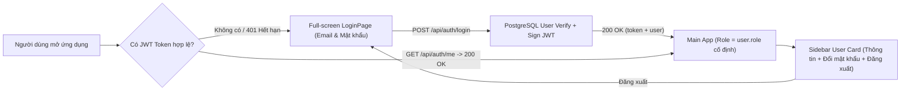

# Production Login Gate & Removal of Demo Role Switcher

## Overview & Brainstorm Contract

### 1. Outcome (Kết quả đầu ra)
- **Màn hình Đăng nhập bắt buộc (Full-screen Login Page)**: Khi người dùng chưa đăng nhập hoặc phiên JWT hết hạn / đã đăng xuất, hệ thống hiển thị trang Đăng nhập chuyên biệt mang nhận diện thương hiệu **ALKANA Coating**, chặn hoàn toàn quyền truy cập vào Sidebar và các phân hệ dữ liệu (`WORKSPACE`, `PROJECTS`, `REPORTS`, `MASTER_DATA`).
- **Xóa bỏ hoàn toàn chế độ Demo & Role Switcher**:
  - Xóa hộp chọn `Role Switcher / Chuyển nhanh vai trò` và dòng thông báo trạng thái demo khỏi Sidebar trái trong [`App.tsx`](../../apps/frontend/src/App.tsx).
  - Xóa mật khẩu điền sẵn (`123456`), email điền sẵn (`leader@alkana.vn`) và danh sách thẻ *"Đăng nhập nhanh 1-Click"* khỏi giao diện xác thực.
  - Khóa chặt quyền hạn (`role`) và phạm vi dữ liệu (`salesmanName`) theo đúng tài khoản `currentUser` đã xác thực từ bảng `User` trong PostgreSQL.
- **Quản lý phiên cá nhân & Đổi mật khẩu**:
  - Trên Sidebar hiển thị thẻ thông tin người dùng đang đăng nhập (Họ tên, Email, Badge vai trò, Salesman phụ trách nếu có) cùng 2 nút thao tác: **Tài khoản / Đổi mật khẩu** và **Đăng xuất (Logout)**.
  - Bổ sung API `POST /api/auth/change-password` và hộp thoại thông tin cá nhân cho phép người dùng tự đổi mật khẩu của mình.

### 2. Constraints (Ràng buộc kỹ thuật)
- Giữ nguyên 4 vai trò RBAC (`ADMIN`, `PROJECT_LEADER`, `SALES`, `TECHNICAL`) và cơ chế phân vùng dữ liệu theo `salesmanName`.
- Quản trị danh sách tài khoản hệ thống (Thêm/Sửa/Xóa User, gán Role & Salesman) tiếp tục tập trung tại `Master Data -> Users` dành riêng cho `ADMIN` ([`MasterDataManager.tsx`](../../apps/frontend/src/components/master/MasterDataManager.tsx)).
- Đảm bảo tương thích 100% với bộ kiểm thử tự động hiện có (`apps/backend/test/*.test.ts`).

### 3. Non-goals (Không nằm trong phạm vi)
- Không thêm OAuth bên thứ ba (Google/Microsoft) hoặc khôi phục mật khẩu qua SMTP email.
- Không thay đổi cấu trúc bảng `User` trong Prisma schema ([`schema.prisma`](../../apps/backend/prisma/schema.prisma)).

### 4. Trade-offs & Better Approaches
- **Trade-offs**: Phương án **Full-screen Login Gate + Ưu tiên tuyệt đối JWT đã xác thực ở Backend + Hỗ trợ tự đổi mật khẩu** yêu cầu tách trang Login riêng và bổ sung endpoint đổi mật khẩu, nhưng loại bỏ hoàn toàn lỗ hổng nâng quyền qua header `x-user-role` khi người dùng đã đăng nhập JWT.
- **Better approaches**: `none — recommended direction is the requested one (Phương án 1: Full-screen Login Gate + Xóa bỏ toàn bộ khối Role Switcher/Demo trên Sidebar + Cho phép người dùng xem thông tin cá nhân, tự đổi mật khẩu và Đăng xuất)`.

---

## Authentication & Session Flow Diagram

---

## Phases Roadmap

| Phase | Name | Effort | Status | Description |
|-------|------|--------|--------|-------------|
| 1 | [Backend JWT Priority & Change Password API](./phase-01-backend-auth-password-and-jwt-priority.md) | 0.5h | Completed | Ưu tiên tuyệt đối `role` và `salesmanName` từ JWT hợp lệ trong middleware, bổ sung `changeUserPassword` và endpoint `POST /api/auth/change-password`. |
| 2 | [Full-Screen Login Page & User Profile Modal](./phase-02-frontend-fullscreen-login-and-profile-modal.md) | 0.5h | Completed | Xây dựng trang đăng nhập toàn màn hình (`LoginPage.tsx`), nâng cấp hộp thoại thông tin tài khoản & đổi mật khẩu (`UserAuthModal.tsx`), loại bỏ hoàn toàn 1-click demo login và mật khẩu điền sẵn. |
| 3 | [Sidebar Demo Removal, Session Gate & E2E Verification](./phase-03-sidebar-demo-removal-and-verification.md) | 0.5h | Completed | Chặn truy cập khi chưa đăng nhập trong `App.tsx`, xóa bỏ `Role Switcher` và text demo trên Sidebar, đồng bộ `client.ts` và chạy kiểm thử toàn diện. |

## Acceptance Criteria

- [x] Mở ứng dụng khi chưa đăng nhập hoặc sau khi bấm **Đăng xuất** sẽ hiển thị màn hình Login toàn trang; không hiển thị Sidebar hay dữ liệu nội bộ.
- [x] Khối `Role Switcher / Chuyển nhanh vai trò` và dòng mô tả trạng thái demo trên Sidebar bị loại bỏ hoàn toàn.
- [x] Form đăng nhập không còn điền sẵn mật khẩu `123456` và không còn danh sách thẻ đăng nhập nhanh 1-Click.
- [x] Vai trò (`role`) được khóa chặt theo tài khoản đang đăng nhập (`currentUser.role`).
- [x] Người dùng đang đăng nhập có thể xem thông tin cá nhân, tự đổi mật khẩu (`POST /api/auth/change-password`) và Đăng xuất.
- [x] `npm run typecheck`, `npm run build`, và `npm test` chạy pass 100%.

<!-- slug: production-login-remove-demo -->

