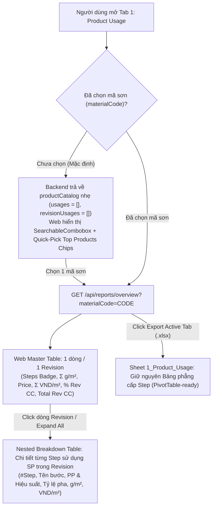

# Product Usage Report: On-Demand Selection, Revision Rollup & Step Breakdown

## Overview & Brainstorm Contract

### 1. Outcome (Kết quả đầu ra)
1. **Loại bỏ chế độ tải tất cả sản phẩm (`ALL`) ở Tab 1 (`Product Usage`)**:
   - Khi mở Tab 1 mà chưa chọn mã sơn cụ thể (`selectedMaterialCode` trống), Backend không truy xuất/trả về mảng dòng chi tiết `usages` của toàn bộ cơ sở dữ liệu (chỉ trả về danh mục `productCatalog` gọn nhẹ phục vụ tìm kiếm).
   - Giao diện Web hiển thị khung chọn sản phẩm theo yêu cầu (**On-Demand Selection**) kèm danh sách **Quick-Pick Top Products** (các mã sơn dùng phổ biến nhất) để bấm chọn nhanh 1 chạm hoặc tìm trên `SearchableCombobox`.
2. **Hiển thị bảng chính theo cấp `Revision` + Chức năng `Breakdown` xuống `Step` trên Web**:
   - Mỗi **Revision** có sử dụng sản phẩm sơn đang chọn chỉ hiển thị **1 dòng duy nhất** trên bảng chính.
   - Dòng Revision tổng hợp sẵn các chỉ số của sản phẩm đó trong Revision:
     - Số bước sử dụng & nhãn bước tóm tắt (VD: `2 bước: #2, #5`).
     - Tổng định mức tiêu hao của sản phẩm trong Revision (`Σ Item CA+Loss g/m²`).
     - Đơn giá `Price Snapshot (VND/Kg)`.
     - Tổng chi phí của sản phẩm trong Revision (`Σ Item Cost VND/m²`) và **Tỷ trọng `%` trên Tổng chi phí Revision (`% of Rev CC`)**.
     - Tổng chi phí sơn của cả Revision (`Total Rev CC VND/m²`).
   - Click vào dòng Revision (hoặc bấm nút `Expand All / Collapse All`) sẽ **Breakdown (sổ xuống)** bảng con liệt kê chi tiết các **Step** có sử dụng sản phẩm đó trong Revision (`#Step`, `Tên công đoạn`, `Phương pháp & Hiệu suất`, `Tỷ lệ pha & Share %`, `Định mức g/m²`, `Chi phí VND/m²`).
3. **Giữ nguyên xuất Excel bảng phẳng (`Export Active Tab`) & Loại bỏ nút `Export All 7 Reports`**:
   - Khi bấm `Export Active Tab (.xlsx)` tại Tab 1, file Excel xuất ra **giữ nguyên 100% cấu trúc bảng phẳng cấp Step hiện tại** (16 cột cho `TECHNICAL`, 20 cột cho các vai trò khác) để người dùng chạy **PivotTable** trong Excel.
   - **Xóa bỏ** nút `Export All 7 Reports (.xlsx) / Xuất Trọn bộ 7 Báo cáo` khỏi thanh công cụ Header của trung tâm báo cáo.

### 2. Constraints (Ràng buộc kỹ thuật & Phân quyền RBAC)
- **Column-level RBAC (`TECHNICAL`)**: Tài khoản `TECHNICAL` (TA) tiếp tục ẩn hoàn toàn (`null`) mọi cột đơn giá và chi phí (`Price Snapshot`, `Total Item Cost`, `% Share of Rev CC`, `Total Rev CC`, `Step Item Cost`) trên cả dòng Revision, bảng Breakdown Step và file Excel.
- **Row-level RBAC (`salesmanName`)**: Tài khoản `SALES` và `TECHNICAL` chỉ truy vấn được dữ liệu thuộc `salesmanName` được gán.
- **Bộ lọc toàn cục**: Tương thích 100% với `Revision Scope (ALL | LATEST | APPROVED)`, `Salesman`, `Customer`, `Finishing System`, `Furniture Item`, và `Quick Search`.
- **Chuẩn giao diện**: Song ngữ **English / Tiếng Việt (EN/VI)** đồng bộ toàn hệ thống.

### 3. Non-goals (Không nằm trong phạm vi)
- Không thay đổi công thức tính toán gốc của CS/CC/BOM trong `@cscc/shared`.
- Không thay đổi cấu trúc bảng dữ liệu PostgreSQL (`schema.prisma`).
- Không thay đổi logic hiển thị của 6 báo cáo còn lại (`Tab 2` -> `Tab 7`).

### 4. Trade-offs & Better Approaches
- **Trade-offs**:
  - Bỏ chế độ `ALL` yêu cầu người dùng chọn 1 mã sơn trước khi xem bảng chi tiết (hoặc click 1 chạm vào gợi ý mã sơn phổ biến), đổi lại **triệt tiêu 100% tải trọng dữ liệu thừa** khi khởi tạo trang báo cáo và đảm bảo các chỉ số KPI (`Avg g/m²`, `Min/Avg/Max VND/m²`) luôn có ý nghĩa thống kê trên đúng 1 sản phẩm.
  - Duy trì song song `revisionUsages` (phục vụ bảng Master-Detail trên Web) và `usages` phẳng (khi đã chọn mã sơn, phục vụ xuất Excel) giúp tách bạch hoàn hảo nhu cầu đọc nhanh trên Web và nhu cầu chạy PivotTable trên Excel mà không phát sinh thêm truy vấn DB.
- **Better approaches**: `none — recommended direction is the requested one (On-Demand Single-Product Selection + Web Revision-to-Step Breakdown + Flat Pivot-Ready Single-Tab Excel Export)`.

---

## Architecture & Data Flow

---

## Phases Roadmap

| Phase | Name | Effort | Status | Description |
|-------|------|--------|--------|-------------|
| 1 | [Shared Types & Backend Revision Rollup Service](./phase-01-shared-types-and-backend-aggregation.md) | 1.0h | Completed | Bổ sung kiểu `ProductUsageRevisionRow` & `ProductUsageStepBreakdownRow` vào `@cscc/shared`; cập nhật `report.service.ts` để chỉ tính chi tiết khi có `materialCode` và gom nhóm theo Revision kèm danh sách Step con, giữ nguyên `report-excel.service.ts`. |
| 2 | [Frontend On-Demand Selector, Revision Breakdown & Export Toolbar](./phase-02-frontend-revision-breakdown-and-export-ui.md) | 1.0h | Completed | Cập nhật `ReportsAnalyticsView.tsx`: bỏ chế độ `ALL`, thêm Quick-Pick Chips khi chưa chọn SP, hiển thị bảng Revision kèm Breakdown Step và xóa nút `Export All 7 Reports`. |
| 3 | [Automated Testing & End-to-End Verification](./phase-03-automated-testing-and-verification.md) | 0.5h | Completed | Cập nhật và bổ sung kiểm thử tự động trong `reports-analytics-rbac.test.ts` cho cơ chế On-Demand, Revision Rollup, Step Breakdown, RBAC `TECHNICAL` và xuất Excel phẳng. |

## Dependencies

- Shared Package: [`packages/shared/src/types.ts`](../../packages/shared/src/types.ts)
- Backend: [`apps/backend/src/services/report.service.ts`](../../apps/backend/src/services/report.service.ts), [`apps/backend/src/services/report-excel.service.ts`](../../apps/backend/src/services/report-excel.service.ts)
- Frontend: [`apps/frontend/src/components/reports/ReportsAnalyticsView.tsx`](../../apps/frontend/src/components/reports/ReportsAnalyticsView.tsx)
- Tests: [`apps/backend/test/reports-analytics-rbac.test.ts`](../../apps/backend/test/reports-analytics-rbac.test.ts)

## Acceptance Criteria

- [x] Mở Tab 1 khi chưa chọn mã sơn không tải/render danh sách dòng vật tư của toàn bộ hệ thống (`usages: []`, `revisionUsages: []`), hiển thị khung hướng dẫn chọn sản phẩm kèm Quick-Pick Chips từ `productCatalog`.
- [x] Khi chọn 1 mã sơn cụ thể, bảng trên Web chỉ hiển thị các **Revision** có sử dụng mã sơn đó (**1 dòng / 1 Revision**), kèm số liệu tổng hợp của mã sơn trong Revision (`Số bước & nhãn bước`, `Σ g/m²`, `Price Snapshot`, `Σ VND/m²`, `% Share of Rev CC`, `Total Rev CC`).
- [x] Bấm vào từng dòng Revision (hoặc nút `Expand All / Collapse All`) sẽ mở/đóng bảng **Breakdown** chi tiết các bước (`Step`) sử dụng mã sơn đó trong Revision.
- [x] Tài khoản `TECHNICAL` ẩn toàn bộ các cột giá và chi phí (`null`) ở cả dòng Revision và bảng Breakdown Step.
- [x] Bấm `Export Active Tab (.xlsx)` ở Tab 1 xuất ra file Excel giữ nguyên 100% cấu trúc bảng phẳng cấp Step hiện tại để chạy PivotTable.
- [x] Nút `Export All 7 Reports (.xlsx) / Xuất Trọn bộ 7 Báo cáo` được loại bỏ khỏi giao diện.
- [x] `npm run typecheck`, `npm run build`, và `npm test` chạy pass 100%.

<!-- slug: product-usage-revision-breakdown -->

