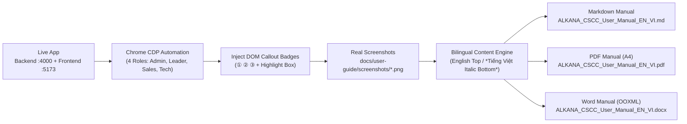

# ALKANA CS & CC Bilingual Visual User Manual (EN/VI — Markdown, PDF, Word `.docx`)

## Overview & Brainstorm Contract

### 1. Outcome (Kết quả đầu ra)
Bộ **Hướng dẫn Sử dụng Người dùng Cuối (End-User Manual)** đầy đủ, trực quan, súc tích cho hệ thống **ALKANA Coating — Coating Schedule (CS) & Coating Cost (CC)** tại thư mục [`docs/user-guide/`](../../docs/user-guide/):
1. **Bộ ảnh chụp màn hình thực tế có đánh số Callout (`docs/user-guide/screenshots/*.png`)**:
   - Chụp trực tiếp từ ứng dụng Web đang chạy thực tế (`1440x900`) với dữ liệu chuẩn (`NITORI-HO CHI MINH / NTR 001` và 4 vai trò `ADMIN`, `LEADER`, `SALES`, `TECHNICAL`).
   - Tự động gắn nhãn số thứ tự thao tác (`①`, `②`, `③`, `④`) và khung viền highlight đỏ trực tiếp trên đúng nút bấm/vùng giao diện ở từng bước.
2. **Định dạng Song ngữ Cố định (Fixed Bilingual Format — EN / *VI*)**:
   - Mọi tiêu đề, bước thao tác, bảng giải thích và lưu ý đều trình bày đồng nhất: **Tiếng Anh (English) ở dòng trên** và ***Tiếng Việt in nghiêng (Italic Vietnamese) ở dòng dưới***, đồng bộ 100% với ngôn ngữ giao diện của toàn dự án.
3. **Xuất bản 3 Định dạng Chuẩn (Multi-Format Deliverables)**:
   - **Markdown (`.md`)**: [`docs/user-guide/ALKANA_CSCC_User_Manual_EN_VI.md`](../../docs/user-guide/ALKANA_CSCC_User_Manual_EN_VI.md) (kèm bản HTML gốc [`docs/user-guide/ALKANA_CSCC_User_Manual_EN_VI.html`](../../docs/user-guide/ALKANA_CSCC_User_Manual_EN_VI.html)).
   - **PDF (`.pdf`)**: [`docs/user-guide/ALKANA_CSCC_User_Manual_EN_VI.pdf`](../../docs/user-guide/ALKANA_CSCC_User_Manual_EN_VI.pdf) (chuẩn trang A4, phân trang thông minh, nhúng toàn bộ ảnh thực tế sắc nét).
   - **Microsoft Word (`.docx`)**: [`docs/user-guide/ALKANA_CSCC_User_Manual_EN_VI.docx`](../../docs/user-guide/ALKANA_CSCC_User_Manual_EN_VI.docx) (chuẩn OOXML Word, có trang bìa, phân cấp Heading 1/2/3, bảng biểu chuẩn `w:shd val="clear"`, nhúng ảnh PNG thực tế và đánh số trang).

### 2. Constraints (Ràng buộc)
- **Không dùng ảnh giả lập**: 100% ảnh minh họa phải được chụp từ giao diện thực của ứng dụng.
- **Súc tích, không dư thừa**: Mỗi bước đi theo cấu trúc **Action (Thao tác) $\rightarrow$ UI Target (Vị trí) $\rightarrow$ Result (Kết quả)**.
- **Bảo mật & RBAC**: Phản ánh chính xác cơ chế phân quyền theo vai trò (`TECHNICAL` ẩn toàn bộ đơn giá/chi phí; `SALES`/`TECHNICAL` giới hạn theo `salesmanName`; `LEADER`/`ADMIN` toàn quyền) và không lộ secret hệ thống.

### 3. Non-goals (Không nằm trong phạm vi)
- Không thay đổi bất kỳ logic tính toán hay schema cơ sở dữ liệu nào của ứng dụng.
- Không viết tài liệu hướng dẫn lập trình (Developer API/Codebase Guide) trong tài liệu dành cho End-User.

### 4. Trade-offs & Better Approaches
- **Trade-offs**:
  - Sử dụng script tự động hóa trình duyệt Chrome Headless qua CDP (`scripts/generate-user-manual.mjs`) để vừa thao tác giao diện thật, vừa tiêm Callout Badge (`①`, `②`, `③`) và xuất đồng bộ `.md`, `.html`, `.pdf`, `.docx` đòi hỏi viết kịch bản chụp chuẩn xác từng selector, nhưng đổi lại đảm bảo **100% hình ảnh khớp tuyệt đối với code thực tế** và có thể tái tạo (re-generate) chỉ bằng 1 lệnh khi giao diện thay đổi.
- **Better approaches**: `Single-source bilingual specification + automated live browser screenshot capture with injected DOM callout overlays + automated multi-format export (.md, .pdf, .docx)`.

---

## Architecture & Generation Pipeline

---

## Phases Roadmap

| Phase | Name | Effort | Status | Description |
|-------|------|--------|--------|-------------|
| 1 | [Automated Live Browser Screenshot & Callout Capture](./phase-01-live-browser-screenshot-capture.md) | 1.0h | Completed | Khởi chạy Backend/Frontend thực tế, điều khiển Chrome qua CDP đăng nhập các role, điều hướng qua toàn bộ 8 phân hệ, gắn Callout `① ② ③` và chụp bộ ảnh thực tế vào `docs/user-guide/screenshots/`. |
| 2 | [Bilingual Content Authoring & Markdown / HTML Generation](./phase-02-bilingual-content-markdown-html.md) | 1.0h | Completed | Biên soạn nội dung hướng dẫn sử dụng chi tiết từng bước theo chuẩn Song ngữ cố định (English trên / *Tiếng Việt in nghiêng dưới*) và xuất file `.md` + `.html`. |
| 3 | [PDF & Word (`.docx`) Compilation and Verification](./phase-03-pdf-and-docx-compilation-verification.md) | 1.0h | Completed | Kết xuất file `ALKANA_CSCC_User_Manual_EN_VI.pdf` (A4) và `ALKANA_CSCC_User_Manual_EN_VI.docx` (nhúng ảnh, bảng biểu, phân trang chuẩn), kiểm tra toàn diện và cập nhật `README.md`. |

## Acceptance Criteria

- [x] Bộ ảnh chụp màn hình thực tế tại `docs/user-guide/screenshots/` bao phủ toàn bộ 8 chương nghiệp vụ (Đăng nhập, Quản lý Dự án & Revision, Lập CS, Xem CC, Dự toán BOM, Xuất Excel & In A4, 7 Báo cáo Phân tích, Quản trị 6 bảng Master Data & Users) kèm đánh dấu vị trí `①`, `②`, `③` trực quan.
- [x] Mọi mục nội dung tuân thủ nghiêm ngặt định dạng **Song ngữ cố định: Tiếng Anh ở trên, *Tiếng Việt in nghiêng ở dưới***.
- [x] File Markdown [`docs/user-guide/ALKANA_CSCC_User_Manual_EN_VI.md`](../../docs/user-guide/ALKANA_CSCC_User_Manual_EN_VI.md) đầy đủ, rõ ràng, liên kết đúng toàn bộ hình ảnh.
- [x] File PDF [`docs/user-guide/ALKANA_CSCC_User_Manual_EN_VI.pdf`](../../docs/user-guide/ALKANA_CSCC_User_Manual_EN_VI.pdf) hiển thị chuẩn font tiếng Việt/Anh, hình ảnh sắc nét, bố cục trang A4 chuyên nghiệp.
- [x] File Word [`docs/user-guide/ALKANA_CSCC_User_Manual_EN_VI.docx`](../../docs/user-guide/ALKANA_CSCC_User_Manual_EN_VI.docx) mở chuẩn trên Microsoft Word (hợp lệ OOXML, nhúng đầy đủ ảnh PNG, bảng biểu và định dạng song ngữ).
- [x] Dọn dẹp toàn bộ tiến trình trình duyệt/server tạm thời sau khi hoàn tất.

<!-- slug: bilingual-visual-user-manual -->

