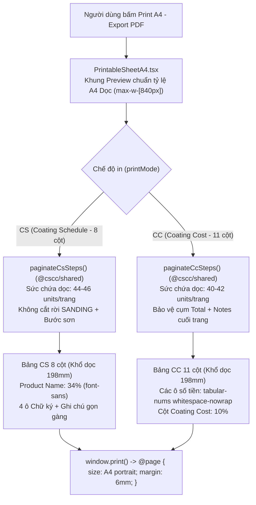

# A4 Portrait Print & PDF Export Layout for Coating Schedule (CS) & Coating Cost (CC)

## Overview & Brainstorm Contract

### 1. Outcome (Kết quả đầu ra)
1. **Chuyển chuẩn In A4 & Xuất PDF sang Khổ Dọc (`A4 Portrait` — `210mm × 297mm`)**:
   - Thiết lập `@page { size: A4 portrait; margin: 6mm; }` trong [`apps/frontend/src/index.css`](../../apps/frontend/src/index.css) để hộp thoại in/xuất PDF của trình duyệt tự động nhận khổ giấy A4 dọc (vùng in khả dụng `198mm × 285mm`).
   - Thu gọn khung Preview trên màn hình trong [`PrintableSheetA4.tsx`](../../apps/frontend/src/components/print/PrintableSheetA4.tsx) về kích thước chuẩn tỷ lệ A4 dọc (`max-w-[840px]`) để trải nghiệm xem trước trên Web đồng nhất 100% với bản in PDF (**WYSIWYG**).
2. **Tối ưu bố cục & Typography gọn gàng, rõ ràng, không bể layout trên bề ngang `198mm`**:
   - **Header & Metadata**: Cân chỉnh kích thước Logo, tiêu đề song ngữ và lưới Metadata 3 cột gọn gàng, không bị tràn hay đè chữ.
   - **Bảng Coating Schedule (CS — 8 cột)**:
     - Cân đối lại `<colgroup>` ưu tiên diện tích cho cột `Product Name / Tên sản phẩm` (`34%`) và `Application Step / Bước thi công` (`14.5%`).
     - Chuyển font cột `Product Name` từ `font-mono` sang `font-sans font-semibold` (tiết kiệm ~22% bề ngang ký tự mà vẫn sắc nét), khóa `whitespace-nowrap tabular-nums` cho các cột số (`No.`, `Mixing Ratio`, `CA`).
     - Tinh gọn tiêu đề song ngữ trên `<thead>` để hiển thị gọn trong 2 dòng.
   - **Bảng Coating Cost (CC — 11 cột)**:
     - Thiết kế lại `<colgroup>` 11 cột cho khổ dọc `198mm` (dành `10%` cho cột cuối `Coating Cost`, `26%` cho `Product Name`, `9%` cho `Item`, và tối ưu các cột số ngắn `Ratio` `5%`, `Efficiency` `5.5%`, `CA` `6%`).
     - Áp dụng `whitespace-nowrap tabular-nums` cho toàn bộ các ô đơn giá, định mức và chi phí để các con số tiền tệ (`543,000`, `119,219.05`, `894,143`) **tuyệt đối không bao giờ bị gãy dòng**.
     - Cô đọng nhãn tiêu đề song ngữ 11 cột và dùng cỡ chữ chuẩn in kỹ thuật (`print:text-[8.5px]` cho dữ liệu, `print:text-[8px]` cho header bảng) để bảng 11 cột thoáng, rõ nét và không tràn viền.
3. **Cập nhật Thuật toán Phân trang (`paginateCsSteps` & `paginateCcSteps`) theo chiều cao A4 Dọc**:
   - Khai thác lợi thế chiều dọc tăng thêm `+43.9%` (từ `198mm` lên `285mm`), nâng sức chứa mỗi trang từ `30 units` lên `44–46 units` (CS) và từ `25 units` lên `40–42 units` (CC).
   - Các quy trình sơn 5–7 bước sẽ nằm trọn vẹn trong **1 trang A4 dọc duy nhất**; quy trình dài 10 bước (50 dòng hóa chất như `NTR 001`) giảm từ 3 trang xuống **2 trang A4 dọc**, loại bỏ hoàn toàn hiện tượng rớt phần Ghi chú & 4 ô Chữ ký sang trang thứ 3.

### 2. Constraints (Ràng buộc kỹ thuật & Nghiệp vụ)
- Giữ nguyên 100% dữ liệu nghiệp vụ, công thức tính toán chính xác IEEE-754, và quy tắc phân quyền RBAC (`TECHNICAL` không xem/in được giá và bảng CC).
- Không cắt đôi bất kỳ bước sơn nào (`ScheduleStep` hoặc cặp `SANDING` + bước sơn liền kề) qua ranh giới giữa 2 trang giấy.
- Giữ nguyên thông tin song ngữ **English / Tiếng Việt (EN/VI)** trên toàn bộ biểu mẫu in.

### 3. Non-goals (Không nằm trong phạm vi)
- Không thay đổi giao diện bảng chỉnh sửa trên màn hình làm việc chính (`CoatingScheduleEditor.tsx`, `CoatingCostTable.tsx`).
- Không thay đổi cấu trúc xuất file Excel (`.xlsx`) ở Backend.

### 4. Trade-offs & Better Approaches
- **Trade-offs**:
  - Chuyển sang khổ dọc làm giảm bề ngang trang giấy từ `285mm` xuống `198mm`, đòi hỏi bảng CC 11 cột phải sử dụng cỡ chữ in `8.5px` và khóa `whitespace-nowrap` cho các cột số; đổi lại chiều cao trang tăng từ `198mm` lên `285mm`, giúp giảm 30%–50% số trang in và khớp hoàn toàn với chuẩn tập hồ sơ/hợp đồng A4 dọc của doanh nghiệp.
- **Better approaches**: `none — recommended direction is the requested one (Full A4 Portrait Standard with synchronized column proportions, sans-serif product typography, non-breaking tabular numbers, and portrait vertical pagination)`.

---

## Architecture & Layout Flow

---

## Phases Roadmap

| Phase | Name | Effort | Status | Description |
|-------|------|--------|--------|-------------|
| 1 | [Shared Portrait Pagination Engine](./phase-01-shared-portrait-pagination-engine.md) | 0.5h | Completed | Cập nhật hằng số sức chứa trang dọc (`44/46 units` cho CS, `40/42 units` cho CC) và ngưỡng ngắt dòng theo bề ngang cột A4 dọc trong `packages/shared/src/calculator.ts`. |
| 2 | [Frontend A4 Portrait Layout, Typography & Print CSS](./phase-02-frontend-a4-portrait-layout-and-css.md) | 1.0h | Completed | Cập nhật `@page { size: A4 portrait }` trong `index.css`; tối ưu khung Preview, Header, Metadata, `<colgroup>` và Typography chống bể layout cho bảng CS (8 cột) và CC (11 cột) trong `PrintableSheetA4.tsx`. |
| 3 | [Automated Testing & Verification](./phase-03-automated-testing-and-verification.md) | 0.5h | Completed | Cập nhật unit test phân trang A4 dọc trong `packages/shared/src/calculator.test.ts`; chạy kiểm tra `typecheck`, `test` và `build` toàn hệ thống. |

## Dependencies

- Shared Package: [`packages/shared/src/calculator.ts`](../../packages/shared/src/calculator.ts), [`packages/shared/src/calculator.test.ts`](../../packages/shared/src/calculator.test.ts)
- Frontend: [`apps/frontend/src/index.css`](../../apps/frontend/src/index.css), [`apps/frontend/src/components/print/PrintableSheetA4.tsx`](../../apps/frontend/src/components/print/PrintableSheetA4.tsx)

## Acceptance Criteria

- [x] CSS `@media print` đặt `@page { size: A4 portrait; margin: 6mm; }` để trình duyệt tự động chọn khổ giấy A4 Dọc khi bấm In / Xuất PDF.
- [x] Khung xem trước (`PrintableSheetA4.tsx`) trên màn hình có tỷ lệ khổ dọc gọn gàng (`max-w-[840px]`), phản ánh trung thực bố cục trang in.
- [x] Bảng **Coating Schedule (CS - 8 cột)** và **Coating Cost (CC - 11 cột)** hiển thị rõ ràng, cân đối trên khổ A4 dọc, không bị tràn lề ngang, các con số đơn giá/chi phí/định mức không bị rớt dòng.
- [x] Bộ phân trang `paginateCsSteps` và `paginateCcSteps` tận dụng đúng chiều cao khổ A4 dọc (quy trình 10 bước `NTR 001` giảm từ 3 trang xuống 2 trang, không còn trang chữ ký mồ côi).
- [x] `npm run typecheck`, `npm test`, và `npm run build` chạy pass 100%.

<!-- slug: a4-portrait-print-pdf -->

