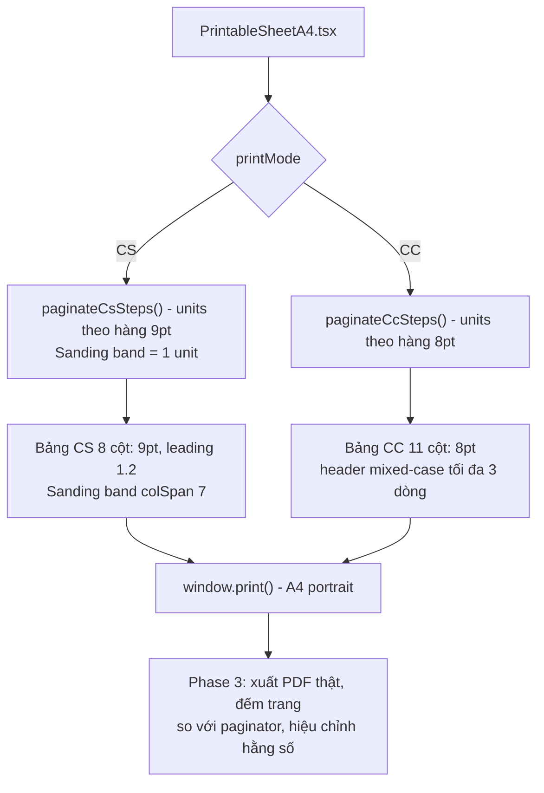

# A4 Portrait Print Readability: Typography, Column Rebalance & Sanding Band

## Overview

Bản in/PDF hiện tại (xem `docs/ALKANA_CS_NTR 001_Rev00.pdf`, `docs/ALKANA_CC_NTR 001_Rev00.pdf`) dùng chữ quá nhỏ: dữ liệu CS `9px ≈ 6.75pt`, header CS `≈ 6pt`, dữ liệu CC `≈ 6.4pt`, header CC `≈ 5.6pt`. Trong khi đó cột `Product Name` chỉ dùng ~50% bề ngang, dòng `SANDING / CHÀ NHÁM` gãy 2 dòng và trang 1 của CC trống ~78mm cuối trang.

**Insight then chốt:** dòng CS cao ~13pt nhưng chữ chỉ 6.75pt — phần còn lại là leading + padding. Siết `line-height 1.2` và padding dọc `1pt` cho phép chữ **9pt** mà chiều cao dòng chỉ tăng ~5%. Cộng với dải Chà nhám 1 dòng (tiết kiệm ~9 × 9pt), quy trình 10 bước NTR 001 vẫn nằm trong 2 trang.

## Brainstorm Contract

### Outcome
- Bản in/PDF CS và CC dễ đọc rõ rệt trên A4 dọc:
  - CS dữ liệu **9pt**, header bảng **7.5pt**.
  - CC dữ liệu **8pt**, header bảng **7pt**.
  - Metadata **8.5pt**, Remark/Notes/Chữ ký **8pt**, tiêu đề **12pt**.
  - Không còn chữ nào < 7pt.
- Bề ngang cột phân bổ theo nội dung thực; dòng Chà nhám thành **dải ngang 1 dòng** (đã được người dùng chấp nhận khác bố cục Excel gốc).
- Bộ phân trang khớp chiều cao thực tế của layout mới: không tràn trang, không để trống lãng phí.

### Constraints
- Giữ `@page { size: A4 portrait; margin: 6mm; }`.
- Giữ song ngữ EN/VI, giữ 100% dữ liệu, công thức, RBAC (`TECHNICAL` không xem/in CC).
- Không tách một bước sơn (hay cặp `SANDING` + bước liền sau) qua 2 trang; Remark + 4 ô chữ ký (CS), Total + Notes (CC) luôn đi cùng nhau.
- Người dùng chấp nhận quy trình rất dài có thể sang trang 3 do chữ 9pt.

### Non-goals
- Không đổi giao diện editor (`CoatingScheduleEditor.tsx`, `CoatingCostTable.tsx`).
- Không đổi file Excel xuất ra từ backend.
- Không làm cơ chế auto-fit/co giãn chữ động theo nội dung.
- Không ghi đè 2 file PDF mẫu trong `docs/` (bản mới xuất ra thư mục reports của plan để so sánh).

### Acceptance Criteria
- [x] Mọi cỡ chữ in đúng thang đã chốt (đặt bằng đơn vị `pt`); không có chữ < 7pt.
- [x] CS: dòng Chà nhám render 1 dòng dạng `SANDING / CHÀ NHÁM — <sandingSpec>` trải từ cột 2 đến cột 8.
- [x] Không chữ nào tràn viền ô (đặc biệt header `Efficiency`); số tiền và khoảng số (`40-45°C`, `#180-240`, `100-120`) không bị ngắt dòng ở giữa.
- [x] NTR 001 in ra: **CS = 2 trang**, chữ ký nằm cùng trang với bước cuối; **CC = 2 trang**.
- [x] Số trang PDF thực tế do trình duyệt xuất **bằng** số trang bộ phân trang tính (không có trang tràn).
- [x] Quy trình 5 bước (2–3 hóa chất/bước) vẫn nằm trong 1 trang cho cả CS và CC.
- [x] `npm run typecheck`, `npm test`, `npm run build` pass.

### Trade-offs
- **Chữ 9pt so với 8.5pt**: dễ đọc hơn, giả định chính là dòng chỉ cao thêm ~5% nhờ siết leading/padding. Hỏng đầu tiên khi tên vật tư dài làm nhiều dòng wrap 2 lần → quy trình dài sang trang 3 (đã được chấp nhận).
- **Dải Chà nhám**: giả định người đọc quen ranh giới bước bằng dải nền xám. Hỏng đầu tiên khi `sandingSpec` rất dài (> ~70 ký tự) phải wrap — ước lượng đơn vị phải tính trường hợp này.
- **Ước lượng đơn vị (heuristic) so với đo DOM thật**: giữ heuristic hiện có (đơn giản, chạy được ở shared/test), nhưng bắt buộc hiệu chỉnh bằng bản in thật ở Phase 3. Hỏng đầu tiên khi font hệ thống khác metric — chừa biên an toàn ~5%.

Better approaches: none — recommended direction is the requested one (đo trên PDF thực tế cho thấy chiều cao dòng bị chi phối bởi padding/leading, không phải cỡ chữ).

## Layout Flow

## Phases

| Phase | Name | Effort | Status | Description |
|-------|------|--------|--------|-------------|
| 1 | [Pagination Recalibration](./phase-01-pagination-recalibration.md) | 0.75h | Completed | Hằng số trang và ngưỡng ký tự theo chữ 9pt/8pt, sanding band 1 dòng; cập nhật test. |
| 2 | [Print Typography, Columns & Sanding Band](./phase-02-print-typography-columns-sanding-band.md) | 1.25h | Completed | Thang chữ pt, siết leading/padding, colgroup mới, dải Chà nhám, chống ngắt khoảng số, sửa header tràn. |
| 3 | [Real Print Verification & Calibration](./phase-03-real-print-verification-and-calibration.md) | 1h | Completed | Xuất PDF thật NTR 001 + các ca biên, so số trang với paginator, tinh chỉnh hằng số, chạy toàn bộ gate. |

Phase 1 và 2 độc lập về file; Phase 3 phụ thuộc cả hai và là nơi chốt hằng số cuối cùng.

## Files

- Modify: [`packages/shared/src/calculator.ts`](../../packages/shared/src/calculator.ts) (L378–L609)
- Modify: [`packages/shared/src/calculator.test.ts`](../../packages/shared/src/calculator.test.ts) (L211–L310)
- Modify: [`apps/frontend/src/components/print/PrintableSheetA4.tsx`](../../apps/frontend/src/components/print/PrintableSheetA4.tsx)
- Possibly modify: [`apps/frontend/src/index.css`](../../apps/frontend/src/index.css) (chỉ khi cần class in dùng chung)
- Optional docs: `docs/user-guide/screenshots/14-print-a4-preview.png` (chụp lại nếu sách hướng dẫn hiển thị bố cục bảng in)

<!-- slug: a4-print-readability-typography -->

