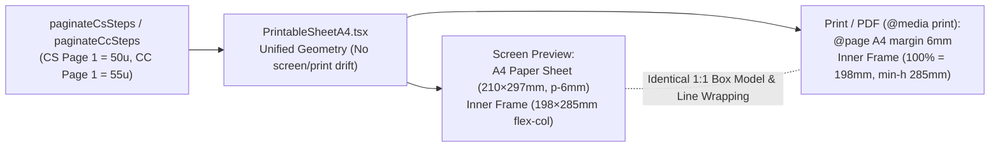

# A4 True-WYSIWYG Print Preview & Full-Height Sheet Pagination

## Overview

Giải quyết triệt để hiện tượng Trang 1 của bản in CS và CC bị ngắt trang sớm để trống ~44mm cuối tờ giấy A4, đồng thời biến màn hình Preview (`PrintableSheetA4.tsx`) thành bản mô phỏng **True-WYSIWYG 100%** (tỷ lệ `198mm × 285mm` khớp từng milimet, từng điểm ngắt dòng và khoảng trống cuối trang với tờ giấy A4/PDF thực tế).

## Brainstorm Contract

### Outcome
- **Màn hình Preview = Bản in A4 / PDF 100% (True-WYSIWYG):**
  - Mọi spacing, chiều cao logo (`h-7`), padding (`p-[2mm]`), kích thước vùng in (`width: 198mm; min-height: 285mm`) được hợp nhất giữa chế độ xem trên màn hình và chế độ `@media print` (xóa bỏ sự lệch kích thước do các class `print:*` khác với screen).
  - Trên màn hình Preview, mỗi trang được hiển thị như một tờ giấy A4 trắng thật (`210mm × 297mm`, lề `6mm`, khung viền trong `198mm × 285mm`) đặt trên nền bàn làm việc tối màu. Người dùng nhìn thấy trên màn hình **chính xác 100%** vị trí ngắt dòng, số bước trên mỗi trang và khoảng trống còn lại dưới đáy trang giống hệt khi in ra giấy.
- **Lấp đầy Trang 1 hợp lý (Phương án 1):**
  - **Coating Cost (CC):** Tăng ngân sách `CC_FIRST_PAGE_MAX_UNITS` lên `55` (và `CC_NEXT_PAGE_MAX_UNITS` lên `62`). Với quy trình chuẩn 10 bước như `NTR 001` (50 dòng hóa chất + Footer Total/Notes/Remark), toàn bộ bảng tính chi phí **nằm gọn trong 1 trang A4 duy nhất (`Page 1 / 1`)**, cao `~274mm / 285mm` (không còn tràn lẻ Bước 10 sang trang 2). Nếu quy trình dài ≥ 11 bước, Trang 1 chứa trọn 10 bước (`~260mm / 285mm`) trước khi qua Trang 2.
  - **Coating Schedule (CS):** Tăng ngân sách `CS_FIRST_PAGE_MAX_UNITS` lên `50` (và `CS_NEXT_PAGE_MAX_UNITS` lên `56`). Với `NTR 001`, Trang 1 chứa **8 bước đầy đủ (48 dòng bảng)** cao `~266.5mm / 285mm` (thay vì 7 bước trống 44mm như cũ); Trang 2 chứa Bước 9, Bước 10 + Remark + 4 ô Chữ ký (`Page 1 / 2`, `2 / 2`).
- **Khung biểu mẫu chuẩn chiều cao A4 (Phương án 2):**
  - Khung `.a4-print-page` có kích thước chuẩn vùng in A4 (`width: 198mm; min-height: 285mm; display: flex; flex-direction: column;`) cả trên Preview lẫn khi in PDF/giấy, giúp đường viền ngoài của biểu mẫu luôn vuông vức hết trang A4 chuyên nghiệp (không bị co lửng lơ giữa tờ giấy ở các trang ít dòng).

### Constraints
- Giữ `@page { size: A4 portrait; margin: 6mm; }` và thang cỡ chữ dễ đọc (`CS 9pt`, `CC 8pt`, header `7.5pt/7pt`).
- Không cắt ngang một bước sơn hoặc cặp `SANDING` + bước sơn liền sau qua 2 trang.
- Không để nội dung thực tế tràn vượt quá `285mm` gây phát sinh trang giấy trắng ngoài ý muốn của bộ phân trang.
- Giữ nguyên RBAC (`TECHNICAL` không xem/in được CC), công thức tính toán và xuất Excel.

### Non-goals
- Không thay đổi giao diện bảng nhập liệu (`CoatingScheduleEditor.tsx`, `CoatingCostTable.tsx`).
- Không thu nhỏ cỡ chữ dưới thang `9pt` (CS) và `8pt` (CC).

### Acceptance Criteria
- [x] Trên màn hình Preview và trong PDF/bản in giấy của `NTR 001`:
  - **CC:** Hiển thị đúng **1 trang (`Page / Trang: 1 / 1`)** chứa đủ 10 bước + dòng `TOTAL COATING COST` + `Notes` + `REMARK`, chiều cao nội dung ~96% khung trang, không tràn sang trang 2.
  - **CS:** Hiển thị đúng **2 trang (`1 / 2`, `2 / 2`)**; Trang 1 chứa **Bước 1 đến Bước 8** (còn khoảng đệm đáy ~18mm cân đối); Trang 2 chứa **Bước 9, Bước 10 + Remark + 4 ô Chữ ký** trong khung A4 đầy đặn.
- [x] Chiều rộng (`198mm`) và chiều cao (`285mm`) của khung `.a4-print-page` cùng mọi khoảng cách bên trong trên màn hình Preview giống **100%** khi xuất PDF/in giấy (kiểm chứng bằng phép đo `getBoundingClientRect()` giữa screen và `@media print`).
- [x] Số trang PDF do Chromium xuất ra khớp tuyệt đối với `totalPages` trên thanh công cụ Preview ở mọi kịch bản (5 bước, 10 bước `NTR 001`, 12 bước, và tên vật tư dài).
- [x] `npm run typecheck`, `npm test`, `npm run build` pass 100%.

## Architecture & WYSIWYG Flow

## Phases

| Phase | Name | Effort | Status | Description |
|-------|------|--------|--------|-------------|
| 1 | [Pagination Budget Optimization](./phase-01-pagination-budget-optimization.md) | 0.75h | Completed | Hiệu chỉnh hằng số phân trang CS (50/56) và CC (55/62) cùng hệ số wrap để lấp đầy Trang 1 (CS 8 bước, CC 10 bước gọn 1 trang); cập nhật unit tests. |
| 2 | [True-WYSIWYG A4 Preview & Full-Height Frame](./phase-02-true-wysiwyg-a4-preview-and-frame.md) | 1.0h | Completed | Đồng bộ 100% CSS giữa Screen Preview và Print, dựng mô phỏng tờ giấy A4 `210×297mm` trên màn hình và khung viền chuẩn `198×285mm`. |
| 3 | [Visual Parity & Print PDF Verification](./phase-03-visual-parity-and-pdf-verification.md) | 0.75h | Completed | Kiểm chứng độ khớp 1:1 giữa Preview và PDF xuất thật từ Chromium, cập nhật file PDF mẫu và chạy toàn bộ quality gates. |

## Files

- Modify: `packages/shared/src/calculator.ts`
- Modify: `packages/shared/src/calculator.test.ts`
- Modify: `apps/frontend/src/components/print/PrintableSheetA4.tsx`
- Modify: `apps/frontend/src/index.css`
- Update artifacts: `docs/printout/ALKANA_CS_NTR 001_Rev00.pdf`, `docs/printout/ALKANA_CC_NTR 001_Rev00.pdf`, `docs/user-guide/screenshots/14-print-a4-preview.png`

<!-- slug: a4-wysiwyg-full-page-print -->

