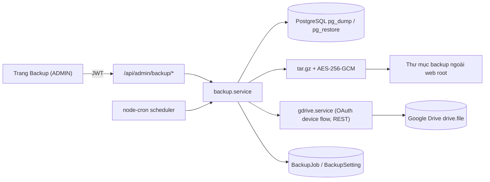

# Admin Backup & Restore + Google Drive

## Brainstorm Contract

### Outcome
- Trang **"Sao lưu & Phục hồi"** (chỉ ADMIN) trong UI:
  - "Sao lưu ngay" với 3 phạm vi: **Database**, **Website**, **Toàn bộ**.
  - Lịch tự động (mặc định DB hằng ngày 02:00 giữ 14 bản; Toàn bộ hằng tuần giữ 4 bản).
  - Danh sách bản sao lưu: tải về, xoá, tải lên từ máy, **phục hồi**.
  - Thẻ **Google Drive**: kết nối/ngắt kết nối/kiểm tra, công tắc "Lưu thêm 1 bản lên Drive" (áp dụng cho thủ công và theo lịch), phục hồi từ bản trên Drive.
- Mọi bản sao lưu được **mã hóa** (AES-256-GCM) trước khi lưu cục bộ và trước khi lên Drive.
- Phục hồi luôn tạo **bản sao lưu an toàn** trước, tự quay lại nếu lỗi.

### Constraints
- Quyền: mọi route `/api/admin/backup/*` qua `requireAdminMiddleware` (đã tồn tại, kiểm tra ở backend). Lưu ý: middleware hiện còn nhận `x-user-role` khi không có JWT (dành cho test) → phải đóng đường này cho route backup (chỉ chấp nhận JWT hợp lệ có role ADMIN).
- Production: Ubuntu 24.04 `192.168.18.33`, Node chạy bằng systemd dưới user `it`, PostgreSQL 16 native (không Docker) tại `127.0.0.1:5432` → `pg_dump`/`pg_restore` có sẵn qua gói `postgresql-client`/`postgresql-16`. Dev: Windows + Docker Postgres (chỉ kiểm thử).
- Không file upload lúc chạy: dữ liệu Excel được import dạng base64 vào DB (xác nhận trong `app.ts`) → "Website" không có thư mục upload.
- Thông tin Google (Client Secret, refresh token) và mật khẩu mã hóa: lưu mã hóa bằng khóa chủ trong biến môi trường `BACKUP_MASTER_KEY`, **không bao giờ** trả về frontend.
- Tải lên Drive lỗi không làm hỏng bản sao lưu cục bộ (đánh dấu lỗi, thử lại).
- Không phụ thuộc googleapis SDK: dùng `fetch` (Node ≥ 18) gọi REST OAuth/Drive.

### Non-goals
- Sao lưu hệ điều hành/Nginx toàn máy; PITR liên tục; nhiều đích cloud ngoài Drive; email cảnh báo (chỉ hiển thị trong ứng dụng).
- Tự khởi động lại dịch vụ sau khi phục hồi Website (cần sudo) — UI hiện hướng dẫn chạy `deploy.sh`/restart.

### Phạm vi các loại sao lưu
| Loại | Nội dung |
|---|---|
| Database | `pg_dump -Fc` của `cscc_db` (toàn bộ dữ liệu, gồm User, báo giá, revision, lịch) |
| Website | Mã nguồn dự án (loại `node_modules`, `dist`, `.git`, thư mục backup) + `apps/backend/.env` + `deploy.sh` nếu có. Bản sao cấu hình Nginx/systemd nếu đọc được (không bắt buộc) |
| Toàn bộ | Database + Website trong một file |

Mỗi file: `<loại>-<yyyymmdd-HHMMSS>.cscc-backup` (tar.gz mã hóa) chứa `manifest.json` (loại, thời gian, phiên bản app, checksum SHA-256, số bảng/bản ghi DB).

### Trade-offs
- **Dựng trong backend (chọn)** — phụ thuộc nhất vào việc `pg_dump` và quyền ghi thư mục có sẵn cho user `it`; hỏng khi tiến trình Node bị restart giữa lúc phục hồi (giảm nhẹ bằng bản sao lưu an toàn + cờ bảo trì ghi trên đĩa).
- **Xác thực Drive: OAuth Device Flow** — phụ thuộc vào việc admin tạo OAuth client loại "TVs and Limited Input devices" một lần; hỏng khi ứng dụng Google để ở chế độ "Testing" (refresh token hết hạn sau 7 ngày) → hướng dẫn chuyển "In production" (phạm vi `drive.file` không nhạy cảm nên không cần Google xác minh).
- Service Account bị loại: Gmail cá nhân không có quota cho service account.
- Redirect OAuth bị loại: server nội bộ không có URL redirect công khai hợp lệ.

### Better approaches
Không có cách nào vượt trội yêu cầu ban đầu; tuy nhiên: nên bổ sung bản copy ngoài máy (Drive đã đáp ứng) vì lưu cùng máy sẽ mất khi ổ cứng hỏng.

### Acceptance criteria
1. Mọi route backup trả 403 cho TECHNICAL/SALES/PROJECT_LEADER và cho request chỉ có header `x-user-role: ADMIN` không JWT.
2. Sao lưu Database rồi phục hồi vào DB thử cho số bản ghi mọi bảng khớp `manifest.json`.
3. Phục hồi lỗi (file hỏng/sai mật khẩu/checksum sai) không làm mất dữ liệu hiện tại.
4. Lịch tự chạy đúng giờ, chính sách lưu giữ xoá đúng bản cũ (cục bộ và Drive).
5. Bật Drive: sau mỗi lần sao lưu có đúng 1 file trên Drive, checksum khớp; ngắt kết nối xoá token; phục hồi từ Drive hoạt động.
6. File trên đĩa và trên Drive không đọc được nếu không có mật khẩu (kiểm tra bằng giải mã sai).
7. Không có secret nào xuất hiện trong response API, log hay frontend bundle.

## Khuyến nghị về Google Cloud (bạn không cần hiểu kỹ — làm một lần ~10 phút)
Vì đây là ứng dụng tự lưu trữ, Google yêu cầu chính bạn tạo "giấy phép kết nối" của riêng mình (miễn phí):
1. Vào Google Cloud Console bằng Gmail dùng để lưu bản sao, tạo project "CSCC Backup", bật **Google Drive API**.
2. Cấu hình màn hình đồng ý OAuth: loại **External**, thêm email của bạn làm test user, rồi bấm **Publish app** (chuyển "In production").
3. Tạo **OAuth client ID** loại **TVs and Limited Input devices**, sao chép **Client ID** và **Client Secret**.
4. Dán hai giá trị đó vào thẻ Google Drive trong UI, bấm **Kết nối**, mở đường link hiện ra và nhập mã.
Dự án sẽ cung cấp hướng dẫn từng bước này ngay trong UI (có ghi chú cảnh báo "ứng dụng chưa xác minh" là bình thường) và trong `docs/user-guide`. Tôi không thể tự tạo project này thay bạn vì cần đăng nhập Google của bạn.

## Kiến trúc

## Phases

| # | Phase | Effort | Status |
|---|---|---|---|
| 1 | [Khảo sát & nền tảng (schema, khóa, lưu trữ, bảo mật route)](./phase-01-foundation-schema-security.md) | 2h | Completed |
| 2 | [Sao lưu lõi + mã hóa + manifest](./phase-02-backup-engine.md) | 3h | Completed |
| 3 | [Phục hồi an toàn (DB/Website/Toàn bộ) + chế độ bảo trì](./phase-03-restore-engine.md) | 3h | Completed |
| 4 | [Google Drive (kết nối, upload, liệt kê, tải về, xoá)](./phase-04-google-drive.md) | 2.5h | Completed |
| 5 | [API admin + lịch tự động + lưu giữ](./phase-05-api-scheduler-retention.md) | 1.5h | Completed |
| 6 | [Giao diện admin](./phase-06-admin-ui.md) | 3h | Completed |
| 7 | [Kiểm thử, tài liệu, triển khai](./phase-07-tests-docs-deploy.md) | 2h | Completed |

## Rủi ro chính
- `pg_restore` khi đang có kết nối Prisma → dùng `--clean --if-exists --single-transaction`, bật cờ bảo trì chặn request, `prisma.$disconnect()` rồi kết nối lại.
- Mất `BACKUP_MASTER_KEY` hoặc mật khẩu → không giải mã được; UI yêu cầu admin xác nhận đã lưu mật khẩu offline và cho phép nhập lại mật khẩu khi phục hồi sang máy khác.
- Đĩa đầy: kiểm tra dung lượng trống trước khi sao lưu.
- Thêm phụ thuộc: `node-cron`, `tar` (hoặc dùng `tar` hệ thống); `pg_dump` phải có trên PATH hoặc cấu hình `PG_BIN_DIR`.

## Quyết định đã chốt (không còn câu hỏi mở)
1. **Mật khẩu mã hóa:** admin tự đặt trong UI, tự lưu giữ offline. Hệ thống lưu bản mã hóa bằng `BACKUP_MASTER_KEY` để sao lưu theo lịch chạy không cần người nhập; UI yêu cầu tick "Tôi đã lưu mật khẩu" và cảnh báo rõ rằng mất mật khẩu thì không thể phục hồi. Không có chức năng khôi phục mật khẩu.
2. **`deploy.sh` và thư mục sao lưu:** được phép. `deploy.sh` thêm bước kiểm tra `pg_dump` và tạo `/var/backups/cscc` (chủ `it`, mode 0700). Các bước cần sudo ghi rõ trong phase 7.
3. **Phạm vi "Website":** mã nguồn + `.env` (loại `node_modules`, `dist`, `.git`, thư mục backup).

## Bàn giao cho `/ak-cook` (cửa sổ chat khác)
- Chạy: `/ak-cook plans/261110-1200-admin-backup-restore-gdrive/plan.md` (thực hiện tuần tự phase 1 → 7; phase 3 và 4 độc lập nhau sau phase 2, có thể song song nếu muốn).
- Mỗi phase xong phải chạy typecheck và test liên quan trước khi sang phase kế tiếp; cập nhật cột Status trong bảng trên.
- Việc cần người thật: tạo Google Cloud OAuth client (hướng dẫn ở trên), đặt `BACKUP_MASTER_KEY` trên production, chạy bước sudo ở phase 7, kiểm thử Drive thật một lần. Không thử phục hồi trên DB production thật.
- Không thêm `googleapis`; không đưa secret vào log/response/bundle.
- **Triển khai trên server:** sau khi cook xong và push, giao agent khác thực hiện [server-runbook.md](./server-runbook.md) qua SSH (từng bước có điều kiện kiểm tra, quy tắc an toàn, rollback). Cook không tự triển khai lên server.
