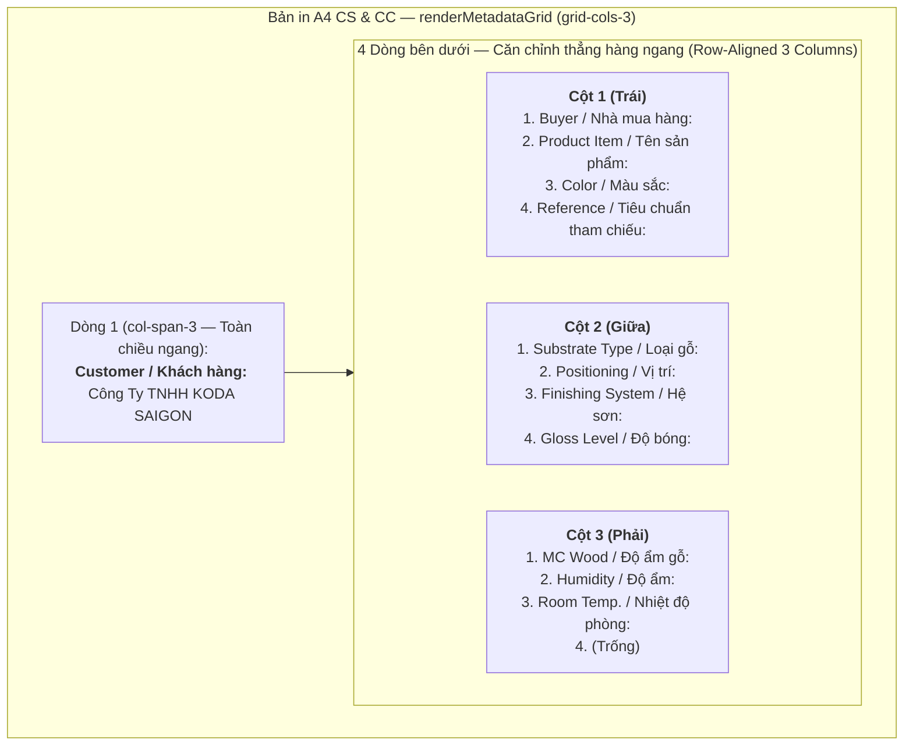

# Restructure Print Metadata Layout (CS & CC) & Add Optional `Buyer / Nhà mua hàng` Field

## Brainstorm Contract

### Outcome
1. **Thêm mới trường `Buyer / Nhà mua hàng` (`buyer`) vào Dự án / Phiên bản (`ProjectRevision`):**
   - Là ô nhập văn bản (`textbox`) **không bắt buộc phải nhập (optional)**, mặc định `""`.
   - Lưu trữ bền vững trong bảng `ProjectRevision` (PostgreSQL), tự động giữ nguyên khi nhân bản phiên bản (`Clone Rev`), tự động lưu qua Auto-Save ở tab CS, và hỗ trợ nhập ngay từ Modal **Tạo mới Hồ sơ** (`Create New Project`).
   - Đồng bộ hiển thị trên Header của **Coating Schedule (CS)**, **Coating Cost (CC)**, **Bản in A4 / Xuất PDF**, và **Xuất file Excel (`.xlsx`)**.
2. **Thay đổi bố cục phần Thông tin chung (`renderMetadataGrid`) trên Bản in A4 / PDF của cả Coating Schedule (CS) và Coating Cost (CC):**
   - **Dòng đầu tiên (Trải dài toàn chiều ngang từ mép trái tới mép phải — `col-span-3`):**
     - `Customer / Khách hàng:` `{revision.customer.customerName}`
   - **Xuống dòng — Lưới 3 cột căn chỉnh ngay hàng thẳng lối theo từng dòng ngang (`grid-cols-3`):**
     - **Cột 1 (Bên trái — 4 trường):**
       1. `Buyer / Nhà mua hàng:` `{revision.buyer}`
       2. `Product Item / Tên sản phẩm:` `{revision.productName}`
       3. `Color / Màu sắc:` `{revision.colorName}`
       4. `Reference / Tiêu chuẩn tham chiếu:` `{revision.referenceStandard}`
     - **Cột 2 (Ở giữa — 4 trường):**
       1. `Substrate Type / Loại gỗ:` `{revision.substrate}`
       2. `Positioning / Vị trí:` `{revision.positioning}`
       3. `Finishing System / Hệ sơn:` `{revision.finishingSystem}`
       4. `Gloss Level / Độ bóng:` `{revision.glossLevel}`
     - **Cột 3 (Bên phải — 3 trường):**
       1. `MC Wood / Độ ẩm gỗ:` `{revision.mcWood}`
       2. `Humidity / Độ ẩm:` `{revision.roomHumidity}`
       3. `Room Temp. / Nhiệt độ phòng:` `{revision.roomTemp}`
       4. *(Ô trống giữ nhịp lưới 4 hàng)*

### Constraints
- **Tương thích ngược CSDL PostgreSQL:** Tự động chạy `ALTER TABLE "ProjectRevision" ADD COLUMN IF NOT EXISTS "buyer" TEXT NOT NULL DEFAULT '';` khi khởi động `dataStore.init()` để toàn bộ hồ sơ hiện có hoạt động trơn tru không cần reset DB.
- **Không bắt buộc nhập (`Optional`):** Trường `Buyer / Nhà mua hàng` không chặn lưu/phê duyệt trong `validateRevisionBeforeSave` và không hiển thị viền cảnh báo vàng khi để trống.
- **Chuẩn trang in A4 (`210×297mm`):** Bố cục mới gọn gàng, giữ nguyên khả năng hiển thị trọn vẹn bảng tính 10 bước chuẩn (`NTR 001`) trong khung trang A4 mà không bị tràn trang.

### Non-goals
- Không thay đổi công thức tính toán Coating Cost (IEEE-754) hay BOM Summary.
- Không thay đổi cấu trúc bảng `Customer` trong Master Data.

### Trade-offs
- **Phương án chọn (`Row-aligned 3-Column CSS Grid`):** Đặt các trường của 3 cột theo từng hàng ngang chung trong cùng một `grid-cols-3` (sau dòng `Customer / Khách hàng` `col-span-3`). Phụ thuộc vào việc giữ thứ tự 4 hàng cố định; đổi lại đảm bảo dù nội dung một ô ở cột bất kỳ dài và tự ngắt xuống dòng, các trường ở hàng kế tiếp của cả 3 cột vẫn luôn bắt đầu trên cùng một đường gióng ngang (**ngay hàng thẳng lối tuyệt đối**).
- **Phương án loại bỏ (`3 cột flex-col độc lập`):** Bị lệch dòng giữa 3 cột ngay khi tên loại gỗ hoặc hệ sơn dài quá 1 dòng.

### Better approaches
- Tách `MC Wood / Độ ẩm gỗ:` và `Humidity / Độ ẩm:` ở cột phải thành 2 dòng riêng biệt (thay vì nối bằng dấu `|` như trước), giúp cột phải có đúng 3 dòng cân đối với 4 dòng của cột trái và cột giữa, không còn hiện tượng chữ `Độ ẩm: 80%` bị rớt nửa chừng xuống dòng dưới.

### Acceptance Criteria
1. Modal **Tạo mới Hồ sơ** và phần **Header tab Coating Schedule (CS)** có ô textbox `Buyer / Nhà mua hàng` (không bắt buộc nhập, tự động lưu qua Auto-Save, giữ nguyên khi `Clone Rev`).
2. Bản in A4 của **Coating Schedule (CS)** và **Coating Cost (CC)** hiển thị:
   - Dòng 1 trải dài từ mép trái tới mép phải: `Customer / Khách hàng: <Tên khách hàng>`.
   - 4 dòng bên dưới chia 3 cột ngay hàng thẳng lối theo đúng danh sách trường ở Cột trái (4 trường), Cột giữa (4 trường), Cột phải (3 trường).
3. Khi `Buyer / Nhà mua hàng` hoặc `Reference / Tiêu chuẩn tham chiếu` để trống, nhãn vẫn hiển thị ngay ngắn và giữ đúng hàng gióng ngang giữa 3 cột.
4. File Excel xuất ra (`.xlsx`) và màn hình xem Coating Cost (CC) cập nhật đồng bộ trường `Buyer / Nhà mua hàng`.

---

## Architecture & Print Grid Layout

---

## Phases Roadmap

| # | Phase | Effort | Status | Description |
|---|-------|--------|--------|-------------|
| 1 | [Shared Types & Prisma Database Schema](./phase-01-shared-types-and-database-schema.md) | 0.5h | Completed | Bổ sung trường `buyer` vào `@cscc/shared` (`ProjectRevision`, `ProjectRevisionSummary`) và `schema.prisma` (`ProjectRevision.buyer`). |
| 2 | [Backend Persistence, Clone & Excel Export](./phase-02-backend-persistence-clone-and-excel-export.md) | 1h | Completed | Cập nhật `data-store.ts` (auto-migration cột `buyer`, CRUD Project/Revision), `revision.service.ts` (`cloneRevision`), `excel-importer.service.ts` và `excel-exporter.service.ts`. |
| 3 | [Frontend Print Layout & Editor Forms](./phase-03-frontend-print-layout-and-editor-forms.md) | 1.25h | Completed | Cập nhật `PrintableSheetA4.tsx` (bố cục mới ngay hàng thẳng lối), `CoatingScheduleEditor.tsx`, `ProjectExplorerView.tsx`, `CoatingCostTable.tsx` và `App.tsx`. |
| 4 | [Automated Testing & End-to-End Verification](./phase-04-automated-testing-and-verification.md) | 0.75h | Completed | Viết test kiểm tra lưu/cập nhật/clone trường `buyer`, kiểm tra xuất Excel và build/typecheck toàn bộ monorepo. |

---

## Dependencies
- Shared: [types.ts](file:///c:/dev/cscc/packages/shared/src/types.ts)
- Backend: [schema.prisma](file:///c:/dev/cscc/apps/backend/prisma/schema.prisma), [data-store.ts](file:///c:/dev/cscc/apps/backend/src/store/data-store.ts), [revision.service.ts](file:///c:/dev/cscc/apps/backend/src/services/revision.service.ts), [excel-importer.service.ts](file:///c:/dev/cscc/apps/backend/src/services/excel-importer.service.ts), [excel-exporter.service.ts](file:///c:/dev/cscc/apps/backend/src/services/excel-exporter.service.ts)
- Frontend: [PrintableSheetA4.tsx](file:///c:/dev/cscc/apps/frontend/src/components/print/PrintableSheetA4.tsx), [CoatingScheduleEditor.tsx](file:///c:/dev/cscc/apps/frontend/src/components/schedule/CoatingScheduleEditor.tsx), [ProjectExplorerView.tsx](file:///c:/dev/cscc/apps/frontend/src/components/projects/ProjectExplorerView.tsx), [CoatingCostTable.tsx](file:///c:/dev/cscc/apps/frontend/src/components/cost/CoatingCostTable.tsx), [App.tsx](file:///c:/dev/cscc/apps/frontend/src/App.tsx)

## Bàn giao cho `/ak-cook`
- Chạy: `/ak-cook plans/261117-1501-print-metadata-layout-and-buyer-field/plan.md` để triển khai tuần tự từ Phase 1 $\rightarrow$ Phase 4.
