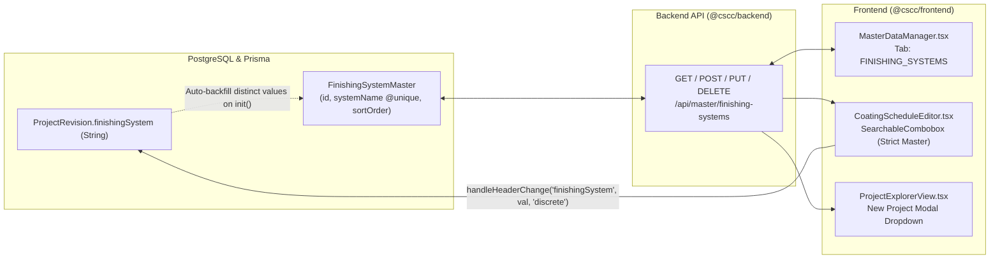

# Finishing System Master & Dropdown Selection on Coating Schedule (CS)

## Brainstorm Contract

### Outcome
1. **Database & Shared (`FinishingSystemMaster`):**
   - Model Prisma `FinishingSystemMaster` trong [schema.prisma](file:///c:/dev/cscc/apps/backend/prisma/schema.prisma) và interface `FinishingSystemMaster` trong [types.ts](file:///c:/dev/cscc/packages/shared/src/types.ts) gồm:
     - `id: string` (UUID / ID định danh)
     - `systemName: string` (`@unique`, viết hoa & trim chuẩn hóa, ví dụ: `"WATERBASE"`, `"NC-PU"`, `"PU"`, `"UV"`)
     - `sortOrder: number` (`@default(0)`)
   - Tự động khởi tạo bảng `FinishingSystemMaster` và quét/backfill toàn bộ các giá trị `finishingSystem` khác rỗng đang tồn tại trong các `ProjectRevision` hiện tại vào bảng `FinishingSystemMaster` khi khởi động `dataStore.init()`.
2. **Backend API (`/api/master/finishing-systems`):**
   - Bổ sung CRUD trong [data-store.ts](file:///c:/dev/cscc/apps/backend/src/store/data-store.ts) (`getFinishingSystems`, `upsertFinishingSystem`, `updateFinishingSystem`, `deleteFinishingSystem`) và các endpoints `GET / POST / PUT / DELETE /api/master/finishing-systems` trong [app.ts](file:///c:/dev/cscc/apps/backend/src/app.ts) tương tự `ApplicationStepMaster`.
3. **Quản lý Master Data ([MasterDataManager.tsx](file:///c:/dev/cscc/apps/frontend/src/components/master/MasterDataManager.tsx)):**
   - Thêm sub-tab **`FINISHING_SYSTEMS` (`Finishing Systems / Hệ sơn`)** cho phép Thêm mới, Sửa (`systemName`, `sortOrder`), Tìm kiếm và Xóa — đồng bộ với tab `Application Steps / Bước thi công`.
4. **Dropdown chọn Hệ sơn trên Coating Schedule ([CoatingScheduleEditor.tsx](file:///c:/dev/cscc/apps/frontend/src/components/schedule/CoatingScheduleEditor.tsx)) & Modal Tạo Hồ sơ ([ProjectExplorerView.tsx](file:///c:/dev/cscc/apps/frontend/src/components/projects/ProjectExplorerView.tsx)):**
   - Thay `<input type="text">` của trường `Finishing System / Hệ sơn` bằng `SearchableCombobox` liên kết trực tiếp với `finishingSystemsMaster`.
   - **Chặn nhập tự do** (không bật `onCreateNew`): chỉ cho phép chọn từ danh sách Master (hỗ trợ gõ để lọc tìm nhanh trong combobox).
   - Giữ `displayValue={revision.finishingSystem}` để các Revision lịch sử vẫn hiển thị an toàn nếu một Hệ sơn cũ bị xóa khỏi Master sau này.

### Constraints
- **Tương thích ngược CSDL PostgreSQL:** Tự động chạy `CREATE TABLE IF NOT EXISTS "FinishingSystemMaster"` và `ensureFinishingSystemsSeeded()` trong `dataStore.init()` để toàn bộ dữ liệu hiện có hoạt động trơn tru không cần reset DB.
- **Bảo toàn kiến trúc hiện hữu:** Giữ nguyên cột `ProjectRevision.finishingSystem` kiểu `String` để tương thích 100% với Coating Cost (CC), Bản in A4, Excel Import/Export, Backup/Restore và Reports & Analytics (Report 5B).
- **Bắt buộc chọn Hệ sơn:** Giữ nguyên kiểm tra `!rev.finishingSystem?.trim()` trong `validateRevisionBeforeSave` tại [App.tsx](file:///c:/dev/cscc/apps/frontend/src/App.tsx#L590-L592) và viền cảnh báo vàng (`highlightEmpty`) khi chưa chọn Hệ sơn.

### Non-goals
- Không bật tính năng thêm nhanh (`onCreateNew` / Quick-add) Hệ sơn trực tiếp trên màn hình CS.
- Không thêm các trường phụ (`code`, `description`, `isActive`) ngoài `systemName` và `sortOrder`.

### Trade-offs
- **Lưu snapshot tên Hệ sơn (`string`) thay vì khóa ngoại (`FK`) cứng:** Phụ thuộc vào giả định tên Hệ sơn chuẩn ít khi đổi tên hàng loạt; đổi lại tránh được rủi ro lỗi ràng buộc khóa ngoại khi import Excel hoặc khi xóa/sửa danh mục Master, đồng thời bảo toàn nguyên vẹn lịch sử các Revision đã `APPROVED`/`LOCKED`.

### Better approaches
- `none — recommended direction is the requested one (mirrors ApplicationStepMaster pattern in schema.prisma, data-store.ts, MasterDataManager.tsx, and CoatingScheduleEditor.tsx)`.

### Acceptance Criteria
1. Khi khởi động backend, bảng `FinishingSystemMaster` được tạo tự động và toàn bộ giá trị `finishingSystem` hiện có trong `ProjectRevision` được nạp vào Master theo thứ tự chuẩn hóa (`TRIM` + `UPPERCASE`).
2. Tab **Finishing Systems / Hệ sơn** trong **Master Data** cho phép Xem danh sách, Tìm kiếm, Thêm mới, Cập nhật (`systemName`, `sortOrder`) và Xóa.
3. Ô **Finishing System / Hệ sơn** trong Header của **Coating Schedule (CS)** và trong modal **Create New Project** hiển thị dropdown `SearchableCombobox` lấy từ Master, chặn nhập tự do ngoài danh sách, lưu qua Auto-Save (`discrete` mode) và hiển thị cảnh báo vàng nếu để trống.
4. Toàn bộ typecheck, build và test suite của `@cscc/shared`, `@cscc/backend`, `@cscc/frontend` đều PASS 100%.

---

## Architecture & Data Flow

---

## Phases Roadmap

| # | Phase | Effort | Status | Description |
|---|-------|--------|--------|-------------|
| 1 | [Shared Types & Prisma Database Schema](./phase-01-shared-types-and-database-schema.md) | 0.5h | Done | Định nghĩa `FinishingSystemMaster` trong `@cscc/shared` (`types.ts`) và `apps/backend/prisma/schema.prisma`. |
| 2 | [Backend Master Store, Auto-Seed & REST Endpoints](./phase-02-backend-master-api-and-auto-seed.md) | 1h | Done | Cập nhật `data-store.ts` (tạo bảng tự động, backfill từ `ProjectRevision` hiện có, CRUD methods) và thêm routes `/api/master/finishing-systems` trong `app.ts`. |
| 3 | [Frontend Master Data Tab & CS Dropdown Integration](./phase-03-frontend-master-tab-and-cs-dropdown.md) | 1h | Done | Cập nhật `client.ts`, `App.tsx`, thêm tab quản lý Hệ sơn trong `MasterDataManager.tsx` và chuyển ô Hệ sơn trong `CoatingScheduleEditor.tsx` + `ProjectExplorerView.tsx` sang `SearchableCombobox`. |
| 4 | [Automated Testing & End-to-End Verification](./phase-04-automated-testing-and-verification.md) | 0.5h | Done | Viết integration test kiểm tra auto-backfill dữ liệu cũ và CRUD `/api/master/finishing-systems`, chạy toàn bộ test & build monorepo. |

---

## Dependencies
- Shared: [types.ts](file:///c:/dev/cscc/packages/shared/src/types.ts)
- Backend: [schema.prisma](file:///c:/dev/cscc/apps/backend/prisma/schema.prisma), [data-store.ts](file:///c:/dev/cscc/apps/backend/src/store/data-store.ts), [app.ts](file:///c:/dev/cscc/apps/backend/src/app.ts)
- Frontend: [client.ts](file:///c:/dev/cscc/apps/frontend/src/api/client.ts), [App.tsx](file:///c:/dev/cscc/apps/frontend/src/App.tsx), [MasterDataManager.tsx](file:///c:/dev/cscc/apps/frontend/src/components/master/MasterDataManager.tsx), [CoatingScheduleEditor.tsx](file:///c:/dev/cscc/apps/frontend/src/components/schedule/CoatingScheduleEditor.tsx), [ProjectExplorerView.tsx](file:///c:/dev/cscc/apps/frontend/src/components/projects/ProjectExplorerView.tsx)

## Bàn giao cho `/ak-cook`
- Chạy: `/ak-cook plans/261118-1023-finishing-system-master/plan.md` để triển khai tuần tự từ Phase 1 $\rightarrow$ Phase 4.
